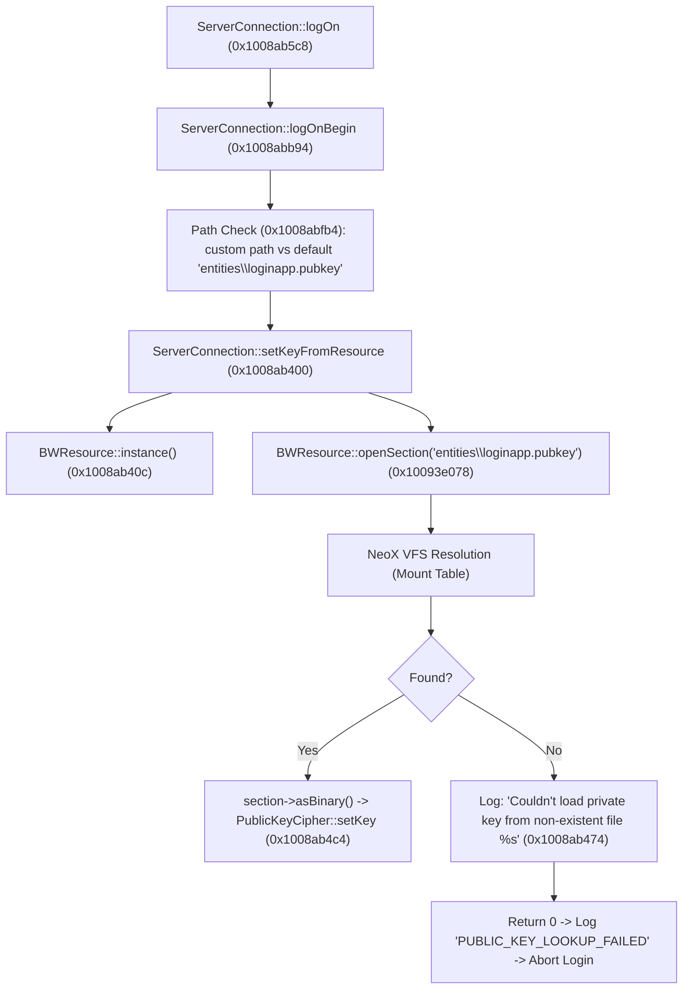

# Public-Key Resource Lookup and VFS Analysis
## Mechanics of `entities\loginapp.pubkey` Resolution in NeoX / BigWorld

---

### 1. Architectural Overview

In Phase 6.2B.9, static disassembly revealed that during client login, `ServerConnection::logOnBegin` invokes `ServerConnection::setKeyFromResource` with the resource identifier string `"entities\\loginapp.pubkey"`. If this lookup fails, the client logs:
`ServerConnection::logOnBegin PUBLIC_KEY_LOOKUP_FAILED` (VA `0x10309c3d1`)
and terminates the login sequence before transmitting any packets.

This document details the exact native mechanism through which `entities\loginapp.pubkey` is resolved by the game's Virtual File System (VFS) and evaluates whether this lookup can be redirected without modifying the original application package.

---

### 2. Disassembly Trace of Resource Ingestion

#### 2.1 Invocation Chain


#### 2.2 Native Code References
1. **Default Path Ingestion (`ServerConnection::logOnBegin` at VA `0x1008abfb4`):**
   ```arm64
   0x1008abfb4: cbz   x22, #0x1008abfc0 ; Check if caller provided custom pubkey path
   0x1008abfb8: ldrb  w8, [x22]
   0x1008abfbc: cbnz  w8, #0x1008abfc8  ; If non-empty, use custom path in x22
   0x1008abfc0: adrp  x22, #0x10309c000
   0x1008abfc4: add   x22, x22, #0x3b8  ; Default string: "entities\\loginapp.pubkey"
   0x1008abfc8: mov   x0, x22
   0x1008ac028: add   x1, sp, #0x40     ; Store path string
   0x1008ac02c: mov   x0, x21           ; ServerConnection this
   0x1008ac030: bl    #0x1008ab3ec      ; Call setKeyFromResource
   0x1008ac034: mov   x22, x0           ; Return value (boolean)
   0x1008ac040: tbz   w22, #0, #0x1008ac0e0 ; If false, branch to failure
   ```
2. **Resource Opening (`ServerConnection::setKeyFromResource` at VA `0x1008ab400`):**
   ```arm64
   0x1008ab40c: bl    #0x10093e95c      ; BWResource::instance()
   0x1008ab414: mov   x1, x20           ; Path: "entities\\loginapp.pubkey"
   0x1008ab418: bl    #0x10093e078      ; BWResource::openSection(path)
   0x1008ab41c: ldr   x0, [sp, #0x28]   ; Returned DataSectionPtr
   0x1008ab420: cbz   x0, #0x1008ab460  ; If NULL, branch to error logging
   0x1008ab424: ldr   x8, [x0]          ; vtable
   0x1008ab428: ldr   x9, [x8, #0xf8]   ; DataSection::asBinary() virtual method
   0x1008ab42c: add   x8, sp, #0x20
   0x1008ab430: blr   x9                ; Retrieve binary key data and length
   0x1008ab4bc: add   x0, x19, #0xf10   ; PublicKeyCipher instance
   0x1008ab4c0: add   x1, sp, #8        ; Key buffer
   0x1008ab4c4: bl    #0x100927a20      ; PublicKeyCipher::setKey(buffer, len)
   ```
3. **Failure Exit at VA `0x1008ac0e0`:**
   ```arm64
   0x1008ac0e0: adrp  x0, #0x10309c000
   0x1008ac0e4: add   x0, x0, #0x3d1    ; "ServerConnection::logOnBegin PUBLIC_KEY_LOOKUP_FAILED\n"
   0x1008ac0e8: bl    #0x101b634c0      ; Log error message
   ```

---

### 3. NeoX / BigWorld Virtual File System (VFS) Resolution

How does `BWResource::openSection` search for files?

#### 3.1 Mount Table and Search Hierarchy
Disassembly of the VFS initialization routine at VA `0x1007fec60`–`0x1007ff074` establishes that NeoX configures its virtual file systems from `neox.xml` under the key `filesystems`:
- `%APP_DIR%`: Application bundle directory (`/var/containers/Bundle/Application/<UUID>/client.app/`).
- `%DOC_DIR%`: User documents directory (`/var/mobile/Containers/Data/Application/<UUID>/Documents/`).
- `%WORK_DIR%`: Ephemeral working cache.

The VFS mounts two categories of filesystems:
1. **Discrete Filesystem (`discrete`):** Direct file lookups on physical storage.
   - Searches physical folders in `%DOC_DIR%/res/` and `%APP_DIR%/res/`.
2. **Archive Package Filesystem (`opener` / `.npk`):**
   - Ingests packages defined in `all_npk_list_file` and `res/npk_manifest.xml`.
   - Mounts archives: `script.npk`, `assets.npk`, `res/entities.npk`, `res/common.npk`, `res/textures.npk`, etc.

#### 3.2 Physical Search Sequence for `entities\loginapp.pubkey`
When `BWResource::openSection("entities\\loginapp.pubkey")` executes, the search sequence is:
1. Normalize path separators (`entities/loginapp.pubkey`).
2. Search discrete override folders:
   - `%DOC_DIR%/res/entities/loginapp.pubkey`
   - `%APP_DIR%/res/entities/loginapp.pubkey`
   - `%APP_DIR%/entities/loginapp.pubkey`
3. Search mounted NPK archive index headers:
   - Search `res/entities.npk`
   - Search `script.npk`
   - Search `assets.npk`
   - Search all other mounted `.npk` archives.

---

### 4. Ground Truth: Presence of `loginapp.pubkey` in the Provided IPA

A complete automated search was conducted across the extracted client directory and all 1,208 entries inside `RoS-Legacy-iOS.ipa`:
- `script.npk`: **NOT FOUND**.
- `res/entities.npk`: **NOT FOUND**.
- All other 18 `.npk` archives in `res/`: **NOT FOUND**.
- Loose files in `Payload/client.app/`: **NOT FOUND**.

#### Why is the file absent from the IPA?
In production NetEase mobile titles:
1. The base IPA distributed via the App Store is a minimal bootstrap package.
2. On first launch, the native patcher downloads game assets (including resource patches and public keys) into the local `%DOC_DIR%` (`Documents/res/`).
3. Alternatively, the NetEase UniSdk or script engine dynamically injects custom login parameters during the startup sequence.

**Consequence for Offline Research:**
Without either an asset patch containing `loginapp.pubkey` or a custom path passed from script, the untouched game client on a real device will immediately hit `PUBLIC_KEY_LOOKUP_FAILED` and abort.

---

### 5. Technical Feasibility of Redirecting Public-Key Lookup

Can `entities\loginapp.pubkey` be redirected to a private server key without modifying the executable or packaged resources?

| Redirection Technique | Operating Platform | Feasibility | Technical Reason / Limitation |
| :--- | :--- | :---: | :--- |
| **Windows Launcher VFS Redirection** | Windows PC | **IMPOSSIBLE** | A Windows program runs on a PC and has zero kernel or filesystem visibility into an iOS device running an isolated app sandbox. |
| **iOS Documents Folder Injection (`%DOC_DIR%`)** | Non-jailbroken iOS device | **IMPOSSIBLE** | `UIFileSharingEnabled` is `False` in `Info.plist`. iOS sandboxing forbids external tools from writing files into the app container over USB. |
| **NPK Archive Modification** | Packaged IPA | **FEASIBLE, but requires re-signing** | Adding `entities/loginapp.pubkey` into `res/entities.npk` allows clean VFS resolution, but modifies the IPA and invalidates Apple code signature. |
| **Loose File Bundle Placement** | Packaged IPA | **FEASIBLE, but requires re-signing** | Placing `entities/loginapp.pubkey` inside `Payload/client.app/` resolves via discrete filesystem, but modifies the IPA and invalidates signature. |
| **Jailbreak Dynamic Hook (Frida/Substrate)** | Jailbroken iOS device | **FEASIBLE without IPA modification** | A tweak can hook `BWResource::openSection` in RAM at runtime and return the private server's public key without touching the IPA on disk. |

---

### 6. Summary

1. The client resolves `entities\loginapp.pubkey` via `BWResource::openSection` through the NeoX VFS.
2. The file is **completely absent** from the provided `RoS-Legacy-iOS.ipa`.
3. An untouched IPA executing on a stock, non-jailbroken iOS device has no valid public key, cannot decrypt server communications, and will abort with `PUBLIC_KEY_LOOKUP_FAILED`.
4. It is **technically impossible** for an external Windows launcher to redirect this lookup on a stock iOS device.
5. Providing the private server's public key strictly requires either **packaging the key into the app bundle (requiring re-signing)** or **runtime in-memory hooking on a jailbroken iOS device**.
