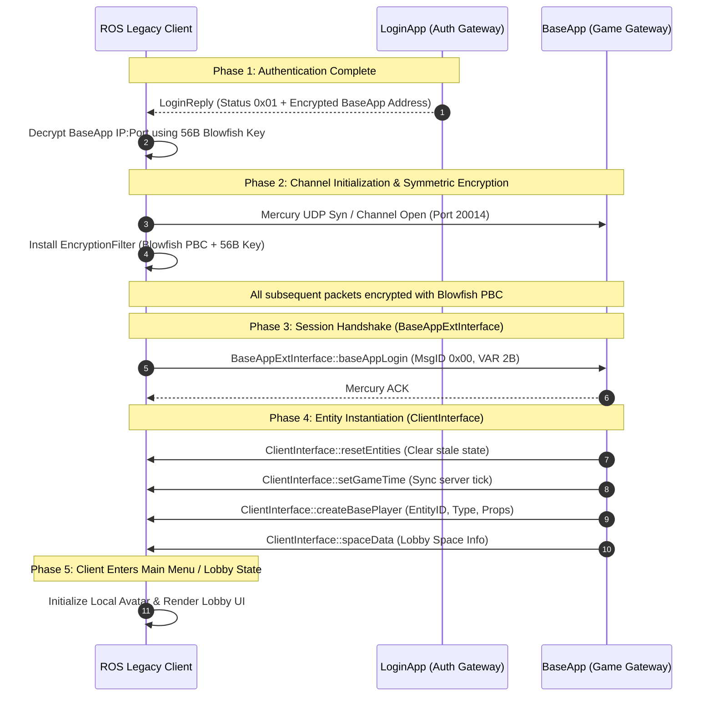

# BaseApp Transition and Interface Requirements
## Post-Login Handshake, Channel Migration, and Entity Instantiation

---

### 1. Executive Summary

Once the original Rules of Survival Legacy client successfully receives and decrypts a `LoginReply` from `LoginApp`, it transitions immediately from the authentication phase to the game session phase.

This document analyzes the post-login protocol boundary:
1. The client establishes a new Mercury channel to the `BaseApp` IP and port provided in `LoginReply`.
2. The client activates full-datagram **Blowfish PBC encryption** using the 56-byte session key.
3. The client transmits `BaseAppExtInterface::baseAppLogin` (Message ID `0x00`) or `authenticate` (Message ID `0x01`).
4. To transition the client into an active, responsive lobby state, the server must implement a minimal set of `ClientInterface` callbacks, prominently `createBasePlayer`.

> [!IMPORTANT]
> This phase is technical research only. We do not implement BaseApp or claim that the client can enter an active combat match. This document defines the protocol requirements necessary to reach the main menu / lobby state.

---

### 2. Post-Login Transition Sequence

---

### 3. `BaseAppExtInterface` Wire Specification

Native static analysis of the interface table registered at VA `0x1008cdeac` reveals the complete set of external messages accepted by `BaseApp`:

| Message ID | Method Name | Length Style | Declared Length | Purpose / Payload |
| :---: | :--- | :---: | :---: | :--- |
| **`0x00`** | `baseAppLogin` | `VAR(2B)` | Variable (2B prefix) | Initial session handshake carrying player credentials/session ticket. |
| **`0x01`** | `authenticate` | `FIXED` | 4 Bytes | Re-authentication / session resumption ticket. |
| **`0x02`** | `avatarUpdateImplicit` | `FIXED` | 24 Bytes | Player movement / orientation update (implicit coordinates). |
| **`0x03`** | `avatarUpdateExplicit` | `FIXED` | 32 Bytes | Full 3D coordinate and rotation update vector. |
| **`0x04`** | `avatarUpdateWardImplicit` | `FIXED` | 24 Bytes | Spectator / ward position update. |
| **`0x05`** | `avatarUpdateWardExplicit` | `FIXED` | 32 Bytes | Full spectator position update. |
| **`0x06`** | `switchInterface` | `FIXED` | 0 Bytes | Transport state transition notification. |
| **`0x07`** | `requestEntityUpdate` | `VAR(2B)` | Variable | Client requests delta synchronization for specific entity ID. |
| **`0x08`** | `enableEntities` | `FIXED` | 8 Bytes | Instructs server to start streaming Area of Interest (AoI) entities. |
| **`0x09`** | `setSpaceViewportAck` | `FIXED` | 8 Bytes | Viewport acknowledgement. |
| **`0x0a`** | `setVehicleAck` | `FIXED` | 8 Bytes | Vehicle mounting acknowledgement. |
| **`0x0b`** | `restoreClientAck` | `FIXED` | 4 Bytes | Reconnection restoration acknowledgement. |
| **`0x0c`** | `identifyVersionPoint` | `VAR(2B)` | Variable | Asset / resource patch point check. |
| **`0x0d`** | `summariseVersionPoint` | `VAR(2B)` | Variable | Asset version summary. |
| **`0x0e`** | `commenceResourceDownload` | `VAR(2B)` | Variable | Client requests dynamic resource download. |
| **`0x0f`** | `disconnectClient` | `FIXED` | 1 Byte | Graceful disconnect notification. |
| **`0x10`** | `resourceVersionTag` | `FIXED` | 1 Byte | Resource tag sync. |
| **`0x11`** | `entityMessage` | `VAR(2B)` | Variable | Generic RPC call routed to player entity script. |

---

### 4. `ClientInterface` Callbacks Required for Lobby Entry

To bring the original client into a visual, playable lobby without freezing, crashing, or disconnecting, the server must emit specific `ClientInterface` callbacks:

#### 4.1 Step 1: `resetEntities`
- **Method:** `ClientInterface::resetEntities`
- **Purpose:** Informs the client to wipe any previously cached entity state and prepare for a fresh world/lobby context.

#### 4.2 Step 2: `setGameTime`
- **Method:** `ClientInterface::setGameTime`
- **Payload:** 4 bytes `uint32_t` representing current server game tick.
- **Purpose:** Synchronizes the client's internal simulation clock with the server.

#### 4.3 Step 3: `createBasePlayer` (Critical Boundary)
- **Method:** `ClientInterface::createBasePlayer`
- **Purpose:** Spawns the player's primary entity representation in the game engine.
- **Payload Structure:**
  - `EntityID`: 4 bytes `int32_t` (unique entity identifier).
  - `EntityTypeID`: 2 bytes `uint16_t` (maps to entity definition in `entities.npk` / `entities.xml`, e.g., `Avatar`).
  - `SpaceID`: 4 bytes `int32_t` (the virtual space, typically space ID 1 for lobby).
  - `Properties`: Binary serialized BigWorld dictionary matching the entity definition:
    - Account ID / Player Name
    - Diamond count & Gold balance
    - Equipped character skin, weapon skins, and clothes
    - Level, rank, and matchmaking rating (MMR)

#### 4.4 Step 4: `spaceData`
- **Method:** `ClientInterface::spaceData`
- **Purpose:** Transmits global space parameters (lighting, weather, skybox properties) for the lobby environment.

---

### 5. Minimum Implementation Roadmap for BaseApp

To progress beyond Phase 6.2B.11 and achieve an interactive lobby, the following backend components must be planned:

1. **Mercury Blowfish Transport Listener:**
   - Extend `phase6B_8_local_gateway` to support a second UDP port (`20014`) dedicated to BaseApp.
   - Initialize channel state with the 56-byte session key negotiated during the LoginApp handshake.
2. **`BaseAppLogin` Handler:**
   - Ingest Message ID `0x00`, validate the session ticket, and bind the channel to the user's database ID.
3. **Entity Serialization Engine:**
   - Create a Python serializer that packages player inventory, diamonds, and profile data from `ros-private-server` into the exact binary dictionary expected by `createBasePlayer`.
4. **Lobby Heartbeat Loop:**
   - Transmit periodic `setGameTime` and keepalive ACKs to maintain the reliable Mercury channel.
