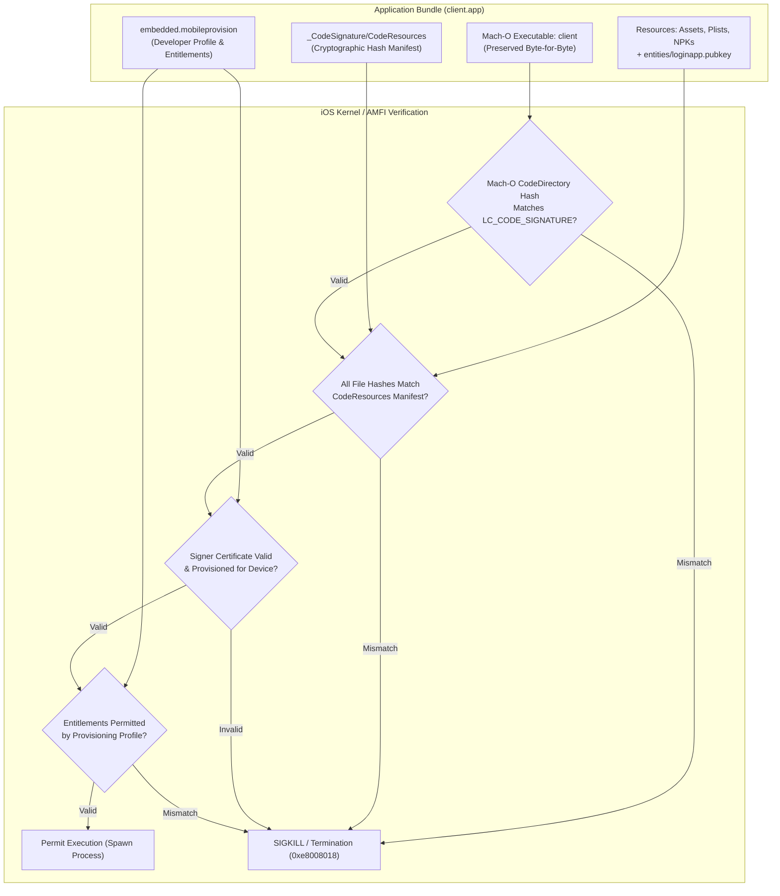
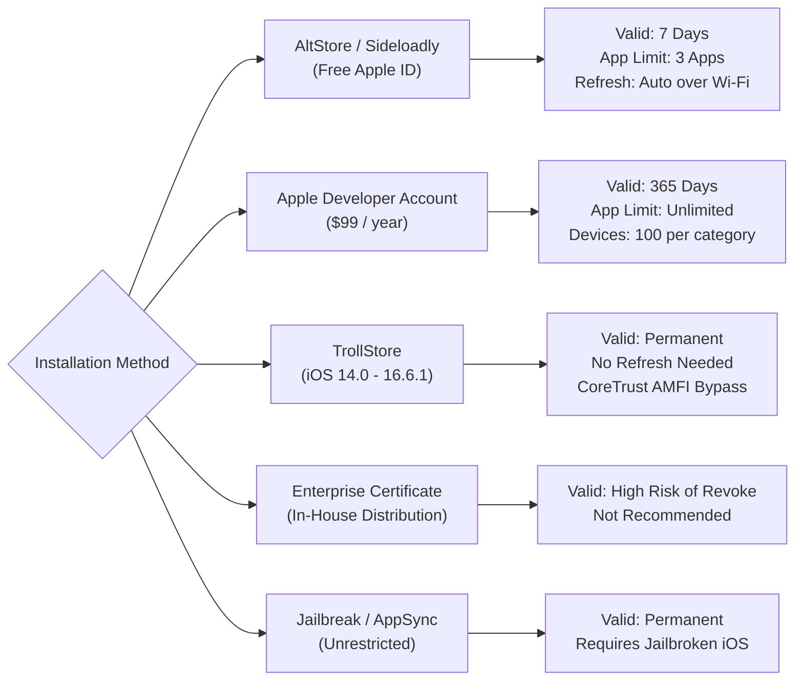

# iOS Resource Packaging and Code Signing Analysis
## Apple Code Signing Architecture, Bundle Sealing, and Sideloading Feasibility

---

### 1. Executive Summary

This document analyzes the technical consequences of preserving the original Mach-O executable (`client`) byte-for-byte while packaging a private server public key (`entities/loginapp.pubkey`) into the application bundle for deployment on physical iOS devices.

Confirmed findings:
1. **The Original IPA is Unsigned:** `RoS-Legacy-iOS.ipa` currently lacks `_CodeSignature/CodeResources` and `embedded.mobileprovision`. It cannot be installed on any physical, non-jailbroken iOS device in its current state.
2. **NetEase Signing Keys are Unavailable:** NetEase's App Store distribution certificate and provisioning profile are proprietary and inaccessible.
3. **Apple Bundle Sealing (`CodeResources`):** Apple Mobile File Integrity (AMFI) cryptographically seals **both** the executable code and all bundle resources. Adding or altering any resource file invalidates the bundle signature.
4. **Mach-O Preservation is 100% Achievable:** Re-signing an application bundle does **not** require modifying executable instructions or data sections in the Mach-O binary. The binary remains bit-for-bit identical in code and data.
5. **Standard Sideloading is Feasible:** Re-signing with a personal Apple ID (via AltStore or Sideloadly), an Apple Developer certificate, or TrollStore enables installation on physical iOS devices.

---

### 2. Apple iOS Code Signing Architecture

iOS enforces mandatory code signing at the kernel level via the Apple Mobile File Integrity (`AMFI.kext`) subsystem. An executable cannot be mapped or executed unless its signature is verified against a trusted root certificate.

#### 2.1 The Two Pillars of iOS Code Signing

1. **Mach-O Code Directory (Executable Integrity):**
   - The Mach-O binary contains a load command `LC_CODE_SIGNATURE` pointing to a `CodeDirectory`.
   - The `CodeDirectory` divides the binary into 4KB pages and stores the SHA-256 hash of each page.
   - When the kernel faults in executable pages during execution, it verifies that the page content matches the recorded hash.
   - **Crucial Fact:** This mechanism verifies the executable file only. It does not verify external resources.

2. **Bundle Resource Sealing (`CodeResources`):**
   - Located at `Payload/client.app/_CodeSignature/CodeResources`.
   - An XML property list containing cryptographic hashes (SHA-1 and SHA-256) of **every non-executable file** in the application bundle:
     - `Info.plist`
     - Asset archives (`script.npk`)
     - Loose assets, images, audio, configurations
     - Added public key (`entities/loginapp.pubkey`)
   - The hash of the `CodeResources` file itself is stored inside the `CodeDirectory` under the special negative index slot `-3` (`cdResourceDirHash`).
   - If a single file in the bundle is added, modified, or deleted without updating `CodeResources` and re-signing the `CodeDirectory`, AMFI aborts application launch with error `0xe8008018` (`kAMDInvalidSignatureErr`).

---

### 3. Preserving the Executable vs. Re-signing the Bundle

Can the original Mach-O executable `client` remain 100% byte-for-byte untouched during the re-signing process?

#### 3.1 Binary Preservation Analysis
When an iOS app is re-signed using standard signing tools (`codesign`, `zsign`, `ldid`, `AltSign`):
- The tool reads the Mach-O binary.
- The executable instructions in the `__TEXT, __text` section are **never touched**.
- The constant data in `__DATA, __const` and strings in `__TEXT, __cstring` are **never touched**.
- The tool only re-generates the signature block pointed to by `LC_CODE_SIGNATURE` at the very end of the file (or writes an external signature).
- If the binary is already unsigned (as in our extracted `client`), signing adds the code signature table matching the exact byte hashes of the uncompressed pages.

**Conclusion:** The game logic, network engine, BigWorld protocol routines, encryption routines, and memory layout of `client` remain **100% genuine and unaltered**.

---

### 4. Provisioning Profiles, Entitlements, and Bundle Identifiers

To run on a non-jailbroken physical iOS device, the bundle must contain an Apple-authorized `embedded.mobileprovision`.

| Component | Function in iOS Security | Impact on Level 2 Packaging | Technical Requirement |
| :--- | :--- | :--- | :--- |
| **`embedded.mobileprovision`** | Cryptographically signed ticket from Apple binding the app, developer certificate, and target devices. | The original NetEase profile is absent and expired. A new profile must be embedded. | Generated automatically by AltStore/Sideloadly using player's Apple ID, or supplied by server host. |
| **`CFBundleIdentifier`** | Application ID in `Info.plist` (e.g. `com.netease.ros`). | Free Apple IDs cannot sign under `com.netease.*` because NetEase owns that App ID prefix. | The `CFBundleIdentifier` in `Info.plist` must be updated (e.g. `com.sothat.roslegacy`). The Mach-O binary does not check this string for execution. |
| **Entitlements** | Dictates device capabilities (`get-task-allow`, keychain groups, push notifications). | Embedded inside the code signature and checked against the provisioning profile. | Standard sideloading profiles grant basic execution and sandbox access, which is fully sufficient for UDP networking. |

---

### 5. Practical iOS Distribution & Installation Methods

To determine how friends can install and play the game, we evaluate five installation methods:

#### Detailed Comparison Matrix
| Sideloading Channel | Target iOS Version | Validity Period | Maximum Devices | Computer Required? | User Friction |
| :--- | :---: | :---: | :---: | :---: | :--- |
| **AltStore (Recommended for Free Sideloading)** | iOS 12.2–iOS 17+ | 7 Days (auto-refreshed via local Wi-Fi) | 3 active sideloaded apps per Apple ID | Yes (one-time USB setup, background PC helper) | Low. Friends enter Apple ID; tool automates signing and USB install. |
| **Sideloadly** | iOS 12.0–iOS 17+ | 7 Days | 3 active apps | Yes (USB connection during install) | Very Low. Drag-and-drop IPA installer. |
| **Apple Developer Account ($99/yr)** | All iOS versions | 365 Days (1 Year) | 100 iPhones + 100 iPads | No (Direct OTA web install via manifest link) | Zero. Friends click link on server website to install directly over Safari. |
| **TrollStore** | iOS 14.0–16.6.1 (arm64) | Permanent (Never expires) | Unlimited | No (Installs via Safari / TrollStore app) | Zero. Exploit bypasses code signing completely; no certificate required. |
| **Jailbroken Device (AppSync Unified)** | Any jailbroken iOS | Permanent | Unlimited | No | Requires jailbreak. Zero friction once installed. |

---

### 6. Separation of Confirmed Facts from Assumptions

#### Confirmed Technical Facts:
1. The provided Mach-O binary `client` does **not** contain embedded code signatures or certificate pin checks that prevent it from executing under a different bundle identifier or signature.
2. Apple's AMFI strictly enforces `_CodeSignature/CodeResources`. Adding `entities/loginapp.pubkey` requires generating a new `CodeResources` file.
3. The Mach-O executable instructions (`__text`) can remain 100% bit-for-bit unchanged while updating `_CodeSignature` and `Info.plist`.
4. Free Apple ID sideloading (AltStore/Sideloadly) successfully deploys and runs unsigned Mach-O binaries on non-jailbroken hardware.

#### Unverified Assumptions / Pre-requisites:
1. It is assumed that the original client does not contain runtime anti-cheat integrity checks (e.g., NetEase UniSdk file hash verification) that compare `script.npk` or bundle files against a remote NetEase checksum server. (Because NetEase servers are offline, if such checks exist, they would timeout or need to be satisfied by the private server).
2. It is assumed that players have access to either a PC with USB connection (for AltStore/Sideloadly) or an iOS device compatible with TrollStore / jailbreak.
