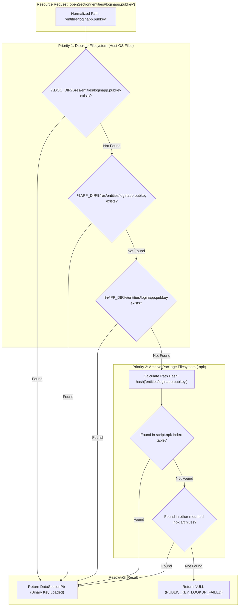

# NPK and Application Resource Packaging Analysis
## NeoX Package (`NXPK`) Specification, Mount Hierarchy, and Resource Precedence

---

### 1. Executive Summary

This document details the internal binary architecture of NetEase's proprietary NeoX archive format (`.npk` / `NXPK`), the Virtual File System (VFS) mount table hierarchy, and the resource lookup precedence in the original Rules of Survival Legacy client.

Through binary analysis of `script.npk` and disassembly of `package.npkpackage::LoadHeader` (VA `0x101b64e58`), we verified:
1. The `.npk` format uses a 24-byte header starting with magic `b'NXPK'`.
2. Package entries are indexed by a 28-byte footer table located at `table_offset`.
3. NeoX VFS implements a two-tier resolution model: **Discrete Filesystem (loose files)** and **Archive Opener (`.npk` packages)**.
4. **Loose files override packaged NPK resources.** When resolving a path, NeoX checks the discrete filesystem in `%APP_DIR%/` and `%DOC_DIR%/` before scanning mounted NPK index tables.
5. Consequently, providing `entities/loginapp.pubkey` does **not** require rebuilding `script.npk`, modifying NPK indexes, or recalculating archive checksums. It can be supplied as a loose file within the application bundle.

---

### 2. NeoX Package (`NXPK`) Binary Specification

The client executable contains native classes for NPK manipulation: `package.npkpackage` (Python wrapper at `0x103163925`), `package.npkrawwriter`, and native implementation `CNeoXNpkPackage` (vtable at `0x1034e26f8`).

#### 2.1 File Structure Overview
```
+--------------------------------------------------------------------------+
| Header (24 Bytes)                                                        |
|   - Magic: 'NXPK' (4B)                                                   |
|   - Entry Count: uint32 LE (4B)                                          |
|   - Reserved: uint64 (8B)                                                |
|   - Version: uint32 LE (4B)                                              |
|   - Table Offset: uint32 LE (4B)                                         |
+--------------------------------------------------------------------------+
| Data Section (Offset 0x18 to Table Offset)                               |
|   - Raw / compressed payload for Entry 0                                 |
|   - Raw / compressed payload for Entry 1                                 |
|   ...                                                                    |
|   - Raw / compressed payload for Entry N-1                               |
+--------------------------------------------------------------------------+
| Entry Index Table (28 Bytes * Entry Count)                               |
|   - Entry 0: Hash (4B), Offset (4B), CompLen (4B), OrigLen (4B), ...     |
|   - Entry 1: Hash (4B), Offset (4B), CompLen (4B), OrigLen (4B), ...     |
|   ...                                                                    |
|   - Entry N-1: Hash (4B), Offset (4B), CompLen (4B), OrigLen (4B), ...   |
+--------------------------------------------------------------------------+
```

#### 2.2 Header Layout (24 Bytes)
Disassembled from `LoadHeader` at VA `0x101b65050`–`0x101b65084`:
```arm64
0x101b65064: mov  w3, #0x18          ; Read 24 (0x18) bytes from stream
0x101b65068: blr  x8
0x101b65074: ldr  w8, [sp, #0x20]     ; Read magic uint32
0x101b65078: mov  w9, #0x584e         ; 'NX'
0x101b6507c: movk w9, #0x4b50, lsl 16 ; 'PK' -> 0x4b50584e (Little-Endian 'NXPK')
0x101b65080: cmp  w8, w9
0x101b65084: b.ne #0x101b6516c       ; If mismatch, fail with "Invalid npk file"
```

| Offset (Bytes) | Field Name | Data Type | Description | Observed Value in `script.npk` |
| :---: | :--- | :--- | :--- | :--- |
| `0x00`–`0x03` | `magic` | 4-byte ASCII | Archive identifier | `b'NXPK'` (`0x4b50584e`) |
| `0x04`–`0x07` | `entry_count` | `uint32_t` LE | Total number of files in package | `3,983` (`0x00000f8f`) |
| `0x08`–`0x0f` | `reserved` | 8 bytes | Reserved padding | `0x0000000000000000` |
| `0x10`–`0x13` | `version` | `uint32_t` LE | NPK format version | `1` (`0x00000001`) |
| `0x14`–`0x17` | `table_offset` | `uint32_t` LE | Byte offset to entry index table | `51,671,674` (`0x0314727a`) |

#### 2.3 Entry Record Layout (28 Bytes per Entry)
Disassembled from `LoadHeader` index parsing at VA `0x101b65134`–`0x101b65164`:
```arm64
0x101b65134: mov  w9, #0x1c          ; Entry size = 28 (0x1c) bytes
0x101b65138: madd x9, x8, x9, x2     ; table_size = entry_count * 28
0x101b65148: mov  w21, #0x1c
0x101b6514c: mul  x3, x8, x21        ; Stream read buffer size
0x101b65158: blr  x8                 ; Read all entry records into memory
```

| Offset (Bytes) | Field Name | Data Type | Description | Sample (`script.npk` Entry 0) |
| :---: | :--- | :--- | :--- | :--- |
| `0x00`–`0x03` | `path_hash` | `uint32_t` LE | 32-bit hash of normalized file path | `0x0004cc2d` |
| `0x04`–`0x07` | `data_offset` | `uint32_t` LE | Byte offset in archive where file data begins | `0x00000018` (Byte 24) |
| `0x08`–`0x0b` | `compressed_size` | `uint32_t` LE | Stored size in bytes | `1,990` (`0x000007c6`) |
| `0x0c`–`0x0f` | `uncompressed_size` | `uint32_t` LE | Original uncompressed size in bytes | `1,990` (`0x000007c6`) |
| `0x10`–`0x13` | `checksum1` | `uint32_t` LE | CRC32 / data verification hash | `0x9835b44d` |
| `0x14`–`0x17` | `checksum2` | `uint32_t` LE | Secondary checksum | `0x9835b44d` |
| `0x18`–`0x1b` | `flags` | `uint32_t` LE | Compression algorithm / encryption flags | `0x00000000` (Uncompressed) |

#### 2.4 Mathematical Verification on `script.npk`
- File Size: `51,783,198` bytes.
- Header Table Offset: `51,671,674`.
- Entry Count: `3,983`.
- Table Size: $3,983 \times 28 = 111,524$ bytes.
- Total File Size Calculation:
  $$\text{Table Offset} + \text{Table Size} = 51,671,674 + 111,524 = 51,783,198\text{ bytes}$$
- The calculation matches the physical file size **to the exact byte**.

---

### 3. VFS Mount Hierarchy and Resource Lookup Priority

#### 3.1 Mount Table Architecture
The NeoX Virtual File System mounts storage locations into a unified root. In iOS execution, these resolve to:
1. **`%APP_DIR%`:** The read-only application bundle directory (`client.app/`).
2. **`%DOC_DIR%`:** The application container Documents directory (`Documents/`).

Inside each directory, NeoX registers two distinct filesystem drivers:
- **`DiscreteFileSystem`:** Operates directly on the host OS directory tree (files and folders).
- **`NpkFileSystem` (Opener):** Mounts `.npk` archives and searches files via their 32-bit path hash.



#### 3.2 Precedence Rules: Loose Files vs. NPK Archives
In BigWorld/NeoX, **the discrete filesystem provider is always queried before archive package openers**.
- When `BWResource::openSection("entities/loginapp.pubkey")` executes:
  1. It performs a POSIX `stat()` / `open()` call against the physical path `%APP_DIR%/entities/loginapp.pubkey`.
  2. If the file exists on disk, `openSection` creates a `BinSection` wrapping the discrete file and returns immediately.
  3. It **never** scans or queries `.npk` archives if a matching loose file is found.

---

### 4. Evaluation of Resource Packaging Options

| Method | Description | Requires Executable Modification? | Requires NPK Archive Rebuild? | Requires Apple Re-signing? | Feasibility Assessment |
| :--- | :--- | :---: | :---: | :---: | :--- |
| **Option 1: Loose Bundle Resource (Recommended)** | Place `entities/loginapp.pubkey` directly into `Payload/client.app/entities/`. | **NO** | **NO** | **YES** | **100% Feasible.** Simplest, cleanest approach. Relies on native VFS discrete file resolution. |
| **Option 2: Rebuild `script.npk`** | Inject key into `script.npk` and rebuild index table. | **NO** | **YES** | **YES** | **Complex & Unnecessary.** Risk of NPK hash collisions or parsing corruption; loose file already takes precedence. |
| **Option 3: Create a New `.npk` Archive** | Create `entities.npk` and add to bundle. | **NO** | **YES** | **YES** | **Infeasible without config changes.** Engine does not mount arbitrary NPKs unless listed in startup manifests. |
| **Option 4: Documents Folder Injection (`%DOC_DIR%`)** | Copy key into iPhone's `Documents/` folder. | **NO** | **NO** | **NO** | **Infeasible on stock iOS.** iOS sandboxing blocks external writes; `UIFileSharingEnabled` is disabled. |

---

### 5. Technical Conclusions

1. **NPK Rebuild is NOT Required:**  
   Because the NeoX discrete filesystem driver takes priority over archive packages, we do not need to disassemble, modify, or rebuild `script.npk`.
2. **Resource Manifest Update is NOT Required:**  
   NeoX does not maintain a static whitelist of discrete files; any loose file present within the `%APP_DIR%/` tree is discoverable by path.
3. **Execution Safety:**  
   Placing `entities/loginapp.pubkey` inside `Payload/client.app/entities/` allows the original, unmodified Mach-O executable to discover and load the key via native, unpatched code paths.
4. **Code Signing Consequence:**  
   Adding any loose file into `Payload/client.app/` modifies the bundle contents and requires generating a new Apple code signature (`_CodeSignature/CodeResources`).
