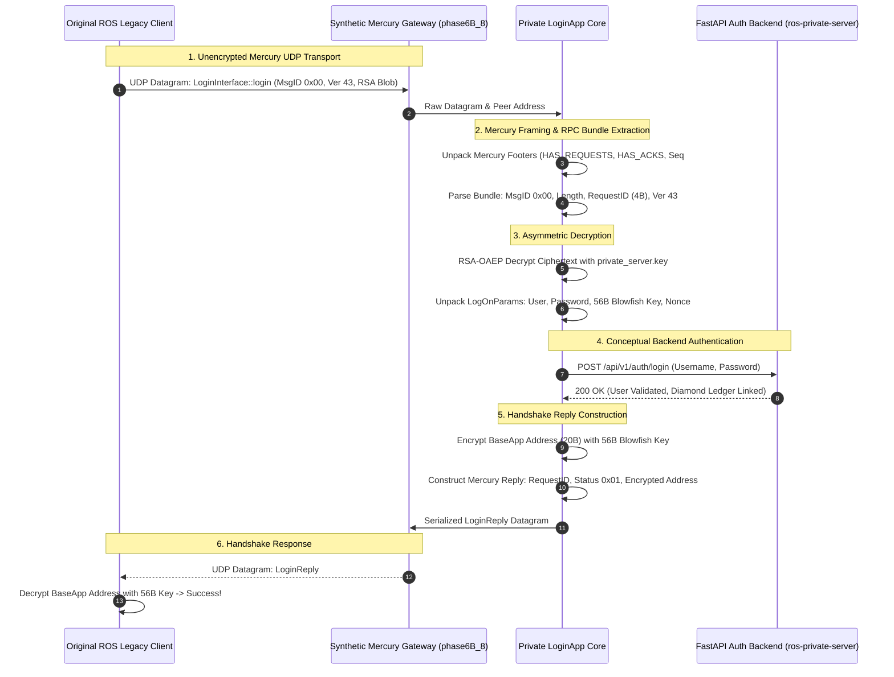

# Private LoginApp Protocol Implementation Design
## Mercury Transport, BigWorld Bundle RPC, and Cryptographic Handshake Architecture

---

### 1. Architectural Overview

The proposed ROS Sothat private `LoginApp` serves as the entry authentication gateway for the Rules of Survival Legacy client.

Its responsibility is to:
1. Ingest unencrypted Mercury UDP datagrams on port `20013` (or configured port).
2. Demux native Mercury transport framing and footer metadata.
3. Unpack the BigWorld application bundle to locate the `LoginInterface::login` request (Message ID `0x00`).
4. Decrypt the RSA-OAEP envelope using the private server's RSA key.
5. Extract player credentials, nonce, and the client-generated 56-byte Blowfish session key.
6. Verify credentials against the FastAPI authentication database.
7. Construct and transmit a Mercury `LoginReply` containing a success status and the Blowfish-encrypted BaseApp address.



---

### 2. End-to-End Ingestion & Processing Pipeline

#### Step 1: UDP Datagram Reception
- **Transport Protocol:** UDP IPv4.
- **Port:** Default client port is `20013` (`0x4e2d`, as verified at VA `0x1008abf8c` in `ServerConnection::logOnBegin`).
- **Encryption State:** Unencrypted (plaintext datagram).

#### Step 2: Mercury Framing and Footer Parsing
- **Header:** 2 bytes `uint16_t` little-endian flags.
  - Typical login packet flags:
    - `0x0001`: `HAS_REQUESTS` (Packet contains RPC request requiring reply).
    - `0x0040`: `HAS_SEQUENCE_NUMBER` (Packet carries 28-bit sequence number).
    - Combined flag: `0x0041`.
- **Footers (Unpacked from tail):**
  - Sequence number: 4 bytes (28-bit sequence number, 4-bit sub-sequence).
  - Request metadata: 1 byte tracking pending request count.

#### Step 3: BigWorld RPC Bundle Demuxing
The bundle body starts at offset `2` (immediately following the 2-byte Mercury flags) and continues until the start of the footer section.
- **Message Header:**
  - `Message ID`: 1 byte `uint8_t` = `0x00` (`LoginInterface::login`).
  - `Length`: 2 bytes `uint16_t` little-endian (`VAR(2B)` encoding).
  - `Request ID`: 4 bytes `uint32_t` little-endian (assigned by client bundle manager).
- **Body Layout:**
  ```
  +---------------+--------------------+--------------------+--------------------------------+
  | Msg ID (0x00) | Length (2B uint16) | Request ID (4B LE) | Body (LOGIN_VERSION + RSA Blob)|
  +---------------+--------------------+--------------------+--------------------------------+
  ```

#### Step 4: Login Version & Ciphertext Extraction
- **`LOGIN_VERSION`:**
  - 4 bytes `uint32_t` little-endian = `43` (`0x0000002b`).
  - Native verification: Disassembly at VA `0x1008a8290` explicitly writes `0x2b`.
  - If `version != 43`: LoginApp must reject with `LOGON_STATUS_ERR_VERSION_MISMATCH`.
- **Encrypted Payload (RSA-OAEP Ciphertext):**
  - Extracted from `body[4:]` up to the declared message length.
  - Size is determined by the server's RSA key modulus:
    - 1024-bit key: exactly 128 bytes.
    - 2048-bit key: exactly 256 bytes.

#### Step 5: RSA-OAEP Decryption
- **Algorithm:** RSA with OAEP Padding (`RSA_PKCS1_OAEP_PADDING`).
- **Hash Function:** SHA-1 (OpenSSL default for OAEP, verified in `PublicKeyCipher::encrypt` at VA `0x100927c7c`).
- **Label / MGF1:** Empty label, SHA-1 MGF1.
- **Decryption Key:** The private key corresponding to `entities/loginapp.pubkey`.
- **Output:** Plaintext serialized `LogOnParams`.

#### Step 6: `LogOnParams` Deserialization
Plaintext byte stream layout (disassembled from `LogOnParams::addToStream` at VA `0x1008992fc`):

```
+----------+------------------+------------------+------------------+-------------------+-------------------+
| Type(1B) | Username (BWstr) | Password (BWstr) | BlowfishKey(57B) | Nonce (16B SIMD)  | ClientFlags (4B)  |
+----------+------------------+------------------+------------------+-------------------+-------------------+
```

| Field Name | Type / Encoding | Size (Bytes) | Description |
| :--- | :--- | :---: | :--- |
| `LogOnType` | `uint8_t` | 1 | Protocol subtype (typically `0x01`). |
| `Username` | BigWorld String (`len + chars`) | $1 + L$ | Player account username. |
| `Password` | BigWorld String (`len + chars`) | $1 + L$ | Salted password (`aec05336` prefix + shifted bytes) or auth token. |
| `SessionKey` | BigWorld String (`0x38` + 56 bytes) | 57 | **Client-generated 56-byte Blowfish key.** |
| `ClientNonce` | Raw binary block | 16 | Random 128-bit cryptographic nonce. |
| `ClientFlags` | `uint32_t` little-endian | 4 | Client build / feature bitmask. |

##### BigWorld String Unpacking Algorithm:
```python
def unpack_bw_string(stream: io.BytesIO) -> str:
    first_byte = stream.read(1)[0]
    if first_byte < 0xFF:
        length = first_byte
    else:
        # 3-byte little-endian uint24
        length = struct.unpack('<I', stream.read(3) + b'\x00')[0]
    return stream.read(length).decode('utf-8', errors='replace')
```

#### Step 7: Credential Validation & FastAPI Backend Integration
1. Desalt and unshift the password string.
2. Query FastAPI backend service (`POST /api/v1/auth/login` or direct internal database session).
3. Verify password hash (Argon2 / bcrypt) and account status (active, not banned).
4. Select target `BaseApp` node (local gateway IP and BaseApp port).

#### Step 8: `LoginReply` Construction
When authentication succeeds, LoginApp constructs a Mercury reply datagram:
- **Mercury Transport Flags:**
  - `0x0004`: `HAS_ACKS` (if acknowledging the login request sequence).
  - `0x0000`: Reliable / reply framing.
- **BigWorld Reply Envelope:**
  - `Message ID`: Special BigWorld reply message ID `0xFF` (or configured reply handler ID).
  - `Request ID`: 4 bytes `uint32_t` matching the client's original Request ID from Step 3.
- **Reply Body Payload:**
  - `Status`: 1 byte `uint8_t` = `0x01` (`LOGON_STATUS_SUCCESS`).
  - **Blowfish Encrypted Block:**
    - The client's `LoginHandler::handleMessage` (VA `0x1008a83f8`) passes the remainder of the stream to `EncryptionFilter::decrypt` using the 56-byte Blowfish session key.
    - Plaintext content: 20 bytes `Mercury::Address`:
      - `ip`: 4 bytes `uint32_t` (IPv4 in network byte order).
      - `port`: 2 bytes `uint16_t` (UDP port in network byte order).
      - `padding`: 14 bytes zero padding (struct alignment).
    - Blowfish encryption requires the plaintext to be padded to an 8-byte multiple (24 bytes).

---

### 3. Gateway Support & Implementation Gap Analysis

| Pipeline Stage | Requirement | Phase 6.2B.8.5 Gateway Status | Implementation Needed for Private LoginApp |
| :--- | :--- | :---: | :--- |
| **UDP Ingestion** | Receive datagram on port 20013 | Supported (`gateway.py`) | Add dedicated LoginApp UDP socket listener. |
| **Mercury Flags** | Decode `HAS_REQUESTS`, `HAS_SEQUENCE_NUMBER` | **Fully Implemented** | Integrate existing `PacketParser.unpack_footers`. |
| **Bundle Extraction** | Slice bundle payload from footers | Supported | Extract bundle bytes between header and footers. |
| **RPC Parser** | Parse BigWorld MsgID, RequestID | **Missing** | Implement `BigWorldBundleParser` class. |
| **RSA Decryption** | RSA-OAEP SHA-1 private key decryption | **Missing** | Implement `RsaOaepDecryptor` using `cryptography` library. |
| **LogOnParams Unpack** | Unpack BW strings, 56B Blowfish key, nonce | **Missing** | Implement `LogOnParams.deserialize(stream)`. |
| **Auth Backend Link** | Verify credentials in DB | Conceptual | Hook into FastAPI `ros-private-server/app/services`. |
| **Blowfish Address Encrypt** | Encrypt 20B address with 56B key | Cipher Supported (`EncryptionFilter`) | Encrypt BaseApp address block before reply packaging. |
| **LoginReply Packaging** | Construct reply bundle with Request ID | **Missing** | Implement `LoginReplyBuilder` class. |

---

### 4. Transition from LoginApp to BaseApp

Following receipt of `LoginReply`:
1. The client terminates communication with `LoginApp`.
2. The client initializes a new connection to `BaseApp` using the decrypted IP and port.
3. The client instantiates an `EncryptionFilter` on the new channel using the 56-byte Blowfish session key.
4. From this point forward, **all Mercury packets sent to BaseApp are full-datagram encrypted using Blowfish in PBC mode**.
