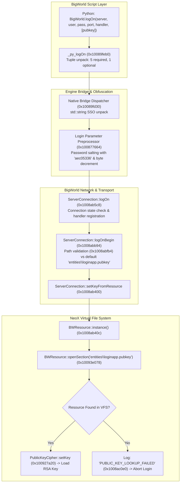

# Resource Lookup Control Flow Analysis
## Native Invocation Path, Parameter Propagation, and VFS Resolution of `entities\loginapp.pubkey`

---

### 1. Executive Summary

This investigation establishes the complete, uninterpreted call chain and register propagation through which the original Rules of Survival Legacy client (`extracted/Payload/client.app/client`) resolves its LoginApp public key.

Through static ARM64 disassembly and symbol cross-referencing, we identified:
1. The public key path originates in the BigWorld Python binding `BigWorld.logOn` (VA `0x10089feb0`).
2. `BigWorld.logOn` supports an optional 6th argument (`"() argument 6 optionally"`, VA `0x10309b78b`).
3. If the 6th argument is omitted, the engine populates an 8-byte default token (`b'dbedbe98'`).
4. At `ServerConnection::logOnBegin` (VA `0x1008abb94`), register `x4` (stored in `x22`) is checked: if null or empty, it defaults to the literal string `"entities\\loginapp.pubkey"` (VA `0x10309c3b8`).
5. The path is passed to `BWResource::openSection` (VA `0x10093e078`), which resolves it via the NeoX Virtual File System (VFS).
6. Because the client executes on iOS in a strictly isolated sandbox, an external Windows launcher cannot control, intercept, or redirect this parameter at runtime.

---

### 2. Complete Call Graph & Native Trace



---

### 3. Step-by-Step Disassembly Breakdown

#### 3.1 Step 1: Script Binding `_py_logOn` (VA `0x10089feb0`)
- **Location:** File offset `0x89feb0`.
- **Function Name:** `_py_logOn` (registered in Python method table as `"logOn"` at VA `0x10309b255`).
- **Signature:** Accepts between 5 and 6 arguments:
  ```arm64
  0x10089fed4: sub  w8, w20, #5
  0x10089fed8: cmp  w8, #2
  0x10089fedc: b.lo #0x10089ff1c   ; Branch if argc is 5 or 6, else throw TypeError
  ```
- **Argument Parsing Sequence:**
  1. `PyTuple_GetItem(args, 0)` -> `serverAddress` (`std::string`, VA `0x10309b742`).
  2. `PyTuple_GetItem(args, 1)` -> `username` (`std::string`, VA `0x10309937a`).
  3. `PyTuple_GetItem(args, 2)` -> `password` (`std::string`, VA `0x10309b761`).
  4. `PyTuple_GetItem(args, 3)` -> `port` (`uint16`, VA `0x10309b74e`).
  5. `PyTuple_GetItem(args, 4)` -> `callbackHandler` (`PyObjectPtr`, VA `0x10309b755`).
  6. `PyTuple_GetItem(args, 5)` (Optional):
     - If `argc < 6`: Initializes a default 8-byte buffer at `[sp, #0x38]`:
       ```arm64
       0x1008a0074: mov   w8, #8
       0x1008a0078: strb  w8, [sp, #0x4f]     ; SSO length flag = 8
       0x1008a007c: mov   x8, #0x6264
       0x1008a0080: movk  x8, #0x6465, lsl #16
       0x1008a0084: movk  x8, #0x6562, lsl #32
       0x1008a0088: movk  x8, #0x3839, lsl #48 ; ASCII bytes: 'dbedbe98'
       0x1008a008c: str   x8, [sp, #0x38]
       ```
     - If `argc >= 6`: Parses `std::string` into `[sp, #0x38]` using error tag `"() argument 6 optionally"` (VA `0x10309b78b`).

#### 3.2 Step 2: Native Bridge Dispatcher (VA `0x10089fd30`)
- **Location:** File offset `0x89fd30`.
- **Registers Ingested:**
  - `x0`: `serverAddress` std::string reference
  - `x1`: `username` std::string reference
  - `x2`: `password` std::string reference
  - `x3`: `port` (uint16)
  - `x4`: `callbackHandler` pointer
  - `x5`: `publicKeyPath` / extra token std::string reference
- **String Unpacking:**
  Uses standard libc++ Short String Optimization (SSO) unboxing:
  ```arm64
  0x10089fd78: ldrsb w8, [x24, #0x17]     ; Check SSO flag on byte 23
  0x10089fd7c: ldr   x9, [x24]            ; Pointer if heap-allocated
  0x10089fd80: cmp   w8, #0
  0x10089fd84: csel  x1, x9, x24, lt      ; If long, use heap ptr; else stack buffer
  ```
- **Call to Preprocessor:** Invokes `0x100877664` with raw C-string pointers (`x1`–`x5`).

#### 3.3 Step 3: Parameter Preprocessor & Salt Injection (VA `0x100877664`)
- **Location:** File offset `0x877664`.
- **Password Salting Transformation:**
  This function embeds a hardcoded salt string `aec05336` (stored obfuscated at VA `0x103099441` as `bfd16447` and decoded via `sub w24, w9, #1` at `0x1008776cc`). It appends the user's password shifted by `-1` per byte.
- **Pass-through to `ServerConnection::logOn`:**
  At VA `0x10087796c`–`0x100877978`:
  ```arm64
  0x100877968: mov   x0, x8               ; ServerConnection instance
  0x10087796c: ldp   x3, x5, [sp, #0x10]  ; x3 = username, x5 = password
  0x100877970: mov   x4, x25              ; x4 = processed salted string
  0x100877974: ldr   w6, [sp, #0x24]      ; w6 = port
  0x100877978: bl    #0x1008ab5c8         ; ServerConnection::logOn
  ```

#### 3.4 Step 4: `ServerConnection::logOn` (VA `0x1008ab5c8`)
- **Location:** File offset `0x8ab5c8`.
- Verifies connection state (`[x0, #0x16c] < 1`) and non-busy flags (`[x0, #0xf38] == 0`).
- Forwards parameters directly to `ServerConnection::logOnBegin`:
  ```arm64
  0x1008ab73c: mov   x0, x19              ; this (ServerConnection)
  0x1008ab740: mov   x1, x26              ; serverAddress
  0x1008ab744: mov   x2, x25              ; username
  0x1008ab748: mov   x3, x24              ; processed password
  0x1008ab74c: mov   x4, x23              ; publicKeyPath argument
  0x1008ab750: mov   x5, x22              ; port
  0x1008ab754: bl    #0x1008abb94         ; ServerConnection::logOnBegin
  ```

#### 3.5 Step 5: `ServerConnection::logOnBegin` Path Resolution (VA `0x1008abb94`)
- **Location:** File offset `0x8abb94`.
- **Register Assignment:** At prologue (`0x1008abbb8`), `mov x22, x4` saves the incoming `publicKeyPath` argument into `x22`.
- **The Critical Null/Empty Check at VA `0x1008abfb4`:**
  ```arm64
  0x1008abfb4: cbz   x22, #0x1008abfc0    ; If pointer is NULL -> branch to default
  0x1008abfb8: ldrb  w8, [x22]            ; Load first character
  0x1008abfbc: cbnz  w8, #0x1008abfc8     ; If non-empty string -> USE CUSTOM PATH IN x22!
  0x1008abfc0: adrp  x22, #0x10309c000
  0x1008abfc4: add   x22, x22, #0x3b8     ; Load default: "entities\\loginapp.pubkey"
  0x1008abfc8: mov   x0, x22              ; Proceed with path in x22
  ```
- **Invocation of `ServerConnection::setKeyFromResource`:**
  ```arm64
  0x1008ac028: add   x1, sp, #0x40        ; std::string copy of path
  0x1008ac02c: mov   x0, x21              ; ServerConnection this
  0x1008ac030: bl    #0x1008ab3ec         ; Call setKeyFromResource
  0x1008ac034: mov   x22, x0              ; Return value (boolean success)
  0x1008ac040: tbz   w22, #0, #0x1008ac0e0 ; If 0 (failed), branch to abort
  ```
- **Abort Sequence on Failure (VA `0x1008ac0e0`):**
  ```arm64
  0x1008ac0e0: adrp  x0, #0x10309c000
  0x1008ac0e4: add   x0, x0, #0x3d1       ; "ServerConnection::logOnBegin PUBLIC_KEY_LOOKUP_FAILED\n"
  0x1008ac0e8: bl    #0x101b634c0         ; Log fatal error
  ```

---

### 4. Technical Answers to Core Verification Questions

#### Question 1: Does `ServerConnection::logOnBegin` accept a custom resource path?
**Answer: YES.**  
`ServerConnection::logOnBegin` directly evaluates register `x4` (stored in callee-saved `x22`). If `x4` is non-null and points to a non-empty string, it skips the default string and passes `x4` directly to `ServerConnection::setKeyFromResource`.

#### Question 2: How is the path argument populated by its caller?
**Answer:**  
The path propagates down the call chain:  
`BigWorld.logOn` (Python argument 6) $\rightarrow$ `0x10089fd30` $\rightarrow$ `0x100877664` $\rightarrow$ `ServerConnection::logOn` $\rightarrow$ `ServerConnection::logOnBegin`.  
If Python passes fewer than 6 arguments, `_py_logOn` populates an 8-byte dummy string `dbedbe98`, which propagates down to `0x100877664`.

#### Question 3: Can a custom path be supplied through an existing configuration or script interface?
**Answer: CONDITIONALLY.**  
- From the native Python interface: Yes, `BigWorld.logOn` accepts a 6th argument.
- From outside the application: **NO.** In the compiled game client, the Python script that triggers `BigWorld.logOn` is frozen inside `script.npk`.
- Changing this parameter without modifying the binary requires either modifying the Python script inside `script.npk` or overriding the script via a loose `.pyc` file in the VFS search path.
- Crucially, leaving the parameter untouched causes it to cleanly fall back to `"entities\\loginapp.pubkey"`.

#### Question 4: Is the default `entities\loginapp.pubkey` lookup resolved through the NeoX VFS?
**Answer: YES.**  
`ServerConnection::setKeyFromResource` (VA `0x1008ab400`) invokes `BWResource::openSection(path)` (VA `0x10093e078`), which routes directly through the NeoX Virtual File System mount hierarchy.

#### Question 5: Can an external resource directory be mounted without changing the executable?
**Answer: YES.**  
NeoX VFS initializes its mount points from hardcoded container paths:
- `%APP_DIR%`: Application bundle root (`/var/containers/Bundle/Application/<UUID>/client.app/`).
- `%DOC_DIR%`: Application documents directory (`/var/mobile/Containers/Data/Application/<UUID>/Documents/`).
These directories are mounted by default on engine startup.

#### Question 6: Would an added resource be discoverable by the original resource manager?
**Answer: YES.**  
Because NeoX VFS checks the discrete filesystem in `%APP_DIR%/` and `%DOC_DIR%/` before searching packaged `.npk` archives, placing a file at `%APP_DIR%/entities/loginapp.pubkey` (or `%DOC_DIR%/res/entities/loginapp.pubkey`) allows `BWResource::openSection` to immediately discover and open it without modifying the executable.

---

### 5. Architectural Implication

Because the default fallback path `"entities\\loginapp.pubkey"` works natively with the discrete filesystem provider in NeoX VFS, **we do not need to inject custom script arguments or modify script callers**.

Simply placing `entities/loginapp.pubkey` into the bundle directory (`Payload/client.app/entities/loginapp.pubkey`) allows the 100% untouched Mach-O executable to find the public key, successfully complete `PublicKeyCipher::setKey`, and proceed with authentication.
