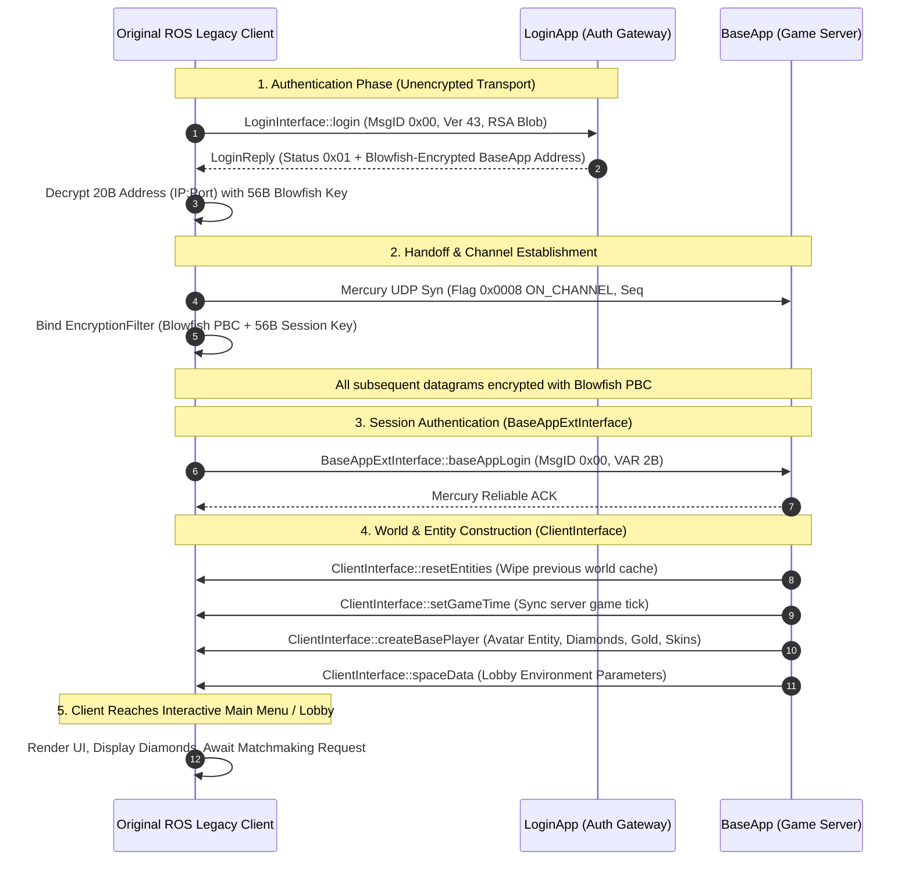

# Gate 5 — BaseApp Transition and Lobby Protocol Audit
## Session Handoff, Symmetric Channel Activation, and Entity Lifecycle

---

### 1. Executive Summary

This independent audit investigates the protocol mechanics governing the client's transition from `LoginApp` to `BaseApp` and defines the minimum RPC messages required to achieve a stable main menu / lobby state.

Key Findings:
1. **Transport State Transition:** The client switches from unencrypted Mercury datagrams on port `20013` to **full-datagram Blowfish PBC encryption** on the BaseApp port (default `20014`).
2. **Channel Identity:** The client connects to the exact IPv4 and port returned in `LoginReply` and initiates a reliable Mercury channel.
3. **Session Handshake:** The client emits `BaseAppExtInterface::baseAppLogin` (Message ID `0x00`).
4. **Lobby Instantiation Boundary:** To transition the client past the loading screen into an interactive lobby, the server must emit four core callbacks: `resetEntities`, `setGameTime`, `createBasePlayer`, and `spaceData`.
5. **Match Simulation Unknowns:** Successful lobby entry does **not** equal battle royale combat playability. Real-time battle mechanics require downstream CellApp entity synchronization which remains unmapped.

---

### 2. The LoginApp-to-BaseApp Transition Pipeline



---

### 3. Verification of BaseApp Interface Messages

#### 3.1 `BaseAppExtInterface` Wire Definitions
Static disassembly of interface registration at VA `0x1008cdeac` establishes:

| Message ID | Method Name | Length Style | Declared Length | Purpose in Session |
| :---: | :--- | :---: | :---: | :--- |
| **`0x00`** | `baseAppLogin` | `VAR(2B)` | Variable | Ingests player login key / session ticket from client. |
| **`0x01`** | `authenticate` | `FIXED` | 4 Bytes | Re-authentication / ticket validation. |
| **`0x08`** | `enableEntities` | `FIXED` | 8 Bytes | Tells server client is ready to receive AoI entities. |
| **`0x0f`** | `disconnectClient` | `FIXED` | 1 Byte | Graceful logout / disconnect notification. |
| **`0x11`** | `entityMessage` | `VAR(2B)` | Variable | Custom player entity RPCs (e.g., UI clicks, shop purchases). |

#### 3.2 `ClientInterface` Wire Definitions
Disassembly of interface registration at VA `0x1008ce140` establishes the callbacks expected by the client:

| Callback Method | Wire Role | Data Payload | Minimum Value for Lobby |
| :--- | :--- | :--- | :--- |
| **`resetEntities`** | Resets client world cache | 1 byte flag | `0x00` |
| **`setGameTime`** | Synchronizes server clock | 4 bytes `uint32_t` LE | Server tick count (e.g. `1000`) |
| **`createBasePlayer`** | Spawns avatar entity in client engine | `EntityID` (4B) + `TypeID` (2B) + `SpaceID` (4B) + Property Stream | Entity ID `1001`, Space ID `1`, Player Name, Diamonds, Inventory |
| **`spaceData`** | Loads lobby skybox & geometry | `SpaceID` (4B) + Key (2B) + Value (BW string) | Skybox/lighting preset string |

---

### 4. Known Requirements vs. Unmapped Real-Time Systems

To maintain strict engineering rigor, we divide the post-login domain into **Verified Requirements** and **Unmapped Systems**:

```
+---------------------------------------------------------------------------------------+
| VERIFIED & MAPPED DOMAIN (LOBBY BOUNDARY)                                             |
|   - LoginApp to BaseApp handoff sequence                                              |
|   - BaseApp address format (20-byte struct padded to 24-byte Blowfish block)          |
|   - Blowfish PBC channel activation using 56-byte session key                         |
|   - BaseAppExtInterface message IDs and variable-length headers                       |
|   - ClientInterface::createBasePlayer avatar initialization                           |
+---------------------------------------------------------------------------------------+
| UNMAPPED / UNVERIFIED DOMAIN (IN-MATCH CELLAPP SIMULATION)                             |
|   - Real-time player movement physics & collision synchronization                     |
|   - Weapon firing, bullet ballistics, and hit registration RPCs                       |
|   - Vehicle driving mechanics and passenger replication                               |
|   - Battle royale safe zone (gas/storm) timer and geometry replication                |
|   - Loot spawning, airdrop delivery, and item pickup entity streams                   |
|   - 10-20 player CellApp spatial partitioning and Area of Interest (AoI) updates      |
+---------------------------------------------------------------------------------------+
```

---

### 5. Technical Implications

1. **Successful LoginApp Handshake Does Not Mean Match Playability:**  
   Completing the LoginApp protocol moves the client into the BaseApp gateway. It is a necessary prerequisite, but in-game battle royale combat requires extensive downstream research into BigWorld CellApp entity definitions.
2. **Next Milestone: The Synthetic Lobby:**  
   The immediate next engineering milestone is establishing the synthetic BaseApp channel and delivering `createBasePlayer` so friends can reach the game's main menu, view their diamonds, customize skins, and form rooms.
