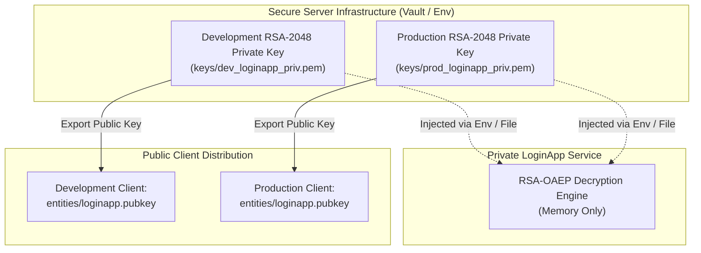

# Gate 4 — Security and Key Management Plan
## Cryptographic Key Lifecycle, Credential Hardening, and Replay Protection Architecture

---

### 1. Executive Summary

This security architecture specifies the protocols, storage mechanisms, and operational safeguards governing asymmetric RSA keys, symmetric session keys, and player credentials for the ROS Sothat private server.

Core Security Mandates:
1. **Strict Key Separation:** Private keys must **never** be packaged into game distribution archives, website frontends, or launcher downloads.
2. **Environment Isolation:** Development and production environments must use cryptographically independent RSA keypairs.
3. **Replay & DoS Hardening:** LoginApp enforces nonce deduplication, sequence validation, and token lifetime restrictions to eliminate replay attacks.
4. **Strong Credential Hashing:** Passwords must be hashed using Argon2id or bcrypt; plaintext passwords must never be stored or persisted in memory beyond the login pipeline.

---

### 2. RSA Cryptographic Key Lifecycle

#### 2.1 Keypair Generation Specifications
- **Algorithm:** RSA with standard PKCS#1 v2.1 OAEP.
- **Modulus Size:** 2048 bits minimum (256 bytes).
- **Public Exponent:** $e = 65537$ (`0x10001`).
- **Public Key Format for Client:**
  - Exported as standard DER / OpenSSL public key format.
  - Stored inside the client bundle at `Payload/client.app/entities/loginapp.pubkey`.

#### 2.2 Storage & Access Control
- **Private Key Storage:**
  - Placed in `ros-private-server/secrets/` with strict OS permissions (`chmod 600` on POSIX, restricted ACL on Windows).
  - Loaded into server memory at process startup via file path or environment variable `LOGINAPP_PRIVATE_KEY_PATH`.
  - **Zero Exposure Rule:** The build and distribution scripts must explicitly blacklist `*.key`, `*.pem`, and `secrets/` from any launcher or client installer zip.

#### 2.3 Key Rotation Protocol
To rotate the server RSA keypair without locking out active players:
1. **Dual-Key Ingestion Phase:**
   - LoginApp maintains both the current private key and the newly generated private key in memory.
   - If decryption fails with Key A, LoginApp attempts decryption with Key B.
2. **Client Update Release:**
   - Distribute updated application package containing New Key B in `entities/loginapp.pubkey`.
3. **Sunset Phase:**
   - Once all active players have migrated to the updated package, retire and revoke Key A.

---

### 3. Symmetric Session Key Security (Blowfish PBC)

#### 3.1 Key Generation & Negotiation
- **Origin:** Generated client-side using native OS entropy (`arc4random_buf` / OpenSSL `RAND_bytes`).
- **Length:** Exactly 56 bytes (448 bits), the maximum key size for Blowfish.
- **Transmission:** Encrypted within the RSA-OAEP envelope.
- **Server Ephemeral Lifecycle:**
  - Stored in LoginApp memory for a maximum TTL of 60 seconds.
  - Transferred securely to the designated `BaseApp` process via internal IPC or shared Redis/memory state.
  - Purged from LoginApp memory immediately upon session handoff.

---

### 4. Authentication & Replay Protection

#### 4.1 Nonce Tracking & Replay Defense
To prevent malicious interception and replay of unencrypted Mercury UDP datagrams carrying valid RSA blobs:
1. **128-bit Client Nonce:** Every `LogOnParams` contains a unique 16-byte random nonce (`q0` SIMD register).
2. **Replay Cache:**
   - LoginApp maintains an in-memory sliding bloom filter / LRU set of observed nonces for the preceding 10 minutes.
   - If a decrypted login packet contains an already-seen nonce, the request is immediately dropped as a replay attack.
3. **Mercury Sequence Number Validation:**
   - Subsequent packets must strictly advance the 28-bit sequence number.

#### 4.2 Credential Protection & Salt Handling
- **Client Salt Ingestion:**
  - The client prefixes user passwords with `aec05336` and decrements each byte by 1.
  - LoginApp reverses this transformation before validating against the database.
- **Backend Password Verification:**
  - Uses `pwd_context.verify(plain_password, user.hashed_password)` from `ros-private-server`.
  - Passwords in the database are hashed with Argon2id / bcrypt using unique per-user cryptographic salts.

---

### 5. Rate Limiting, Brute-Force Defense, and Admin Restrictions

#### 5.1 Connection Rate Limiting
- **Per-IP Rate Limit:** Maximum 10 login requests per minute per IP address. Exceeding threshold triggers temporary 5-minute IP blacklisting.
- **Per-Account Lockout:** Maximum 5 consecutive failed login attempts before an account is locked for 15 minutes.
- **Anti-Amplification:** LoginApp limits UDP reply sizes to strictly match or be smaller than request sizes to prevent UDP reflection attacks.

#### 5.2 Failure Response Sanitization
- Status codes must provide necessary error context (`0x02` bad credentials, `0x04` banned) without leaking user existence details to unauthenticated external probes.

#### 5.3 Administrative Interface Isolation
- The administrative web dashboard (FastAPI `/admin`) operates strictly on HTTPS port `8000` or `8443` with Role-Based Access Control (RBAC).
- Game ports (`20013`, `20014`) do not accept administrative commands or expose server control APIs.
