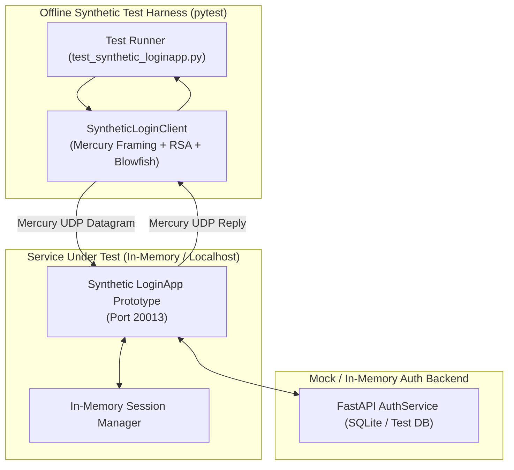

# Gate 6 — Synthetic Login Testing Plan
## Offline Automated Verification Suite for Synthetic LoginApp Prototype

---

### 1. Executive Summary

This testing plan defines an automated, offline test suite to rigorously validate the synthetic `LoginApp` prototype before any physical iOS hardware or real game client testing is performed.

All test scenarios execute in an isolated test environment using Python synthetic clients (`SyntheticLoginClient`).

Testing Principles:
1. **Zero External Hardware:** No physical iOS devices, jailbreaks, or sideloading tools are required.
2. **Complete Coverage:** Evaluates all 12 protocol edge cases, cryptographic permutations, and error responses.
3. **Automated Assertion:** Every test programmatically asserts wire-level packet structures, Mercury footers, Blowfish encryption, and database state.

---

### 2. Test Architecture Overview



---

### 3. Detailed Matrix of 12 Test Scenarios

| Test ID | Test Scenario Name | Input Condition & Packet Mutation | Expected Wire Response | Verification Assertion |
| :---: | :--- | :--- | :--- | :--- |
| **TC-01** | **Valid Login Handshake** | Correct username, valid password, `Ver=43`, valid 56B key, valid RSA-OAEP blob. | `Status == 0x01` (`SUCCESS`), 24B Blowfish-encrypted BaseApp address block. | Decrypted address equals configured BaseApp IP:port; session created in store. |
| **TC-02** | **Invalid Username** | Non-existent username (`unknown_user_999`). | `Status == 0x03` (`NOT_FOUND`), BigWorld error string. | Client receives human-readable error; zero session created. |
| **TC-03** | **Invalid Password** | Existing user with incorrect password string. | `Status == 0x02` (`BAD_PASSWORD`), BigWorld error string. | Password verification fails; no BaseApp address emitted. |
| **TC-04** | **Malformed RSA Ciphertext** | Ciphertext payload corrupted (flipped bits, invalid OAEP padding). | UDP packet dropped or error status returned; zero server crash. | Server handles `ValueError` gracefully; logs warning; server survives. |
| **TC-05** | **Invalid Login Version** | `LOGIN_VERSION = 42` or `44` (`0x0000002c`). | `Status == 0x06` (`VERSION_MISMATCH`) or rejection. | Server asserts version must equal 43 (`0x0000002b`). |
| **TC-06** | **Invalid Request ID** | Client transmits `RequestID = 0x12345678`. | Reply bundle carries matching `RequestID = 0x12345678`. | Client asserts reply matches its issued request ID. |
| **TC-07** | **Invalid Mercury Flags** | Omit `HAS_REQUESTS` (`0x0001`) or omit `HAS_SEQUENCE_NUMBER` (`0x0040`). | Packet dropped or malformed packet warning logged. | Mercury parser rejects datagram lacking mandatory headers. |
| **TC-08** | **Invalid Session Key Length** | Synthetic client passes 32-byte or 64-byte Blowfish key instead of 56 bytes. | Request rejected with bad parameter status. | Server asserts session key length strictly equals 56 bytes. |
| **TC-09** | **Replayed Login Request** | Exact duplicate packet retransmitted with identical client nonce and sequence. | Second packet dropped as replay attack. | Nonce cache detects collision; replay attack blocked. |
| **TC-10** | **Login Timeout / Packet Loss** | LoginApp intentionally delays reply beyond timeout threshold. | Client triggers exponential backoff retransmission. | Unacknowledged request retransmitted up to max retry count. |
| **TC-11** | **BaseApp Endpoint Validity** | Client decrypts BaseApp address block. | 20-byte `Mercury::Address` structure parsed. | Decrypted IP is valid IPv4 (`127.0.0.1`) and port is uint16 (`20014`). |
| **TC-12** | **Concurrent Sessions** | 20 synthetic clients authenticate simultaneously with unique credentials. | All 20 clients receive status `0x01` with distinct session keys. | Session store contains 20 isolated records with zero cross-talk. |

---

### 4. Implementation Specification for `SyntheticLoginClient`

To automate these tests, a helper class `SyntheticLoginClient` will be constructed:

```python
class SyntheticLoginClient:
    def __init__(self, server_ip: str, server_port: int, public_key_path: str):
        self.server_ip = server_ip
        self.server_port = server_port
        self.public_key = self.load_public_key(public_key_path)
        self.session_key = os.urandom(56) # 56-byte Blowfish key
        self.client_nonce = os.urandom(16)
        self.seq_num = 1
        self.request_id = 1

    def build_login_packet(self, username: str, password: str, version: int = 43) -> bytes:
        # 1. Salt password with 'aec05336' and shift bytes by -1
        salted_pass = "aec05336" + "".join(chr(ord(c) - 1) for c in password)
        
        # 2. Serialize LogOnParams plaintext
        stream = io.BytesIO()
        stream.write(b'\x01') # LogOnType = 0x01
        stream.write(encode_bw_string(username))
        stream.write(encode_bw_string(salted_pass))
        stream.write(bytes([56]) + self.session_key) # SessionKey
        stream.write(self.client_nonce)
        stream.write(struct.pack('<I', 0)) # ClientFlags
        plaintext = stream.getvalue()

        # 3. Encrypt with RSA-OAEP SHA-1
        ciphertext = self.public_key.encrypt(
            plaintext,
            padding.OAEP(
                mgf=padding.MGF1(algorithm=hashes.SHA1()),
                algorithm=hashes.SHA1(),
                label=None
            )
        )

        # 4. Pack BigWorld bundle: MsgID 0x00, Length, RequestID, Version, Ciphertext
        bundle_body = struct.pack('<I', version) + ciphertext
        bundle_len = len(bundle_body) + 4 # Body + RequestID
        bundle_hdr = struct.pack('<BHI', 0x00, bundle_len, self.request_id)
        bundle_data = bundle_hdr + bundle_body

        # 5. Pack Mercury headers and footers
        flags = 0x0041 # HAS_REQUESTS | HAS_SEQUENCE_NUMBER
        footer = struct.pack('<IB', (self.seq_num << 4) & 0xFFFFFFF0, 1) # Seq + ReqCount
        return struct.pack('<H', flags) + bundle_data + footer
```

---

### 5. Pass/Fail Exit Criteria

The synthetic LoginApp prototype will be deemed verified and ready for integration when:
1. All 12 automated test cases pass with 100% success rate (`12 passed, 0 failed`).
2. Server memory remains stable under continuous concurrent load.
3. Cryptographic decryption and session key handling perform with zero uncaught exceptions.
4. Test logs confirm zero leakage of passwords or private key material.
