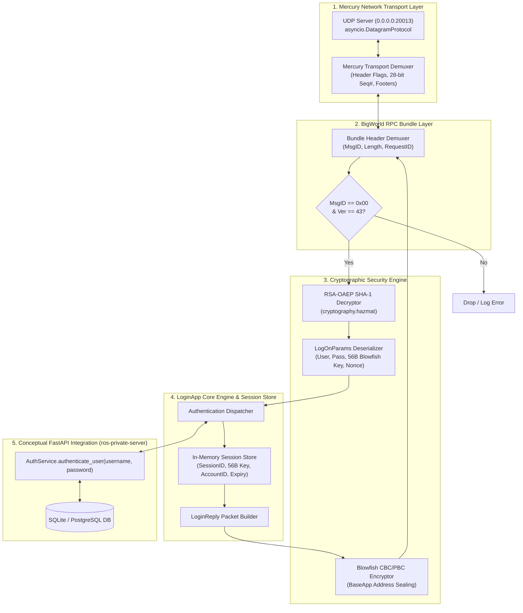

# Gate 3 — Synthetic LoginApp Architecture Specification
## Component Design, Module Interfaces, and Conceptual Backend Integration

---

### 1. Architectural Vision

The synthetic `LoginApp` prototype is an asynchronous Python service designed to operate alongside the existing FastAPI backend (`ros-private-server/`) and the synthetic Mercury gateway (`phase6B_8_local_gateway/`).

Its purpose is to:
1. Emulate the native NetEase BigWorld `LoginApp` service.
2. Ingest unencrypted Mercury UDP datagrams carrying `LoginInterface::login` RPC requests.
3. Perform asymmetric RSA-OAEP SHA-1 decryption using a local private key.
4. Deserialize `LogOnParams` and authenticate users against the private server database.
5. Negotiate the client's 56-byte Blowfish session key and return a valid `LoginReply` pointing to `BaseApp`.



---

### 2. Detailed Module Specifications (10 Functional Modules)

#### Module 1: Mercury Datagram Ingestion (`MercuryDatagramServer`)
- **Technology:** Python `asyncio` with `asyncio.DatagramProtocol`.
- **Interface:**
  ```python
  class MercuryDatagramServer(asyncio.DatagramProtocol):
      def connection_made(self, transport: asyncio.DatagramTransport) -> None: ...
      def datagram_received(self, data: bytes, addr: Tuple[str, int]) -> None: ...
  ```
- **Responsibility:** Ingests raw UDP packets, tracks client peer IP/port tuples, and enforces initial datagram size limits ($< 2048$ bytes).

#### Module 2: Mercury Framing & Footer Parser (`MercuryFrameParser`)
- **Integration:** Reuses verified logic from `phase6B_8_local_gateway/packet_parser.py`.
- **Parsing Logic:**
  - Reads 2-byte header flags (`uint16_t` LE).
  - Validates `HAS_REQUESTS` (`0x0001`) and `HAS_SEQUENCE_NUMBER` (`0x0040`).
  - Unpacks 28-bit sequence number and cumulative ACKs from packet tail.
  - Returns raw BigWorld bundle payload bytes.

#### Module 3: BigWorld RPC Bundle Demuxer (`BigWorldBundleDemuxer`)
- **Parsing Logic:**
  - Extracts Message ID: `data[0]` (must be `0x00` for `LoginInterface::login`).
  - Extracts 2-byte length: `struct.unpack('<H', data[1:3])[0]`.
  - Extracts 4-byte Request ID: `struct.unpack('<I', data[3:7])[0]`.
  - Extracts `LOGIN_VERSION`: `struct.unpack('<I', data[7:11])[0]` (must equal `43`).
  - Slices remaining bytes as RSA ciphertext blob.

#### Module 4: RSA-OAEP Decryption Engine (`RsaOaepDecryptor`)
- **Technology:** `cryptography.hazmat.primitives.asymmetric.padding.OAEP`.
- **Algorithm:**
  ```python
  from cryptography.hazmat.primitives.asymmetric import padding
  from cryptography.hazmat.primitives import hashes

  plaintext = private_key.decrypt(
      ciphertext,
      padding.OAEP(
          mgf=padding.MGF1(algorithm=hashes.SHA1()),
          algorithm=hashes.SHA1(),
          label=None
      )
  )
  ```
- **Safety:** Catches `ValueError` on malformed ciphertext without crashing; returns error code to caller.

#### Module 5: `LogOnParams` Deserializer (`LogOnParamsDeserializer`)
- **Parsing Stream Sequence:**
  1. `logon_type`: 1 byte `uint8`.
  2. `username`: BigWorld string (`unpack_bw_string`).
  3. `password`: BigWorld string (`unpack_bw_string`), desalted by stripping prefix `aec05336` and adding 1 to each byte.
  4. `session_key`: BigWorld string (verifies length is exactly 56 bytes).
  5. `client_nonce`: 16 raw bytes.
  6. `client_flags`: 4 bytes `uint32_t` LE.

#### Module 6: Authentication & Failure Handler (`AuthDispatcher`)
- **Integration with FastAPI:** Invokes the authentication logic from `ros-private-server/app/services/auth_service.py`.
- **Status Evaluation:**
  - If user not found: Return status `0x03` (`LOGON_STATUS_ERR_NOT_FOUND`).
  - If password hash mismatch: Return status `0x02` (`LOGON_STATUS_ERR_BAD_PASSWORD`).
  - If user banned: Return status `0x04` (`LOGON_STATUS_ERR_BANNED`).
  - If already connected: Return status `0x05` (`LOGON_STATUS_ERR_ALREADY_LOGGED_IN`).
  - If successful: Proceed to session generation (status `0x01`).
- **Failure Reply:** Constructs packet containing status byte followed by error message string.

#### Module 7: Session Manager (`LoginSessionManager`)
- **Storage:** In-memory thread-safe dictionary keyed by `account_id` and `session_token`.
- **Session Record Fields:**
  - `account_id`: int
  - `username`: str
  - `blowfish_session_key`: 56 bytes
  - `client_nonce`: 16 bytes
  - `client_ip`: str
  - `created_at`: float
  - `expires_at`: float (TTL = 60 seconds until BaseApp login)
  - `baseapp_id`: int (assigned server node)

#### Module 8: Blowfish Address Encryption (`AddressEncryptor`)
- **Cipher:** Blowfish in CBC or PBC mode with zero padding.
- **Payload:** 20 bytes `Mercury::Address`:
  - `ip`: 4 bytes (e.g. `127.0.0.1` -> `0x7f000001` network byte order).
  - `port`: 2 bytes (e.g. `20014` -> `0x4e2e` network byte order).
  - `padding`: 14 bytes zero bytes.
- **Padding:** Padded to 24 bytes (multiple of 8).
- **Key:** The 56-byte session key extracted from `LogOnParams`.

#### Module 9: `LoginReply` Builder (`LoginReplyBuilder`)
- **Wire Composition:**
  - BigWorld Reply Header: Reply Message ID (`0xFF`), length, and matching 4-byte `Request ID`.
  - Status Byte: `0x01` (`LOGON_STATUS_SUCCESS`).
  - Ciphertext: 24 bytes Blowfish-encrypted BaseApp address block.
  - Footer / Framing: Appends Mercury sequence headers and ACKs.

#### Module 10: Test Audit & Metrics Logger (`AuditLogger`)
- **Logging Standards:**
  - Emits structured JSON events (`login_attempt`, `login_success`, `login_failed`).
  - Records response latency, request ID, sequence numbers, and client flags.
  - **Zero Credential Exposure:** Passwords and private keys are never logged.

---

### 3. Conceptual Integration with `ros-private-server`

The synthetic LoginApp bridges cleanly to the existing FastAPI backend architecture:

```python
# Conceptual Bridge Interface (No modification to backend required)
from app.services.auth_service import AuthService
from app.core.database import async_session_factory

class BackendAuthBridge:
    @staticmethod
    async def verify_credentials(username: str, plain_password: str) -> Optional[UserRecord]:
        async with async_session_factory() as session:
            auth_svc = AuthService(session)
            user = await auth_svc.authenticate_user(username, plain_password)
            return user
```

---

### 4. Implementation Safety Boundaries

1. **Standalone Prototype:** The LoginApp will be implemented as a clean, modular package in `phase6B_13_loginapp_prototype/` (when authorized).
2. **Read-Only Backend:** Communicates with the backend exclusively via public service methods or HTTP REST APIs (`POST /api/v1/auth/login`).
3. **Synthetic Gateways Preserved:** Does not overwrite or delete existing Phase 6.2B.8.5 Mercury gateway files.
