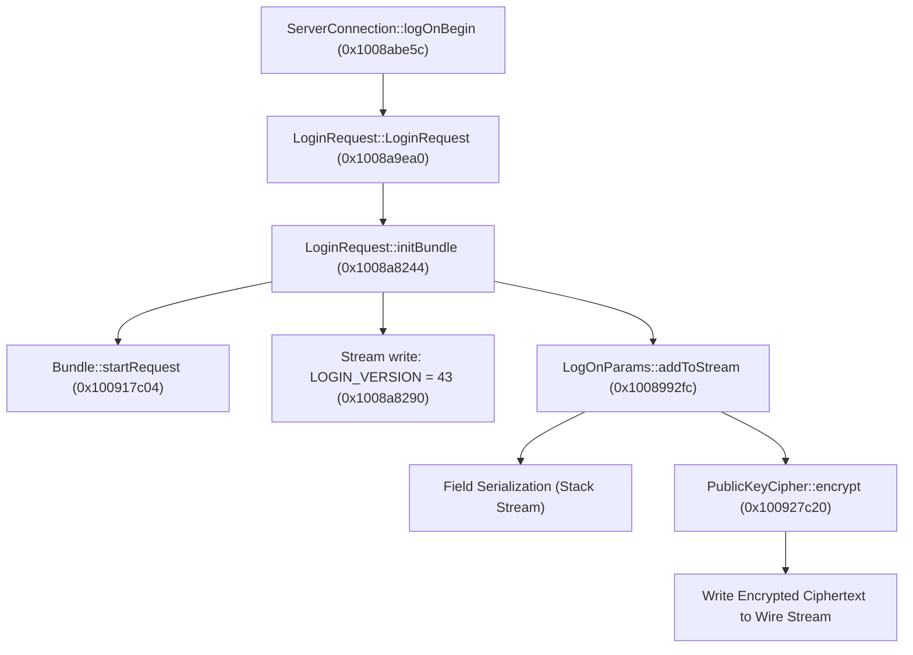

# Native Login Request Specification
## Original Rules of Survival Legacy iOS Client (`client` Mach-O)

---

### 1. Architectural Overview

In the original Rules of Survival Legacy iOS client, authentication begins with the client establishing a Mercury transport connection to the `LoginApp` service. Application-level login data is structured as a BigWorld RPC bundle containing a specialized `LoginInterface::login` request carrying serialized and encrypted `LogOnParams`.

This specification documents the exact wire layout, native instruction addresses, register usage, serialization order, and encryption envelope based on read-only disassembly of the original ARM64 executable (`extracted/Payload/client.app/client`).

---

### 2. Native Disassembly Evidence & Function Boundaries

#### 2.1 Invocation Hierarchy


#### 2.2 Key Function Addresses
| Function | Virtual Address Range | File Offset Range | Purpose |
| :--- | :--- | :--- | :--- |
| `ServerConnection::logOnBegin` | `0x1008abdc0`–`0x1008ac380` | `0x8abdc0`–`0x8ac380` | Initiates login flow, resolves server address, loads pubkey |
| `ServerConnection::setKeyFromResource` | `0x1008ab400`–`0x1008ab540` | `0x8ab400`–`0x8ab540` | Loads RSA public key from `entities\loginapp.pubkey` |
| `LoginRequest::LoginRequest` | `0x1008a9ea0`–`0x1008a9ee8` | `0x8a9ea0`–`0x8a9ee8` | Constructs login request object, binds reply handler |
| `LoginRequest::initBundle` | `0x1008a8244`–`0x1008a8360` | `0x8a8244`–`0x8a8360` | Injects `LOGIN_VERSION`, invokes `LogOnParams::addToStream` |
| `LogOnParams::addToStream` | `0x1008992fc`–`0x100899620` | `0x8992fc`–`0x899620` | Serializes fields, performs RSA-OAEP encryption |
| `PublicKeyCipher::encrypt` | `0x100927c20`–`0x100927d30` | `0x927c20`–`0x927d30` | Wraps OpenSSL `RSA_public_encrypt` (OAEP padding) |

---

### 3. Wire Message Layout

The login datagram sent to `LoginApp` consists of three nested layers:
1. **Mercury Transport Layer** (Header flags, sequence, footers).
2. **BigWorld RPC Bundle Header** (Message ID `0x00`, 2-byte variable length, 4-byte request ID).
3. **Application Login Payload** (`LOGIN_VERSION` uint32 + RSA-OAEP Encrypted `LogOnParams`).

#### 3.1 BigWorld Message Envelope (`LoginInterface::login`)
- **Interface Name:** `LoginInterface` (registered at VA `0x1008cde0c`)
- **Method Name:** `login` (`0x1030453ed`)
- **Message ID:** `0x00` (1 byte `uint8_t`)
- **Length Style:** `VARIABLE_LENGTH` with 2-byte length parameter (`VAR(2B)`)
- **Request ID:** 4 bytes `uint32_t` little-endian (allocated by `Bundle::startRequest` at `0x100917c24`)

```
+---------------+-----------------------+--------------------+-----------------------------+
| Msg ID (0x00) | Length (2B uint16 LE) | Request ID (4B LE) | Body (LOGIN_VERSION + Blob) |
+---------------+-----------------------+--------------------+-----------------------------+
```

#### 3.2 Login Payload Structure
Immediately following the 4-byte Request ID:
1. **`LOGIN_VERSION` (4 bytes, `uint32_t` little-endian):**
   - Native code at `0x1008a8288`–`0x1008a8294`:
     ```arm64
     0x1008a8288: mov  w1, #4
     0x1008a828c: blr  x8            ; allocate 4 bytes on stream
     0x1008a8290: mov  w8, #0x2b     ; w8 = 43 (0x0000002b)
     0x1008a8294: str  w8, [x0]      ; write 4-byte uint32 little-endian
     ```
   - Wire Value: `0x2b, 0x00, 0x00, 0x00` (decimal 43).

2. **Encrypted `LogOnParams` Ciphertext (Variable length, typically 128 or 256 bytes depending on RSA key size):**
   - Serialized by `LogOnParams::addToStream` (`0x1008992fc`).
   - If `pCipher != NULL`, serialized into a stack memory stream and encrypted with `PublicKeyCipher::encrypt`.
   - The ciphertext output is appended to the message stream.

---

### 4. `LogOnParams` Field Serialization (Plaintext Layout)

When `LogOnParams::addToStream` runs, it serializes the following fields in strict sequential order into the temporary stream prior to encryption:

```
+----------+------------------+------------------+------------------+-------------------+-------------------+
| Type(1B) | Username (BWstr) | Password (BWstr) | BlowfishKey(57B) | Nonce (16B SIMD)  | ClientFlags (4B)  |
+----------+------------------+------------------+------------------+-------------------+-------------------+
```

#### Detailed Field Table
| Field # | Field Name | Data Type & Encoding | Size (Bytes) | Native Disassembly Reference | Description |
| :---: | :--- | :--- | :---: | :--- | :--- |
| **1** | `LogOnType` | `uint8_t` (byte) | 1 | `0x10089938c: strb w22, [x0]` | Login type or sub-protocol version. Default is `0x01`. |
| **2** | `Username` | BigWorld Variable String | $1 + L$ or $4 + L$ | `0x1008993a8`–`0x100899430` | Account/username string. Prefixed with BigWorld length. |
| **3** | `Password` | BigWorld Variable String | $1 + L$ or $4 + L$ | `0x100899448`–`0x1008994d0` | Authentication password or ticket token. |
| **4** | `SessionKey` | BigWorld Variable String | 57 (`0x38` + 56B) | `0x1008994e8`–`0x100899550` | Generated 56-byte Blowfish session key. Prefixed with length `0x38`. |
| **5** | `ClientNonce` | 128-bit SIMD block | 16 | `0x100899564: str q0, [x0]` | Random 16-byte cryptographic digest/nonce (`q0` register). |
| **6** | `ClientFlags` | `uint32_t` little-endian | 4 | `0x100899580: str w21, [x0]` | Client version integer / flags (`ldr w21, [x21, #0x58]`). |

#### BigWorld String Variable-Length Prefix Encoding
The BigWorld engine serializes `std::string` using a compact prefix:
- If length $< 255$ (`0xFF`):
  - 1 byte `uint8_t` indicating string byte length.
- If length $\ge 255$ (`0xFF`):
  - 1 escape byte `0xFF`.
  - Followed by 3 bytes `uint24` little-endian encoding the length:
    ```arm64
    0x1008993f4: mov   w24, #0xff
    0x1008993f8: strb  w24, [x0]       ; byte 0 = 0xFF
    0x1008993fc: strb  w8, [x0, #1]    ; byte 1 = len & 0xFF
    0x100899400: strb  w8, [x0, #2]    ; byte 2 = (len >> 8) & 0xFF
    0x100899404: strb  w8, [x0, #3]    ; byte 3 = (len >> 16) & 0xFF
    ```

---

### 5. Cryptographic Envelope

1. **Algorithm:** RSA with OAEP Padding (`RSA_PKCS1_OAEP_PADDING`).
2. **Padding Parameter:** OpenSSL padding identifier `4` (`RSA_PKCS1_OAEP_PADDING` = 4), verified in `PublicKeyCipher::encrypt` at VA `0x100927c7c`:
   ```arm64
   0x100927c7c: mov  w4, #4    ; padding = 4 (RSA_PKCS1_OAEP_PADDING)
   0x100927c80: bl   #RSA_public_encrypt
   ```
3. **OAEP Hash Function:** SHA-1 (OpenSSL default for standard OAEP).
4. **Key Specification:** Loaded from `"entities\loginapp.pubkey"` via `ServerConnection::setKeyFromResource` (VA `0x1008ab400`).
5. **Fail-safe Behavior:**
   - If `pCipher == NULL` (e.g. key lookup disabled), `0x10089936c: cmp x20, #0` skips encryption and streams plaintext directly.
   - If `entities\loginapp.pubkey` lookup fails during `logOnBegin`, native code at `0x1008ac0e0` logs `ServerConnection::logOnBegin PUBLIC_KEY_LOOKUP_FAILED` and halts login.
