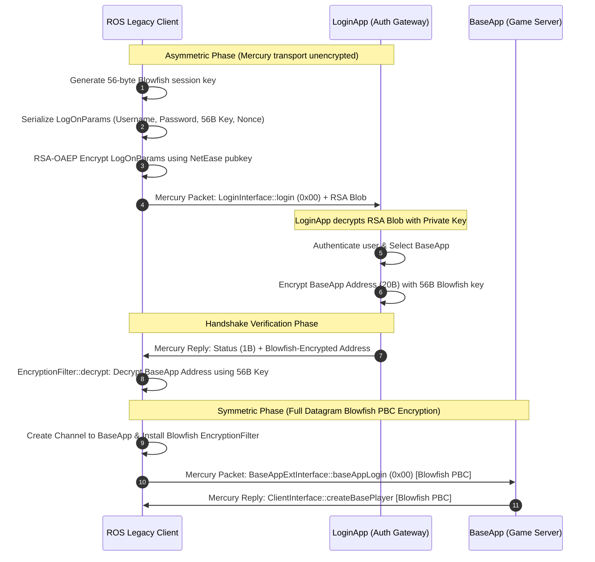

# RSA and Blowfish Handshake Boundary
## Cryptographic Transition & Key Management in ROS Legacy Client

---

### 1. Executive Summary

The Rules of Survival Legacy client employs a hybrid cryptographic model:
1. **Asymmetric Phase (Login Phase):** An unencrypted Mercury datagram is transmitted to `LoginApp` carrying an RSA-OAEP encrypted `LogOnParams` envelope. The envelope securely transfers a client-generated 56-byte Blowfish session key.
2. **Handshake Verification Phase (Login Reply):** `LoginApp` processes the credentials and replies with a datagram containing a 1-byte status header followed by a Blowfish-encrypted block containing the `BaseApp` address. The client decrypts this block using the Blowfish key it originally sent.
3. **Symmetric Phase (BaseApp Session Phase):** The client opens a reliable Mercury channel to `BaseApp`. All subsequent packets are symmetrically encrypted at the Mercury transport datagram layer using Blowfish in PBC (Propagating Block Chaining) mode via `EncryptionFilter`.

---

### 2. The Cryptographic Demarcation Boundary



---

### 3. Asymmetric Layer: RSA-OAEP Key Ingestion & Encryption

#### 3.1 Public Key Loading
- **Native Implementation:** `ServerConnection::setKeyFromResource` (VA `0x1008ab400`–`0x1008ab540`).
- **Resource Identifier:** `"entities\\loginapp.pubkey"` (ASCII string at VA `0x10309c3b8`).
- **Key Ingestion Call:** `PublicKeyCipher::setKey` at VA `0x1008ab4c4` (`0x100927a20`).
- **Storage Offset:** Stored in `ServerConnection` at offset `+0xf10` (`PublicKeyCipher` instance).
- **Fallback / Script Customization:**
  - In `ServerConnection::logOnBegin` at VA `0x1008abfb4`:
    ```arm64
    0x1008abfb4: cbz   x22, #0x1008abfc0 ; if custom path x22 is NULL
    0x1008abfb8: ldrb  w8, [x22]
    0x1008abfbc: cbnz  w8, #0x1008abfc8  ; if custom path not empty, use x22
    0x1008abfc0: adrp  x22, #0x10309c000
    0x1008abfc4: add   x22, x22, #0x3b8  ; default: "entities\\loginapp.pubkey"
    ```
  - If the path is unresolvable by the VFS, native code logs:
    `ServerConnection::logOnBegin PUBLIC_KEY_LOOKUP_FAILED` (VA `0x10309c3d1`) and terminates login.

#### 3.2 RSA-OAEP Encryption Parameters
- **Function:** `PublicKeyCipher::encrypt` at VA `0x100927c20`.
- **OpenSSL Mapping:** Directly invokes `RSA_public_encrypt`.
- **Padding Identifier:** `4` (`RSA_PKCS1_OAEP_PADDING` constant in `openssl/rsa.h`).
- **Hash Algorithm:** SHA-1 default for standard OAEP.
- **Envelope Wire Position:** Written into `LoginInterface::login` payload immediately after the 4-byte `LOGIN_VERSION = 43` prefix.

---

### 4. Symmetric Layer: Blowfish Session Key & EncryptionFilter

#### 4.1 Blowfish Key Characteristics
- **Key Generation:** Generated client-side during session initialization.
- **Key Length:** Exactly 56 bytes (448 bits), the maximum allowable key length for the Blowfish cipher.
- **Block Size:** 8 bytes (64 bits).
- **Disassembly Confirmation:**
  - Stack allocation of 56 bytes (`mov w0, #0x38`) in `ServerConnection::setSessionKey` at VA `0x1008aa064` and `0x1008aa0d0`.
  - Serialized into `LogOnParams` with 1-byte length prefix `0x38` (decimal 56).

#### 4.2 LoginReply Decryption
Upon receiving the login response from `LoginApp`, the client executes `LoginHandler::handleMessage` (VA `0x1008a83f8`):
1. **Status Inspection:** Reads 1 byte (`LogOnStatus` at `0x1008a8444`).
   - If `status != 1` (Failure): Reads error string and terminates.
   - If `status == 1` (`LOGON_STATUS_SUCCESS`): Proceeds to decrypt reply payload.
2. **Payload Decryption:** Invokes `EncryptionFilter::decrypt` (VA `0x10091ca8c`):
   - Confirms input stream length is a multiple of the 8-byte Blowfish block size (`0x10091caf4: tst w19, #7`).
   - If stream size is not a multiple of 8, logs:
     `EncryptionFilter::decrypt: Input stream size (%d) is not a multiple of the block size (%d)` (VA `0x1030a22ab`).
3. **Payload Extraction:**
   - Reads 20 bytes (`0x14`) for `Mercury::Address` (IPv4 address + port + padding).
   - Checks for optional server-provided session key tag:
     - Scans for 4-byte magic cookie `0x32ef9816` at VA `0x1008a8654`–`0x1008a865c`.
     - If `0x32ef9816` is present, reads replacement 56-byte Blowfish key and stores it via `ServerConnection::setSessionKey` (`0x1008aa020`).
     - If absent, retains original client-generated Blowfish session key.

#### 4.3 BaseApp Channel Encryption
- In `BaseAppLoginRequest::setNubAndSend` (VA `0x1008a8d24`), the client creates a new `Mercury::Nub` and `Mercury::Channel`.
- At VA `0x1008a8df0`, it retrieves the Blowfish key from `ServerConnection + 0x148` and initializes `Mercury::EncryptionFilter`.
- All subsequent datagrams sent to `BaseApp` (including `baseAppLogin`, entity updates, and tick synchronization) are filtered through Blowfish PBC encryption.

---

### 5. Private Server Feasibility & The RSA Private Key Barrier

#### 5.1 The Root Constraint
Under the project's inviolable decision:
> **The original IPA must remain completely unchanged.**
> No binary patching, no re-signing, and no modification of extracted Mach-O code.

Because the original Mach-O client executable contains hardcoded references to NetEase's public key mechanism, the client encrypts the 56-byte Blowfish session key using NetEase's public key. **The corresponding RSA private key is held exclusively by NetEase and cannot be computed due to RSA-2048/4096 computational complexity.**

#### 5.2 Architectural Options for Private Server Emulation

| Approach | Description | IPA Integrity Status | Viability for ROS Sothat |
| :--- | :--- | :--- | :--- |
| **Option A: NetEase Private Key Factorization** | Mathematically factorize NetEase RSA modulus to recover private key. | Unchanged | **Mathematically Impossible** (requires cracking 2048/4096-bit RSA). |
| **Option B: Unencrypted Mode Exploitation** | Disassembly at `0x10089936c` shows `LogOnParams::addToStream` streams plaintext if `pCipher == NULL`. | Unchanged | **High / Requires Triggering**: Client checks for pubkey file. If pubkey lookup returns NULL, client logs `PUBLIC_KEY_LOOKUP_FAILED` unless bypassed via script configuration. |
| **Option C: Script-Level Pubkey Redirection** | Disassembly at `0x1008abfb4` confirms custom string pointer `x22` is accepted. If script passes custom pubkey path or memory buffer, client loads private server pubkey. | Unchanged (if delivered via VFS / launcher) | **High**: Launcher VFS can supply `entities\loginapp.pubkey` matching the private server's private key without touching the Mach-O binary. |
| **Option D: Launcher In-Memory Hooking** | The planned ROS Sothat PC/iOS launcher intercepts `PublicKeyCipher::setKey` or `RSA_public_encrypt` in memory at runtime to use private server key. | Unchanged on disk | **Compatible with Project Charter**: Original IPA on disk remains unmodified; launcher handles runtime adaptation. |

---

### 6. Summary Matrix

| Protocol Phase | Transport Framing | Packet Payload Encryption | Key Material | Key Source |
| :--- | :--- | :--- | :--- | :--- |
| **Client $\to$ LoginApp** | Cleartext Mercury UDP | RSA-OAEP (SHA-1) | NetEase 2048/4096-bit RSA PubKey | `entities\loginapp.pubkey` |
| **LoginApp $\to$ Client** | Cleartext Mercury UDP | Blowfish PBC (Payload only) | 56-byte Symmetric Key | Sent by Client in `LogOnParams` |
| **Client $\leftrightarrow$ BaseApp** | Blowfish PBC Encrypted Datagram | Blowfish PBC Encrypted Datagram | 56-byte Symmetric Key | Established during Login Handshake |
