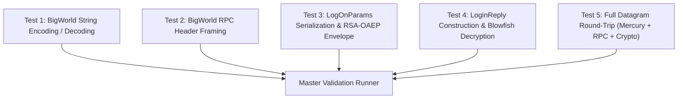

# Synthetic Login & RPC Validation Plan
## Offline Verification Framework for Phase 6.2B.10

---

### 1. Scope and Purpose

This document outlines an offline, non-networked synthetic validation plan designed to verify the correct serialization, deserialization, RPC bundling, and cryptographic processing of the original Rules of Survival Legacy login protocol.

In accordance with strict safety constraints:
- **No network sockets or transmissions are opened.**
- **No databases or live backends are contacted.**
- **Protected binary assets remain unchanged.**
- All tests execute strictly as offline unit/integration test fixtures in Python.

---

### 2. Validation Test Suite Structure

The proposed synthetic test suite comprises five dedicated verification modules:

---

### 3. Detailed Test Module Specifications

#### 3.1 Test Module 1 — BigWorld String Variable-Length Encoding
- **Native Reference:** `LogOnParams::addToStream` (VA `0x1008993a8`–`0x100899430`).
- **Objective:** Verify standard BigWorld variable length string prefix serialization and parsing.
- **Test Cases:**
  1. **Short String ($L < 255$):**
     - Input: `"ros_player_01"` ($L = 13$).
     - Expected Wire Prefix: `b'\x0d'` (1 byte).
     - Expected Output: `b'\x0dros_player_01'`.
  2. **Boundary String ($L = 254$):**
     - Expected Wire Prefix: `b'\xfe'`.
  3. **Long String ($L \ge 255$):**
     - Input: 300-byte token string ($L = 300 = \text{0x00012c}$).
     - Expected Wire Prefix: `b'\xff\x2c\x01\x00'` (`0xFF` escape + 3 bytes uint24 little-endian).
     - Expected Output: 4-byte prefix + 300 data bytes.

#### 3.2 Test Module 2 — BigWorld RPC Header Framing (`LoginInterface::login`)
- **Native Reference:** `LoginRequest::initBundle` (VA `0x1008a8244`), `Bundle::startRequest` (VA `0x100917c04`).
- **Objective:** Verify BigWorld RPC message header formatting.
- **Specification:**
  - `Message ID`: 1 byte `0x00` (`login`).
  - `Length`: 2 bytes little-endian `uint16_t` (`VAR(2B)`).
  - `Request ID`: 4 bytes little-endian `uint32_t`.
  - `LOGIN_VERSION`: 4 bytes little-endian `0x0000002b` (decimal 43).
- **Test Assertion:**
  - Given body length $N$: Header matches `b'\x00' + struct.pack('<H', N + 8) + struct.pack('<I', request_id) + b'\x2b\x00\x00\x00'`.

#### 3.3 Test Module 3 — `LogOnParams` Serialization & RSA-OAEP Envelope
- **Native Reference:** `LogOnParams::addToStream` (VA `0x1008992fc`–`0x100899620`), `PublicKeyCipher::encrypt` (VA `0x100927c20`).
- **Objective:** Verify exact sequential field packing and RSA-OAEP encryption round-trip.
- **Test Vectors:**
  - `LogOnType`: `0x01` (1 byte).
  - `Username`: `"testuser"`.
  - `Password`: `"testpass"`.
  - `SessionKey`: 56 pseudo-random bytes (`os.urandom(56)`).
  - `ClientNonce`: 16 random bytes (128-bit block).
  - `ClientFlags`: `0x00000001` (uint32).
- **Synthetic RSA Keys:**
  - Generate a 2048-bit RSA test keypair in memory.
  - Encrypt with RSA-OAEP (SHA-1 digest, OpenSSL padding 4 equivalent).
  - Decrypt with private key; assert recovered fields match original byte-for-byte.

#### 3.4 Test Module 4 — `LoginReply` Construction & Blowfish Decryption
- **Native Reference:** `LoginHandler::handleMessage` (VA `0x1008a83f8`), `EncryptionFilter::decrypt` (VA `0x10091ca8c`).
- **Objective:** Verify `LoginReply` payload format, 8-byte block alignment, and symmetric decryption.
- **Test Specification:**
  - Construct 20-byte `Mercury::Address`:
    - `ip`: `127.0.0.1` (`0x7f000001` or `0x0100007f`).
    - `port`: `20014` (`0x4e2e`).
    - `padding`: 14 zero bytes.
  - Total plaintext size: 20 bytes $\to$ padded to 24 bytes (multiple of 8).
  - Encrypt with client's 56-byte Blowfish key using Blowfish in PBC/CBC mode.
  - Prepend `status = 0x01` (`LOGON_STATUS_SUCCESS`).
- **Client Emulation Assertion:**
  - Client reads status `0x01`.
  - Client decrypts payload with 56-byte key.
  - Client unpacks address; asserts IP equals `127.0.0.1` and port equals `20014`.

#### 3.5 Test Module 5 — Full Datagram Integration (Mercury + RPC + Crypto)
- **Objective:** End-to-end synthetic packet assembly without network sockets.
- **Integration Flow:**
  1. Construct Mercury datagram header (`flags = HAS_REQUESTS | IS_RELIABLE | HAS_SEQUENCE_NUMBER`).
  2. Embed BigWorld `LoginInterface::login` RPC message with RSA-OAEP payload.
  3. Append Mercury packet footer (`requestID = 1`, `seq = 1`).
  4. Pass packet buffer into `MercuryPacketParser` (from Phase 6.2B.8.5).
  5. Assert flags, footers, RPC headers, and `LogOnParams` parse with 100% fidelity.

---

### 4. Implementation Readiness Criteria for Phase 6.2B.10

Phase 6.2B.10 will be authorized to implement these test fixtures inside `phase6B_8_local_gateway/tests/` or a dedicated test harness only upon explicit user approval.
All tests must execute within $< 1.0$ second and pass with 0 failures before any server-side gateway login handler code is written.
