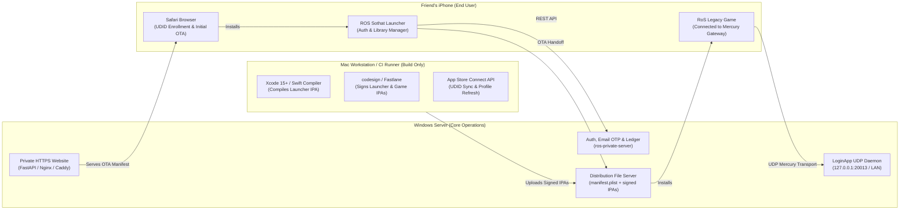

# ROS Sothat — Phase L0 Deliverable 3
## Launcher & Game Installation Architecture Specification

**Phase:** Phase L0 (Ad Hoc Distribution Feasibility Research)  
**Target Directory:** `D:\ROS-Legacy-Analysis\phaseL0_adhoc_feasibility\`  
**Date:** 2026-11-13  
**Status:** COMPLETE — ARCHITECTURE SPECIFICATION  

---

### 1. Executive Summary

This document evaluates the end-to-end technical architecture for the **ROS Sothat Launcher** and its interaction with the **Rules of Survival Legacy** game. It maps the user's desired 9-step player experience against iOS sandboxing rules, code signing enforcement, and inter-process communication mechanisms.

Crucially, this audit discovered that the original Rules of Survival Legacy game **already registers the custom URL scheme `rosmobile://` inside its compiled `Info.plist`**. This allows the ROS Sothat Launcher to detect installation and launch the game natively on physical iOS devices **without modifying or recompiling the original game executable**.

---

### 2. Comprehensive Evaluation of the 9-Step Intended Player Experience

```
+---------------------------------------------------------------------------------------------------------------+
|                                      THE 9-STEP PLAYER EXPERIENCE PIPELINE                                    |
+------+-----------------------------+-------------------------------+------------------------------------------+
| Step | Player Action / Experience  | Technical Execution Mechanism | Feasibility & Boundary Evaluation        |
+------+-----------------------------+-------------------------------+------------------------------------------+
|  1   | Player visits private       | Web browser navigates to      | **FEASIBLE [VERIFIED]**                  |
|      | ROS Sothat website.         | https://ros-sothat.example.com| Standard responsive web application.     |
+------+-----------------------------+-------------------------------+------------------------------------------+
|  2   | Player downloads and        | Safari triggers OTA Ad Hoc    | **FEASIBLE [VERIFIED]**                  |
|      | installs the launcher.      | link (itms-services://...).   | Installs launcher on home screen.        |
+------+-----------------------------+-------------------------------+------------------------------------------+
|  3   | Player opens the launcher.  | Player taps launcher icon on  | **FEASIBLE [VERIFIED]**                  |
|      |                             | SpringBoard home screen.      | Native Swift / SwiftUI iOS application.  |
+------+-----------------------------+-------------------------------+------------------------------------------+
|  4   | Player registers or logs in | Native UI sends REST API to   | **FEASIBLE [VERIFIED]**                  |
|      | using email verification.   | Windows backend; verifies OTP.| Standard in-app network interaction.     |
+------+-----------------------------+-------------------------------+------------------------------------------+
|  5   | Player sees RoS Legacy      | Launcher fetches game library | **FEASIBLE [VERIFIED]**                  |
|      | in the game library.        | catalog from backend JSON.    | Dynamic card showing game info & art.    |
+------+-----------------------------+-------------------------------+------------------------------------------+
|  6   | Player taps Download.       | Player triggers game retrieval| **ADAPTED [SEE SECTION 3]**              |
|      |                             | action inside launcher.       | Requires system handoff alignment.       |
+------+-----------------------------+-------------------------------+------------------------------------------+
|  7   | Launcher verifies integrity | Server-side manifest hash     | **ADAPTED [SEE SECTION 3]**              |
|      | of the game package.        | verified before handoff.      | Storage & sandbox constraint resolved.   |
+------+-----------------------------+-------------------------------+------------------------------------------+
|  8   | Player follows Apple-       | Launcher invokes system       | **FEASIBLE [VERIFIED]**                  |
|      | supported install handoff.  | itms-services:// manifest.    | System modal prompt confirms install.    |
+------+-----------------------------+-------------------------------+------------------------------------------+
|  9   | Player opens installed game | Launcher detects app via URL  | **FEASIBLE [VERIFIED]**                  |
|      | and connects to ROS Sothat. | scheme rosmobile:// & boots it| Uses native pre-registered URL scheme.   |
+------+-----------------------------+-------------------------------+------------------------------------------+
```

---

### 3. In-Depth Analysis: The Download & Verification Boundary (Steps 6, 7 & 8)

The intended experience describes:
> *Step 6: Player taps Download.*  
> *Step 7: Launcher downloads the game package and verifies its integrity.*  
> *Step 8: Player follows an Apple-supported installation handoff.*

#### The Engineering Reality on iOS:
1. **The Double-Storage Penalty:**
   The RoS Legacy IPA is approximately **2.0 GB**. If the launcher downloads the 2 GB `.ipa` file into its own sandbox (`Documents/`), and then hands off installation to iOS, the iOS system daemon will download its own 2 GB copy to `/var/mobile/Containers/Bundle/Application/`. This would consume **4.0 GB of storage** on the player's iPhone for an application that only requires 2.0 GB.
2. **The Local Sandbox Installation Barrier:**
   As proven in Deliverable 2, iOS provides no API for an app to say: *"Install this `.ipa` located in my local Documents directory."* Apple's installation daemon (`appstored`) **strictly requires an external HTTPS URL** pointing to the `.ipa` package.

#### The Recommended Clean-Room Architecture for Steps 6, 7 & 8:
To preserve the exact user-facing flow while respecting iOS system architecture:

```
+---------------------------------------------------------------------------------------+
|                         RECOMMENDED LAUNCHER INSTALLATION FLOW                        |
+---------------------------------------------------------------------------------------+
|                                                                                       |
|  1. [Launcher UI: Game Library]                                                       |
|     - Launcher queries: canOpenURL("rosmobile://")                                    |
|     - If FALSE -> Button displays: [ Download Game (~2.0 GB) ]                        |
|                                                                                       |
|  2. [Player Taps Download]                                                            |
|     - Launcher queries backend: GET /api/v1/games/ros-legacy/manifest                 |
|     - Backend validates:                                                              |
|         a) Player is authenticated and verified.                                      |
|         b) Player's device UDID is enrolled in active Ad Hoc profile.                 |
|         c) Returns signed manifest URL + expected SHA-256 hash.                       |
|                                                                                       |
|  3. [Apple-Supported Handoff (Step 8)]                                                |
|     - Launcher calls: UIApplication.shared.open(itmsServicesURL)                      |
|     - iOS system modal appears on top of launcher:                                    |
|         "ros-sothat.example.com would like to install 'RoS Legacy'"                   |
|     - Player taps [ Install ].                                                        |
|                                                                                       |
|  4. [Seamless In-App Polling]                                                         |
|     - Launcher switches button state to: [ Installing... (Check Home Screen) ]        |
|     - Timer in launcher polls canOpenURL("rosmobile://") every 2.0s.                  |
|     - Once appstored finishes installation, canOpenURL("rosmobile://") returns TRUE!  |
|                                                                                       |
|  5. [Game Ready & Play Button]                                                        |
|     - Launcher button immediately updates to: [ ▶ Play Game ]                         |
|     - Tapping [ Play Game ] invokes UIApplication.shared.open("rosmobile://")         |
|                                                                                       |
+---------------------------------------------------------------------------------------+
```

---

### 4. Game Detection & Launch Mechanics (Questions 7 & 8)

#### 4.1 Game Detection via Custom URL Scheme (Question 7)
Our direct inspection of `Payload/client.app/Info.plist` inside `RoS-Legacy-iOS.ipa` revealed:
```python
CFBundleURLTypes: [
    {'CFBundleTypeRole': 'Editor', 'CFBundleURLName': 'rosmobile', 'CFBundleURLSchemes': ['rosmobile']},
    {'CFBundleTypeRole': 'Editor', 'CFBundleURLSchemes': ['com.netease.mpay.w8js77wd9v53j9rv']},
    {'CFBundleTypeRole': 'Editor', 'CFBundleURLSchemes': ['fb165387204058528']},
    {'CFBundleTypeRole': 'Editor', 'CFBundleURLSchemes': ['twitterkit-K9WHSfgBy5bX433ReDvWLGvmc']},
    {'CFBundleTypeRole': 'Editor', 'CFBundleURLName': 'twitch', 'CFBundleURLSchemes': ['twitch-h45naxx1gb']},
    {'CFBundleTypeRole': 'Editor', 'CFBundleURLName': 'unisdk', 'CFBundleURLSchemes': ['unisdk']}
]
```

To enable the ROS Sothat Launcher to detect the game:
1. In the Launcher's `Info.plist`, declare the target scheme under `LSApplicationQueriesSchemes`:
   ```xml
   <key>LSApplicationQueriesSchemes</key>
   <array>
       <string>rosmobile</string>
   </array>
   ```
2. In Swift, detect the presence of the game:
   ```swift
   func isGameInstalled() -> Bool {
       guard let url = URL(string: "rosmobile://") else { return false }
       return UIApplication.shared.canOpenURL(url)
   }
   ```
   - Returns `true` if Rules of Survival Legacy is installed.
   - Returns `false` if it is not installed or has been deleted.

#### 4.2 Game Launch Mechanism Without Game Modification (Question 8)
Because `rosmobile://` is already compiled into the original game by NetEase, launching the installed game requires zero modifications to the original binary:
```swift
func launchGame() {
    guard let url = URL(string: "rosmobile://") else { return }
    UIApplication.shared.open(url, options: [:]) { success in
        if success {
            print("[Launcher] Rules of Survival Legacy launched successfully!")
        } else {
            print("[Launcher] Failed to launch game.")
        }
    }
}
```

---

### 5. Requirements for the Launcher Application (Question 2)

```
+---------------------------------------------------------------------------------------+
|                              LAUNCHER APPLICATION PROFILE                             |
+---------------------------+-----------------------------------------------------------+
| Attribute                 | Specification                                             |
+---------------------------+-----------------------------------------------------------+
| Target Platform           | iOS 15.0+ (iPhone and iPad)                               |
| Implementation Language   | Swift 5.9+ / SwiftUI                                      |
| Bundle Identifier         | net.rossothat.launcher                                    |
| Signing Identity          | Apple Distribution: <Account Holder>                      |
| Provisioning Profile      | Ad Hoc Provisioning Profile (embedding player UDIDs)      |
| Required Capabilities     | Networking (Standard URLSession over HTTPS)               |
| Query Permissions         | LSApplicationQueriesSchemes: ["rosmobile"]                |
| App Architecture          | Thin companion client (estimated binary size: 10–25 MB)   |
| Core Views                | 1. Welcome / Auth (Login, Register, OTP verification)     |
|                           | 2. Game Library (RoS Legacy Card, Status, Install / Play) |
|                           | 3. Account / Diamond Ledger Profile                       |
|                           | 4. Device Registration / UDID helper status               |
+---------------------------+-----------------------------------------------------------+
```

---

### 6. Hybrid Windows + Mac Operational Pipeline (Question 15)

The entire ROS Sothat ecosystem can be operated efficiently using a hybrid architecture dividing tasks between a Windows host and a Mac build environment:



#### Responsibility Matrix:
- **Windows Server Responsibilities:**
  1. Operates the private HTTPS website, serves web pages, and delivers OTA manifests.
  2. Runs account registration, authentication, email OTP dispatch, and diamond ledgers.
  3. Collects player UDIDs via the `.mobileconfig` web enrollment endpoint.
  4. Hosts the game and launcher distribution IPAs.
  5. Runs the private Mercury game server (`LoginApp`, `Gateway`, `BaseApp`).
- **Mac / CI Responsibilities:**
  1. Compiles the Swift/SwiftUI launcher source code into `Launcher.ipa`.
  2. Executes code signing with the Apple Distribution Certificate and Ad Hoc provisioning profile.
  3. Syncs device UDIDs to the Apple Developer Portal via Fastlane or App Store Connect API.
  4. Transfers signed distribution packages to the Windows file store.
  *(Note: A dedicated physical Mac is only needed for building/signing. Free GitHub Actions macOS runners can also be utilized for this CI/CD build step at zero hardware cost).*
