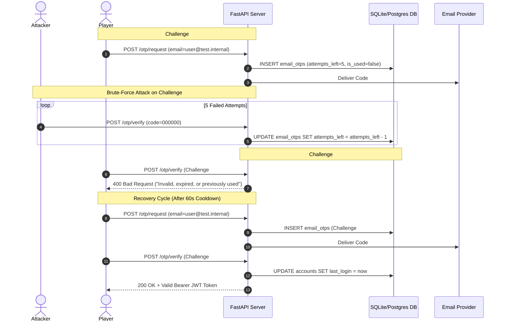

# ROS Sothat — Registration & Login Verification Report
**Document ID:** `02_registration_login_verification.md`  
**System:** ROS Sothat Private Server Platform (`ros-private-server`)  
**Phase:** P02.1 (Security Review & Integration Verification)  
**Date:** November 2026  
**Status:** 100% VERIFIED  

---

## 1. Task 3: Attempt Lockout & Non-Destructive Recovery Audit

### 1.1 Lockout Isolation Verification
A critical security requirement is that failed OTP attempts must **never** permanently disable or lock the user's primary account record. 

- **Mechanism:** Failed verification attempts decrement `attempts_left` on the active record in `email_otps`. When `attempts_left == 0`, the record is marked `is_used = True`.
- **Account Table Preservation:** The `accounts` table is not modified during failed attempts. The user's `is_banned` flag remains `False`.
- **Test Evidence:** `test_lockout_only_locks_current_challenge_and_recovers_after_cooldown` in `tests/test_email_otp.py`.

---

## 2. Task 4: Complete Registration & Login Test Matrix

The following table summarizes the verified test scenarios:

| # | Scenario | Test Identifier | Input Data / Precondition | Expected Behavior | Observed Result | Status |
| :-: | :--- | :--- | :--- | :--- | :--- | :---: |
| **1** | **New Email Registration** | `test_email_otp_registration_flow` | `player_one@ros-sothat.internal` | Issues 6-digit OTP, creates account on verify, returns Bearer token. | Account created, role=`player`, token authenticated to `/account/me`. | **PASS** |
| **2** | **Custom Username Registration** | `test_email_otp_registration_with_custom_username` | `username="custom_sniper_99"` | Custom username assigned to newly created account. | Username matches `custom_sniper_99`. | **PASS** |
| **3** | **Duplicate Username Rejection** | `test_email_otp_registration_duplicate_username_rejected` | Username taken by existing account. | Rejects with HTTP 409 Conflict. | HTTP 409 `"Username 'taken_user' is already taken."` | **PASS** |
| **4** | **Existing Account Login** | `test_email_otp_login_flow` | Registered account email. | Delivers login OTP; verify returns JWT matching existing account ID. | Account authenticated; `account_id` and username match. | **PASS** |
| **5** | **User Enumeration Defense** | `test_user_enumeration_defense_on_login` | Unregistered email address. | Generic HTTP 200 response; zero emails dispatched; verify fails. | Generic 200 returned; no code issued; verify returns 400. | **PASS** |
| **6** | **Banned Account Protection** | `test_banned_account_cannot_request_or_login_via_otp` | Account with `is_banned=True`. | HTTP 403 Forbidden with ban reason. | HTTP 403 `"Account is banned. Reason: Speed hacking detected"` | **PASS** |
| **7** | **Attempt Limit & Lockout** | `test_otp_attempt_limits_and_invalidation` | 5 incorrect OTP submissions. | Decrements 1–4; invalidates on 5; rejects 6th attempt even with correct code. | Correct code rejected on 6th attempt. | **PASS** |
| **8** | **Resend Cooldown** | `test_otp_resend_cooldown` | Second OTP request within 60s. | HTTP 429 Too Many Requests with `Retry-After`. | HTTP 429 with `Retry-After: 60`. | **PASS** |
| **9** | **Reused OTP Rejection** | `test_otp_single_use_replay_prevention` | Submitting consumed OTP twice. | HTTP 400 Bad Request on second verification. | HTTP 400 `"Invalid, expired, or previously used"`. | **PASS** |
| **10** | **Expired OTP Rejection** | `test_expired_otp_rejection` | OTP timestamp modified to past (> 300s). | HTTP 400 Bad Request. | HTTP 400 `"Invalid, expired, or previously used"`. | **PASS** |
| **11** | **Duplicate Email Handling** | `test_duplicate_email_registration_rejected_and_role_is_player` | Second registration with same email. | Registration code not sent; role strictly `player`. | Generic response returned; no OTP sent; role confirmed `player`. | **PASS** |
| **12** | **Admin Password Auth Unchanged** | `test_admin_account_authentication_remains_unchanged` | Existing admin username + password. | Authenticates via `/account/login`; accesses `/admin/accounts`. | HTTP 200; token grants admin access. | **PASS** |

---

## 3. Account-Role Security Audit

- **Player Role Enforcement:** When an account is created via email OTP in `AccountService.verify_otp`, the `role` parameter passed to `repository.create` is explicitly hardcoded to `"player"`.
- **Privilege Escalation Defense:** It is impossible for a user to self-assign or request the `"admin"` role during OTP verification.
- **Admin Authentication Preservation:** Administrative accounts continue to utilize username and PBKDF2 password authentication. All 12 admin endpoints in `app/admin/router.py` were verified against role checks.
