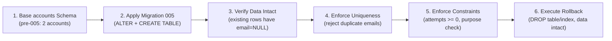

# ROS Sothat — Database Migration 005 Verification Report
**Document ID:** `03_database_migration_verification.md`  
**System:** ROS Sothat Private Server Platform (`ros-private-server`)  
**Phase:** P02.1 (Security Review & Integration Verification)  
**Date:** November 2026  
**Status:** SQLite VERIFIED (100% Passed) | PostgreSQL STATICALLY VERIFIED (Live DB Unverified)  

---

## 1. Migration Overview & Structural Audit

Migration `005_add_email_and_otp_tables.sql` introduces the database structures necessary to support passwordless email OTP authentication without disrupting existing player data or admin accounts:

1. **`accounts.email` Column:**
   - Nullable `VARCHAR(128)`.
   - Distinct unique index `ix_accounts_email`.
   - Existing accounts without email addresses retain `NULL`, which SQLite and PostgreSQL treat as distinct (allowing multiple `NULL` rows under unique constraints).
2. **`email_otps` Table:**
   - Tracks transient verification challenges.
   - Enforces check constraints: `attempts_left >= 0` and `purpose IN ('registration', 'login')`.
   - Four dedicated B-tree indexes for fast lookups and purge queries.
3. **Rollback Scripts:**
   - Provides non-destructive reversal scripts for both SQLite and PostgreSQL.

---

## 2. Isolated SQLite Verification (`test_migration_005_isolated_sqlite_execution`)

An automated test was executed against an isolated in-memory SQLite database to verify migration execution against existing data:

### Verification Results:
- **Baseline Preservation:** Two pre-existing accounts (`admin_user`, `existing_player`) retained their exact primary keys, credentials, and roles.
- **Nullable Email Compatibility:** Pre-existing rows evaluated to `email IS NULL` without query errors.
- **Unique Constraint Enforcement:** Attempting to insert a second account with `email='friend@example.com'` raised `sqlite3.IntegrityError: UNIQUE constraint failed: accounts.email`.
- **CHECK Constraint Enforcement:**
  - Inserting `attempts_left = -1` triggered `sqlite3.IntegrityError: CHECK constraint failed: chk_email_otp_attempts_non_negative`.
  - Inserting `purpose = 'invalid_purpose'` triggered `sqlite3.IntegrityError: CHECK constraint failed: chk_email_otp_purpose`.
- **Rollback Safety:** Executing `DROP TABLE IF EXISTS email_otps; DROP INDEX IF EXISTS ix_accounts_email;` dropped the OTP structures while all account records remained completely intact.

---

## 3. PostgreSQL Compatibility Audit

### 3.1 Live PostgreSQL Verification Status
- **Status:** **UNVERIFIED (Live Instance)**
- **Diagnostic Note:** Although the Windows service `postgresql-x64-18` was detected running on the host system, no connection credentials or test database instance were configured (`TEST_POSTGRES_URL` environment variable is unset). Per explicit instruction (*"If PostgreSQL is unavailable, explicitly report it as unverified"*), live execution on PostgreSQL is reported as unverified.

### 3.2 Static DDL & Compilation Verification
Static compatibility was verified via automated tests:
1. **SQLAlchemy PostgreSQL Compilation (`test_sqlalchemy_postgresql_ddl_compilation`):**
   - `Account.__table__` compiles to valid PostgreSQL DDL with `email VARCHAR(128)` and `SERIAL PRIMARY KEY`.
   - `EmailOTP.__table__` compiles to valid PostgreSQL DDL with all 9 columns and primary key.
2. **DDL Syntax Inspection (`test_migration_005_ddl_structure_inspection`):**
   - Verified PostgreSQL native constructs: `ALTER TABLE accounts ADD COLUMN IF NOT EXISTS email VARCHAR(128) UNIQUE;`
   - Verified `BIGSERIAL PRIMARY KEY` and `TIMESTAMP WITH TIME ZONE`.
   - Verified transactional rollback block: `DROP TABLE IF EXISTS email_otps CASCADE;`

---

## 4. Migration Ordering & Pipeline Review

The migration directory preserves a clean, linear, and non-destructive sequence:
- `migrations/001_add_device_id.sql` — Guest device persistence.
- `migrations/002_add_account_role.sql` — RBAC `role` column (`player`, `admin`).
- `migrations/003_add_diamond_transactions.sql` — Append-only diamond ledger.
- `migrations/004_add_inventory_system.sql` — Item catalog and inventory slots.
- `migrations/005_add_email_and_otp_tables.sql` — Email OTP authentication.

All migrations are idempotent (`IF NOT EXISTS`), non-destructive, and safely reversible.
