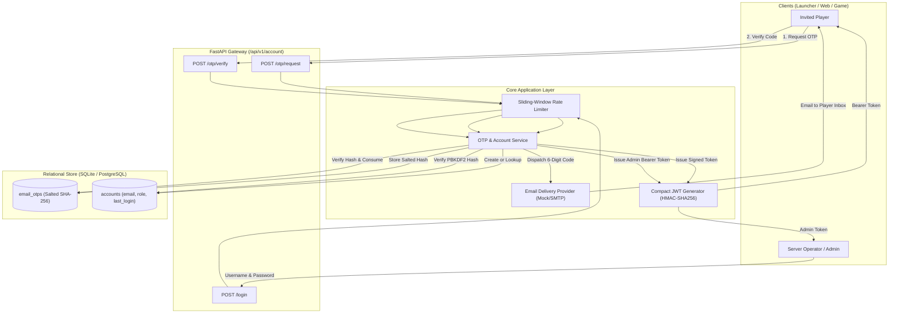

# ROS Sothat — Authentication Architecture
**Document ID:** `02_authentication_architecture.md`  
**System:** ROS Sothat Private Server Platform  
**Phase:** P02 (Backend Foundation & Email OTP Integration)  
**Date:** November 2026  
**Status:** IMPLEMENTED & VERIFIED  

---

## 1. Architecture Overview

ROS Sothat is an invite-only private game server platform accommodating 10–20 invited friends for Rules of Survival Legacy. The platform employs a dual authentication model designed to meet two distinct operational profiles:

1. **Player Authentication (Passwordless Email OTP):**
   - Eliminates password fatigue, brute-force vulnerabilities, and password recovery infrastructure for players.
   - Players register and log in by receiving a 6-digit cryptographic One-Time Password (OTP) in their personal inbox.
   - Upon OTP verification, the backend generates an HMAC-SHA256 Bearer JWT allowing immediate access to game endpoints, character creation, and lobby services.
2. **Administrator Authentication (Credentials & RBAC):**
   - Administrators authenticate using traditional unique usernames and strong passwords hashed with PBKDF2-HMAC-SHA256 (100,000 iterations).
   - Roles (`player` vs `admin`) are verified server-side on every request.
   - Admin access to diamond ledger, inventory granting, and moderation endpoints is protected by strict RBAC guards.



---

## 2. Authentication Workflows

### 2.1 Passwordless Registration Flow
1. **User Action:** The invited friend inputs their email address on the launcher or website and selects **Register**.
2. **Rate Limit & Cooldown Check:** 
   - IP address rate limiter ensures $\le 5$ requests per 60 seconds.
   - Per-email cooldown ensures at least 60 seconds have elapsed since the last OTP request.
3. **Enumeration Protection:** If the email is already registered, a generic confirmation response is returned, preventing email harvesting.
4. **Code Generation & Storage:**
   - A cryptographically random 6-digit numeric string ($100000 \le \text{code} \le 999999$) is generated using Python `secrets.randbelow`.
   - A 16-byte random hex salt is generated.
   - Salted SHA-256 hash: $\text{hash} = \text{SHA256}(\text{salt} \parallel \text{code})$.
   - The record is stored in `email_otps` with `expires_at = now + 300s` and `attempts_left = 5`.
   - Any prior unconsumed OTPs for this email are invalidated (`is_used = True`).
5. **Dispatch:** The code is transmitted via the active `EmailProvider` (SMTP in production, Mock in automated test suites).
6. **Verification & Activation:**
   - The player submits the received 6-digit code (and an optional custom username).
   - The backend checks validity, expiration, and constant-time hash equivalence.
   - A new record is inserted into `accounts`:
     - `email`: player email (normalized lowercase).
     - `username`: chosen username or sanitized email local-part.
     - `password_hash`: sentinel string `*OTP_ONLY_<random>*` (strictly non-loginable with passwords).
     - `role`: `"player"`.
   - A Bearer access token is issued and returned.

### 2.2 Passwordless Login Flow
1. **User Action:** A returning player inputs their email and clicks **Login**.
2. **Enumeration Protection:** If the email does not exist in `accounts`, an identical generic 200 OK response is returned: `"If this email is registered, a verification code has been sent."` No email is dispatched, preventing user reconnaissance.
3. **Ban Check:** If the account is banned, the server returns HTTP 403 Forbidden with the ban reason.
4. **Code Verification:** The player submits the 6-digit code.
5. **Consumption & Token Issue:**
   - The OTP record is marked consumed (`is_used = True`).
   - The account's `last_login` timestamp is updated.
   - An HMAC-SHA256 Bearer JWT token is issued.

### 2.3 Administrative Password Authentication (Preserved)
- Dedicated administrators authenticate via `POST /api/v1/account/login` using username and password.
- Verification uses constant-time `hmac.compare_digest` over PBKDF2-HMAC-SHA256 hashes.
- Banned administrators cannot authenticate.
- Role claim `"role": "admin"` is embedded in the JWT payload and dynamically re-verified against the database on protected endpoints (`get_current_admin`).

---

## 3. Session & Token Architecture

The private server utilizes a lightweight, self-contained compact JWT structure:
```
<base64url_payload>.<base64url_hmac_sha256_signature>
```

### Payload Structure
```json
{
  "sub": 1042,
  "username": "sniper_elite",
  "role": "player",
  "exp": 1731682800
}
```

- **Signing Key:** `settings.SECRET_KEY` (minimum 32 bytes).
- **Default Lifespan:** 1440 minutes (24 hours), configurable via `ACCESS_TOKEN_EXPIRE_MINUTES`.
- **Dynamic Invalidation:** Every authenticated request queries the database via `get_current_account` to ensure the user is neither deleted nor banned. Banned accounts are instantly rejected with HTTP 403, even if their token has not expired.
