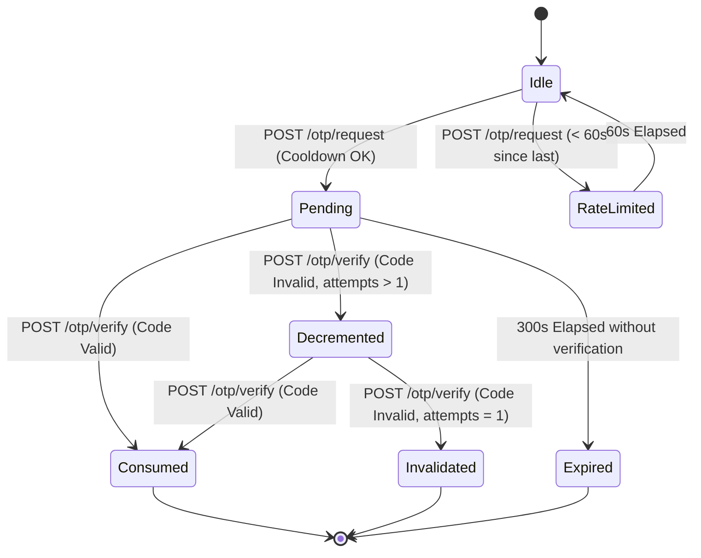

# ROS Sothat — OTP Security Design & Threat Mitigation
**Document ID:** `03_otp_security_design.md`  
**System:** ROS Sothat Private Server Platform  
**Phase:** P02 (Backend Foundation & Email OTP Integration)  
**Date:** November 2026  
**Status:** IMPLEMENTED & AUDITED  

---

## 1. Security Architecture & Threat Matrix

Email One-Time Passwords (OTPs) provide frictionless, passwordless authentication for 10–20 invited friends. However, without stringent architectural controls, OTP systems are vulnerable to brute-force attacks, timing discrepancies, replay exploitation, and user enumeration.

The following threat matrix summarizes each risk and the technical countermeasures implemented in Phase P02:

| Threat Vector | Attack Scenario | Implemented Countermeasure | Verification Mechanism |
| :--- | :--- | :--- | :--- |
| **Brute-Force Search** | Attacker iterates through the $10^6$ 6-digit code space ($000000$ to $999999$). | Strict 5-attempt limit per issued OTP. Code is marked invalid immediately on the 5th failure. | Verified by `test_otp_attempt_limits_and_invalidation`. |
| **Timing Attack** | Attacker observes microsecond differences in string comparison to deduce digits. | `hmac.compare_digest` constant-time comparison on hashes. | Code review of `AccountService.verify_otp_hash`. |
| **Database Compromise** | An attacker gains read access to the database or SQL backups. | Plaintext OTP is NEVER stored. Only salted SHA-256 hashes with unique 16-byte random salts are persisted. | Verified by `test_database_stores_salted_hash_not_plaintext`. |
| **User Enumeration** | Attacker calls `/otp/request` with lists of target emails to determine who is registered. | Identical generic HTTP 200 response returned regardless of account existence. | Verified by `test_user_enumeration_defense_on_login`. |
| **Replay Attack** | Attacker intercepts a previously used code and attempts to submit it again. | Explicit single-use consumption (`is_used = True`) upon successful authentication. | Verified by `test_otp_single_use_replay_prevention`. |
| **Email Bombing / Spam** | Attacker floods an invited user's inbox with dozens of OTP requests. | Enforced 60-second cooldown per email, coupled with IP-based sliding-window rate limits (5 req/60s). | Verified by `test_otp_resend_cooldown`. |
| **Stale Code Reuse** | Player enters an outdated OTP code hours or days later. | Strict 5-minute TTL (`expires_at = created_at + 300s`) enforced at DB query level. | Verified by `test_expired_otp_rejection`. |
| **Concurrent OTP Desync** | Player requests multiple OTPs rapidly; older codes remain usable. | Issuing a new OTP immediately invalidates all prior unconsumed codes for that email. | Invalidation query executed in `repository.invalidate_otps_for_email`. |
| **Plaintext Leak in Logs** | Monitoring or logging agents capture plaintext OTP codes from standard output. | Plaintext codes are NEVER logged. Emails are masked in all logs (`j***n@example.com`). | Verified via log formatting inspection. |
| **Password Bypass on OTP Accounts** | Attacker attempts to log into an OTP-only account using `/account/login` with an empty or guessed password. | OTP accounts are created with a disabled sentinel hash (`*OTP_ONLY_<hex>*`). `verify_password` explicitly rejects any account with this prefix. | Unit tested and enforced in `AccountService.verify_password`. |

---

## 2. Cryptographic Implementation Details

### 2.1 Code Generation
OTP codes are generated using Python's cryptographically secure pseudo-random number generator (`secrets`), which interfaces directly with operating system entropy pools (`CryptGenRandom` on Windows, `getrandom` on Linux):
```python
@staticmethod
def generate_otp_code() -> str:
    """Generates a cryptographically random 6-digit numeric OTP in [100000, 999999]."""
    return f"{secrets.randbelow(900000) + 100000:06d}"
```
- **Code Entropy:** $\log_2(900,000) \approx 19.78$ bits of entropy.
- Capping attempts to 5 restricts the probability of random guessing to:
  $$\mathbb{P}(\text{success}) = \frac{5}{900,000} \approx 0.00055\% \quad (1 \text{ in } 180,000)$$

### 2.2 Storage & Salting
Before persisting to the database, a unique 16-byte cryptographically random salt is generated:
```python
salt = secrets.token_hex(16)
otp_hash = hashlib.sha256(f"{salt}:{code}".encode("utf-8")).hexdigest()
```
The database stores:
- `otp_hash`: 64-character hex SHA-256 string
- `salt`: 32-character hex salt string
- Raw `code` is discarded from memory immediately after email dispatch.

### 2.3 Constant-Time Verification
```python
@classmethod
def verify_otp_hash(cls, code: str, salt: str, expected_hash: str) -> bool:
    computed = cls.hash_otp(code, salt)
    return hmac.compare_digest(computed, expected_hash)
```
`hmac.compare_digest` executes in time proportional to the length of the buffers, preventing side-channel timing leaks.

---

## 3. Cooldown & Attempt Lifecycle State Machine



---

## 4. Privacy & Telemetry Masking

All logging outputs and API responses sanitize user identity to prevent shoulder-surfing and log-indexing exposures:
```python
def mask_email(email: str) -> str:
    local_part, domain = email.split("@", 1)
    if len(local_part) <= 2:
        masked_local = local_part[0] + "***"
    else:
        masked_local = local_part[0] + "***" + local_part[-1]
    return f"{masked_local}@{domain}"
```
Example transformations:
- `player_one@ros-sothat.internal` $\to$ `p***e@ros-sothat.internal`
- `al@example.com` $\to$ `a***@example.com`
- `alexander@domain.com` $\to$ `a***r@domain.com`
