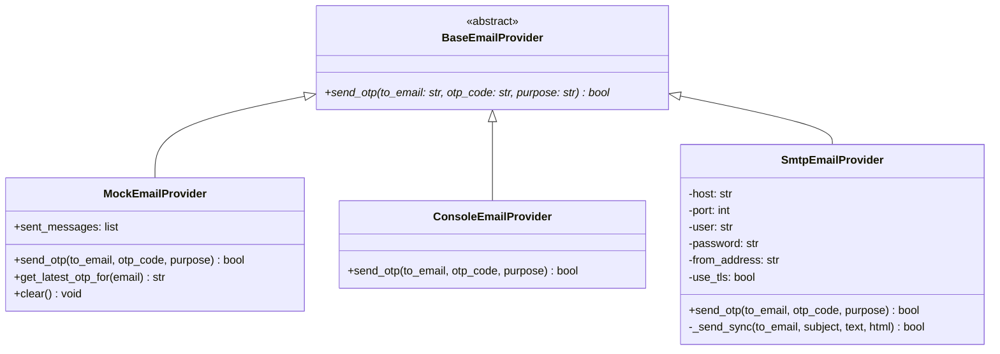

# ROS Sothat — Email Provider Setup & Configuration Guide
**Document ID:** `04_email_provider_setup.md`  
**System:** ROS Sothat Private Server Platform  
**Phase:** P02 (Backend Foundation & Email OTP Integration)  
**Date:** November 2026  
**Status:** IMPLEMENTED & DOCUMENTED  

---

## 1. Provider Architecture

To support seamless testing, offline development, and flexible production operations, the ROS Sothat private server adopts a pluggable email provider pattern defined under `app/email/provider.py`.



### Provider Selection
The active provider is resolved at runtime via the `EMAIL_PROVIDER` environment variable:
- `EMAIL_PROVIDER=mock` (Default): Captures all dispatched emails in an in-memory queue. Used for automated tests and CI without external network access.
- `EMAIL_PROVIDER=console`: Outputs masked OTP dispatch alerts to stdout for local developer debugging.
- `EMAIL_PROVIDER=smtp`: Connects to an external or local SMTP server using TLS/STARTTLS and delivers real emails.

---

## 2. Configuration Parameters

The following parameters are configured in `app/config.py` and overrideable via environment variables:

| Environment Variable | Type | Default Value | Description |
| :--- | :--- | :--- | :--- |
| `EMAIL_PROVIDER` | string | `"mock"` | Provider mode: `"mock"`, `"console"`, or `"smtp"` |
| `SMTP_HOST` | string | `"localhost"` | SMTP server hostname or IP address |
| `SMTP_PORT` | integer | `587` | SMTP port (`587` for STARTTLS, `465` for SSL, `25` for unencrypted local relay) |
| `SMTP_USER` | string | `""` | SMTP username / API user (leave empty if unauthenticated) |
| `SMTP_PASSWORD` | string | `""` | SMTP password / API token / App password |
| `SMTP_FROM` | string | `"noreply@ros-sothat.internal"` | Sender email header in outgoing messages |
| `SMTP_TLS` | boolean | `true` | Upgrade connection via STARTTLS when using port 587/25 |
| `OTP_EXPIRE_SECONDS` | integer | `300` | Expiration TTL for issued OTP codes (5 minutes) |
| `OTP_RESEND_COOLDOWN_SECONDS` | integer | `60` | Minimum wait duration before requesting another code |
| `OTP_MAX_ATTEMPTS` | integer | `5` | Maximum failed verification attempts before invalidation |

---

## 3. Production Deployment Guides

### 3.1 Option A: Gmail / Google Workspace (Simple Setup for 10–20 Friends)
For a small private server with 10–20 friends, a standard Gmail or Google Workspace account with an **App Password** is highly reliable and free:

1. Enable 2-Step Verification on the host Google Account.
2. Generate an App Password under **Security $\to$ 2-Step Verification $\to$ App passwords**.
3. Set the following environment variables:
```bash
EMAIL_PROVIDER=smtp
SMTP_HOST=smtp.gmail.com
SMTP_PORT=587
SMTP_USER=rossothat.notifications@gmail.com
SMTP_PASSWORD=xxxx-xxxx-xxxx-xxxx   # 16-character App Password
SMTP_FROM="ROS Sothat <rossothat.notifications@gmail.com>"
SMTP_TLS=true
```

### 3.2 Option B: SendGrid / Resend / AWS SES (Dedicated Transactional Service)
For dedicated cloud deployment with high deliverability:
```bash
EMAIL_PROVIDER=smtp
SMTP_HOST=smtp.sendgrid.net
SMTP_PORT=587
SMTP_USER=apikey
SMTP_PASSWORD=SG.your_sendgrid_api_key_here
SMTP_FROM="ROS Sothat <noreply@ros-sothat.yourdomain.com>"
SMTP_TLS=true
```

### 3.3 Option C: Local Development with Mailpit / MailHog
For testing real SMTP formatting locally without sending emails over the internet:
```bash
# Run Mailpit via Docker
docker run -d --name mailpit -p 1025:1025 -p 8025:8025 axllent/mailpit

# Configure backend environment
EMAIL_PROVIDER=smtp
SMTP_HOST=localhost
SMTP_PORT=1025
SMTP_USER=""
SMTP_PASSWORD=""
SMTP_FROM="noreply@ros-sothat.internal"
SMTP_TLS=false
```
Open `http://localhost:8025` to view incoming HTML and plain-text verification emails.

---

## 4. Email Template & Formatting

Every email is formatted as a `multipart/alternative` message containing both plaintext and styled HTML versions:

- **Subject:** `ROS Sothat Verification Code: <OTP>`
- **Plaintext Body:**
  ```text
  Hello,

  Your ROS Sothat one-time verification code is: 492817

  This code will expire in 5 minutes.
  If you did not request this registration code, please ignore this email.

  — ROS Sothat Team
  ```
- **HTML Body:**
  Features clean typography with high-contrast 28px bold digits and branded headers.
