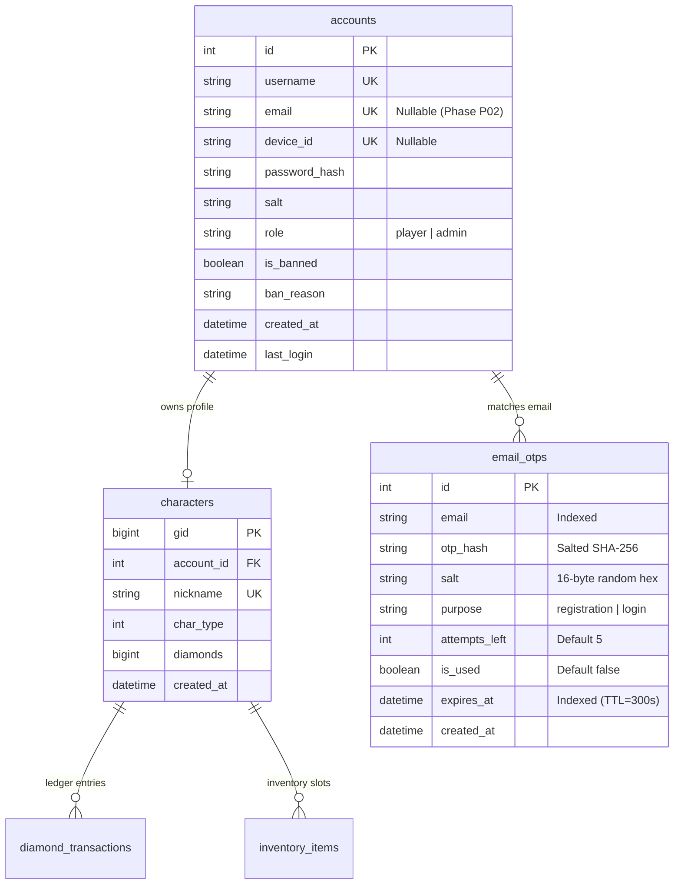

# ROS Sothat — Database Schema Changes & Migration Specification
**Document ID:** `05_database_changes.md`  
**System:** ROS Sothat Private Server Platform  
**Phase:** P02 (Backend Foundation & Email OTP Integration)  
**Date:** November 2026  
**Status:** IMPLEMENTED & MIGRATION AUTHORED  

---

## 1. Schema Overview & Impact Analysis

Phase P02 introduces passwordless email OTP authentication without modifying or dropping existing tables, rows, or constraints. All schema modifications are strictly **non-destructive** and backward-compatible with existing admin accounts, character profiles, diamond ledgers, and inventory records.

### Summary of Changes:
1. **`accounts` Table Modification:**
   - Added column `email VARCHAR(128)` (nullable, unique, indexed).
   - Existing accounts without emails remain valid with `NULL` email values.
   - Passwordless accounts use a sentinel hash `*OTP_ONLY_<random>*` in `password_hash`, satisfying the existing `NOT NULL` constraint without permitting password logins.
2. **`email_otps` Table Addition:**
   - Dedicated table for tracking transient OTP verification codes, expiration timestamps, attempt counters, and consumption flags.

---

## 2. Entity-Relationship Model (Updated)



---

## 3. Data Dictionary: `email_otps`

| Column Name | Data Type | Nullable | Default | Description |
| :--- | :--- | :--- | :--- | :--- |
| `id` | `INTEGER` (SQLite) / `BIGSERIAL` (PostgreSQL) | `NO` | Auto | Primary key identifier |
| `email` | `VARCHAR(128)` | `NO` | None | Normalized lowercase recipient email address |
| `otp_hash` | `VARCHAR(64)` | `NO` | None | SHA-256 hash of `salt:code` (plaintext never stored) |
| `salt` | `VARCHAR(32)` | `NO` | None | 16-byte cryptographically random hex salt |
| `purpose` | `VARCHAR(16)` | `NO` | None | Allowed values: `'registration'`, `'login'` |
| `attempts_left` | `INTEGER` | `NO` | `5` | Remaining verification attempts before permanent invalidation |
| `is_used` | `BOOLEAN` | `NO` | `FALSE` | Single-use consumption flag (`1`/`TRUE` once verified) |
| `expires_at` | `TIMESTAMP` | `NO` | None | Absolute expiration time (created_at + 300 seconds) |
| `created_at` | `TIMESTAMP` | `NO` | `CURRENT_TIMESTAMP` | Audit timestamp of code issuance |

### Constraints:
- `chk_email_otp_attempts_non_negative`: `CHECK (attempts_left >= 0)`
- `chk_email_otp_purpose`: `CHECK (purpose IN ('registration', 'login'))`

### Indexes:
- `ix_email_otps_id`: Primary index on `id`.
- `ix_email_otps_email`: B-tree index on `email` for rapid verification lookups.
- `ix_email_otps_expires_at`: Index on `expires_at` for high-performance purge/expiration checks.
- `ix_email_otps_created_at`: Index on `created_at` for ordering and cooldown calculation.

---

## 4. DDL Specification (`migrations/005_add_email_and_otp_tables.sql`)

### 4.1 SQLite Implementation
```sql
-- 1. Add email column to existing accounts table
ALTER TABLE accounts ADD COLUMN email VARCHAR(128);
CREATE UNIQUE INDEX IF NOT EXISTS ix_accounts_email ON accounts (email);

-- 2. Create email_otps table
CREATE TABLE IF NOT EXISTS email_otps (
    id INTEGER PRIMARY KEY AUTOINCREMENT,
    email VARCHAR(128) NOT NULL,
    otp_hash VARCHAR(64) NOT NULL,
    salt VARCHAR(32) NOT NULL,
    purpose VARCHAR(16) NOT NULL,
    attempts_left INTEGER NOT NULL DEFAULT 5,
    is_used BOOLEAN NOT NULL DEFAULT 0,
    expires_at TIMESTAMP NOT NULL,
    created_at TIMESTAMP NOT NULL DEFAULT CURRENT_TIMESTAMP,
    CONSTRAINT chk_email_otp_attempts_non_negative CHECK (attempts_left >= 0),
    CONSTRAINT chk_email_otp_purpose CHECK (purpose IN ('registration', 'login'))
);

CREATE INDEX IF NOT EXISTS ix_email_otps_id ON email_otps(id);
CREATE INDEX IF NOT EXISTS ix_email_otps_email ON email_otps(email);
CREATE INDEX IF NOT EXISTS ix_email_otps_expires_at ON email_otps(expires_at);
CREATE INDEX IF NOT EXISTS ix_email_otps_created_at ON email_otps(created_at);
```

### 4.2 PostgreSQL Implementation
```sql
-- 1. Add email column to existing accounts table
ALTER TABLE accounts ADD COLUMN IF NOT EXISTS email VARCHAR(128) UNIQUE;
CREATE INDEX IF NOT EXISTS ix_accounts_email ON accounts (email);

-- 2. Create email_otps table
CREATE TABLE IF NOT EXISTS email_otps (
    id BIGSERIAL PRIMARY KEY,
    email VARCHAR(128) NOT NULL,
    otp_hash VARCHAR(64) NOT NULL,
    salt VARCHAR(32) NOT NULL,
    purpose VARCHAR(16) NOT NULL,
    attempts_left INTEGER NOT NULL DEFAULT 5,
    is_used BOOLEAN NOT NULL DEFAULT FALSE,
    expires_at TIMESTAMP WITH TIME ZONE NOT NULL,
    created_at TIMESTAMP WITH TIME ZONE NOT NULL DEFAULT CURRENT_TIMESTAMP,
    CONSTRAINT chk_email_otp_attempts_non_negative CHECK (attempts_left >= 0),
    CONSTRAINT chk_email_otp_purpose CHECK (purpose IN ('registration', 'login'))
);

CREATE INDEX IF NOT EXISTS ix_email_otps_id ON email_otps(id);
CREATE INDEX IF NOT EXISTS ix_email_otps_email ON email_otps(email);
CREATE INDEX IF NOT EXISTS ix_email_otps_expires_at ON email_otps(expires_at);
CREATE INDEX IF NOT EXISTS ix_email_otps_created_at ON email_otps(created_at);
```
