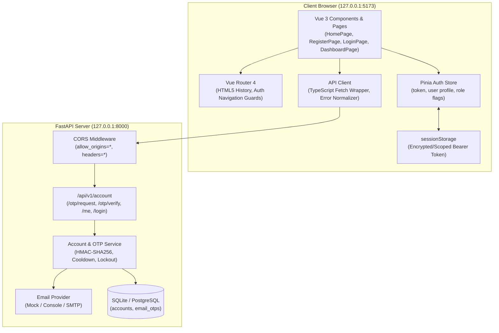
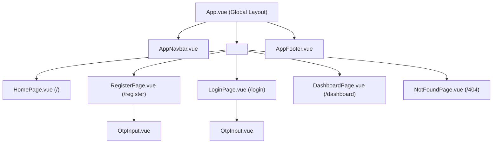

# ROS Sothat — Phase P03: Website Architecture
**Document ID:** `01_website_architecture.md`  
**System:** ROS Sothat Private Server Platform  
**Target:** Website Frontend Application (`ros-website`)  
**Date:** November 2026  
**Status:** IMPLEMENTED & VERIFIED  

---

## 1. Architectural Overview

The ROS Sothat website is an independent single-page application (SPA) built using **Vue 3**, **Vite**, **TypeScript**, **Vue Router 4**, and **Pinia**. It is designed specifically as the player community portal and authentication gateway for 10–20 invited friends connecting to the Rules of Survival Legacy private server ecosystem.



---

## 2. Directory Structure

The frontend is housed cleanly in `D:\ROS-Legacy-Analysis\ros-website`, maintaining complete separation from binary extraction and protocol research folders:

```text
ros-website/
├── dist/                     # Production build artifacts (index.html, JS, CSS)
├── node_modules/             # Installed Node dependencies
├── src/
│   ├── assets/               # Brand vectors and graphics
│   ├── components/           # Reusable UI components
│   │   ├── AppNavbar.vue     # Sticky navigation with mobile drawer
│   │   ├── AppFooter.vue     # Tactical footer with disclaimers and status
│   │   └── OtpInput.vue      # 6-box accessible numeric OTP input
│   ├── pages/                # Route views
│   │   ├── HomePage.vue      # Landing page, ecosystem roadmap, announcements
│   │   ├── RegisterPage.vue  # Email request + OTP verification registration
│   │   ├── LoginPage.vue     # Email OTP login + Admin password login
│   │   ├── DashboardPage.vue # Protected player telemetry and feature status
│   │   └── NotFoundPage.vue  # Tactical 404 error view
│   ├── router/
│   │   └── index.ts          # Vue Router configuration & navigation guards
│   ├── services/
│   │   ├── api.ts            # Typed HTTP client with ApiError handling
│   │   └── auth.ts           # Authentication service methods
│   ├── stores/
│   │   └── auth.ts           # Reactive Pinia authentication store
│   ├── styles/
│   │   └── main.css          # Dark tactical theme, buttons, inputs, alerts
│   ├── types/
│   │   └── auth.ts           # TypeScript interfaces matching backend models
│   ├── App.vue               # Root layout component
│   ├── env.d.ts              # Ambient Vite typing declarations
│   └── main.ts               # Application entry point
├── tests/
│   └── unit/                 # Vitest automated unit test suites
│       ├── auth_service.spec.ts
│       ├── auth_store.spec.ts
│       ├── otp_input.spec.ts
│       └── router_guards.spec.ts
├── .env                      # Local development environment configuration
├── .env.example              # Template environment configuration
├── .gitignore                # Git ignore rules
├── index.html                # Single-page HTML shell
├── package.json              # Dependencies and build scripts
├── tsconfig.json             # TypeScript compiler settings
└── vite.config.ts            # Vite & Vitest configuration
```

---

## 3. Component Hierarchy & Flow



---

## 4. State & Session Lifecycle

1. **Cold Boot:**
   - On initial page load, `App.vue` checks `sessionStorage` for `ros_sothat_token`.
   - If present, `authStore.initSession()` issues `GET /api/v1/account/me` to revalidate the token and retrieve account telemetry.
   - If the token is expired, corrupted, or rejected (HTTP 401/403), `authStore.logout()` purges the token and clears `sessionStorage`.
2. **Navigation Guard:**
   - Routes flagged with `meta: { requiresAuth: true }` intercept unauthenticated navigation and redirect to `/login?redirect=<path>`.
   - Once authenticated, accessing `/login` or `/register` automatically redirects to `/dashboard`.
3. **Logout:**
   - Explicit invocation of `logout()` clears in-memory state and storage, redirecting to `/login`.
