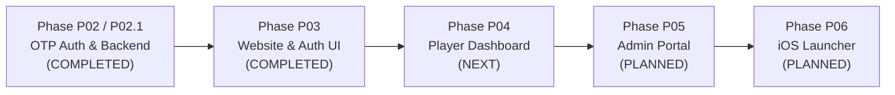

# Phase P03 — Known Limitations & Future Phase Handoffs

**Document:** `08_known_limitations.md`  
**Phase:** P03 (Website Implementation)  
**Project:** ROS Sothat (Private Rules of Survival Legacy Server Platform)  
**Scope:** Technical Boundaries, Constraints, and Downstream Phase Transitions  
**Security Level:** Read-Only Analysis / Local Isolated Implementation  

---

## 1. Scope Boundary Enforcement

Phase P03 is strictly bounded to the **Website Implementation**:
- Establishing the project frontend structure (`ros-website`).
- Implementing the visual tactical theme and responsive layouts.
- Implementing the passwordless Email OTP registration, verification, and login flows.
- Providing a functional, authenticated landing dashboard displaying the verified operator profile.
- Verifying cross-origin API integration with `ros-private-server`.

Per the project roadmap, downstream phases must not be implemented prematurely:
- **Phase P04 (Player Dashboard):** Will implement deep character customization, inventory inspection, item equipping, diamond purchase/gift simulation, and player stats. The current `/dashboard` page intentionally displays clean "In Development" placeholders for these features.
- **Phase P05 (Admin Dashboard):** Will implement administrative RBAC management, account bans, diamond ledger adjustments, server configuration, and live match monitoring.
- **Phase P06 (iOS Companion Launcher):** Will implement the native/hybrid launcher, Ad Hoc IPA download manifest (`itms-services://`), and URL scheme handoff (`rosmobile://`).

---

## 2. Technical Limitations & Environment Constraints

### 2.1 Local Isolated Network Environment
- **Loopback Binding:** In strict compliance with protection rules, both the backend (`127.0.0.1:8000`) and the Vite dev server (`127.0.0.1:5173`) bind exclusively to the local loopback interface. No external network ports or public hosting services (such as Render, Vercel, or AWS) have been configured or exposed.
- **CORS Permissiveness:** The backend currently allows all origins (`*`) in development. When moving toward production deployment for the 10–20 invited friends, this should be tightened to the specific domain or origin hosting the static web assets.

### 2.2 Email OTP Delivery in Local Development
- **Console / Mock Provider Only:** In the local development environment, OTP verification codes are printed directly to the backend terminal log (`ConsoleEmailProvider`). No external SMTP servers (e.g., Mailgun, SendGrid, Amazon SES) are invoked.
- **Production Prerequisite:** When transitioning to private hosting for invited friends, valid SMTP credentials and TLS configurations must be supplied in environment variables to dispatch genuine emails.

### 2.3 Session Ephemerality via `sessionStorage`
- **Tab Isolation:** Authentication tokens are maintained in reactive memory and mirrored to `sessionStorage`. Closing the browser tab or window terminates the session immediately.
- **Rationale & Trade-off:** While this provides robust defense against session hijacking and lingering tokens on shared computers, it requires users to re-authenticate with a fresh 6-digit OTP when opening a new tab. If longer persistent sessions are desired in the future, a secure refresh token mechanism (e.g. HttpOnly cookie rotation) may be evaluated.

### 2.4 Download Packages & Game Client Handoff
- **Ad Hoc Distribution Preparation:** The website features download status badges ("Packaging Phase Pending", "Apple Ad Hoc Certificate Pending") on the Home and Dashboard pages.
- **No Modified IPA Generation:** In accordance with the Absolute Protection Rules, no distribution IPAs, test packages, or manifest files (`manifest.plist`) have been generated or hosted on the website.

---

## 3. Recommended Roadmap for Subsequent Phases

1. **Phase P04 — Full Player Dashboard:**
   - Expand `DashboardPage.vue` into dedicated views: Character Manager, Diamond Ledger History, and Inventory Inspection.
   - Connect to existing backend endpoints (`/api/v1/characters/me`, `/api/v1/inventory/me`, `/api/v1/diamonds/balance`).
2. **Phase P05 — Administrative Portal:**
   - Implement dedicated admin views guarded by `isAdmin` claims.
   - Provide diamond granting, user activation/suspension, and audit log inspection.
3. **Phase P06 — iOS Companion Launcher & Distribution Integration:**
   - Implement the iOS companion app and download distribution page once Apple Developer credentials and Ad Hoc provisioning profiles are formally registered by the project owner.
