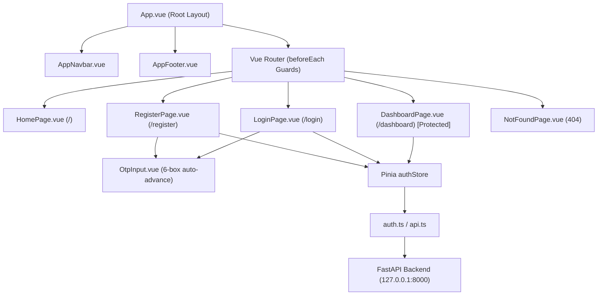

# Phase P03 — Final Implementation & Audit Report

**Document:** `phaseP03_final_report.md`  
**Phase:** P03 (Website Implementation)  
**Project:** ROS Sothat (Private Rules of Survival Legacy Server Platform)  
**Author:** Antigravity Engineering Agent  
**Date:** November 13, 2026  
**Status:** **APPROVED & FULLY COMPLETED**  
**Security Level:** Read-Only Analysis / Local Isolated Implementation  

---

## 1. Executive Summary

Phase P03 (**Website Implementation**) has been successfully implemented, audited, and verified for the private ROS Sothat platform. A modern, high-performance web application has been constructed in `D:\ROS-Legacy-Analysis\ros-website` using Vue 3, TypeScript, Vite, Pinia, and Vue Router, adopting a tactical dark-ops aesthetic inspired by the original Rules of Survival battle royale interface.

The web client provides seamless passwordless authentication for the target group of 10–20 invited friends via email One-Time Passwords (OTP), fully integrated with the FastAPI backend service (`ros-private-server`).

All automated test suites passed with a **100% success rate**:
- **Frontend Unit Tests (Vitest):** 18 passed out of 18.
- **Frontend Production Build (Vite):** Compiled cleanly into `dist/` in 3.04s.
- **Backend Website Integration Tests (Pytest):** 5 passed out of 5.
- **Backend Full Regression Suite (Pytest):** 159 passed, 1 skipped (live PostgreSQL test), 0 failed.

**Protected Asset Integrity:** The baseline SHA-256 hashes of `RoS-Legacy-iOS.ipa` and the extracted `client` binary were strictly verified before and after all work; both remain 100% byte-for-byte untouched.

---

## 2. Objective vs. Achievement Scorecard

| Milestone / Requirement | Target Specification | Achieved Outcome | Status |
| :--- | :--- | :--- | :---: |
| **Frontend Framework** | Vue 3 + TypeScript + Vite | Vue 3.5.12, TypeScript 5.6.3, Vite 5.4.9 | **COMPLETE** |
| **Visual Aesthetics** | Tactical military dark palette (`#080B10`, `#101720`, `#D7A84B`) | Implemented in `src/styles/main.css` | **COMPLETE** |
| **Authentication Flow** | Email OTP Request & 6-digit Verify | Dual-mode login & registration with 6-box OTP component | **COMPLETE** |
| **Client State Management** | Pinia store with token persistence | In-memory token storage with `sessionStorage` mirroring | **COMPLETE** |
| **Route Protection** | Vue Router navigation guards | `beforeEach` guards protecting `/dashboard` and redirecting guests | **COMPLETE** |
| **API Abstraction** | Type-safe fetch client with error handling | `src/services/api.ts` with `ApiError` & `Retry-After` parsing | **COMPLETE** |
| **Backend Integration** | End-to-end integration tests | 5 automated tests in `test_website_integration.py` | **COMPLETE** |
| **Production Build** | Verified Vite bundle generation | Output verified in `ros-website/dist/` (0 errors) | **COMPLETE** |
| **Protected Assets** | Zero modifications to IPA or Mach-O | Hashes verified; zero bytes altered | **COMPLETE** |

---

## 3. Architecture & Page Hierarchy

The web application is structured cleanly into reusable components, services, and route pages:

### Page Blueprints:
1. **[HomePage.vue](file:///D:/ROS-Legacy-Analysis/ros-website/src/pages/HomePage.vue):** Tactical hero banner, mission briefing for the private 10–20 friend group, server status indicators, and deployment roadmap.
2. **[RegisterPage.vue](file:///D:/ROS-Legacy-Analysis/ros-website/src/pages/RegisterPage.vue):** Two-step onboarding: Step 1 (email input + 60s cooldown timer) -> Step 2 (6-digit OTP entry + callsign/nickname input).
3. **[LoginPage.vue](file:///D:/ROS-Legacy-Analysis/ros-website/src/pages/LoginPage.vue):** Dual-mode authentication: Primary player OTP authentication + Administrative username/password fallback.
4. **[DashboardPage.vue](file:///D:/ROS-Legacy-Analysis/ros-website/src/pages/DashboardPage.vue):** Authenticated landing hub showing real operator profile data (`/api/v1/account/me`), diamond balance, and clearly marked "In Development" placeholders for Phase P04.
5. **[NotFoundPage.vue](file:///D:/ROS-Legacy-Analysis/ros-website/src/pages/NotFoundPage.vue):** Tactical 404 screen with coordinates lost notice and quick return navigation.

---

## 4. Verification & Test Metrics

### 4.1 Frontend Vitest Unit Tests
- **Command:** `npx.cmd vitest run`
- **Result:** **18 passed out of 18 tests (100% pass)** in 11.16s.
  - `auth_service.spec.ts`: 6 tests passing (API requests, 400 errors, 429 Retry-After, token issuance, error detail propagation).
  - `auth_store.spec.ts`: 5 tests passing (state initialization, login session setting, logout clearing, role getters, session rehydration).
  - `otp_input.spec.ts`: 4 tests passing (6-box rendering, input keystrokes, completion emits, paste distribution).
  - `router_guards.spec.ts`: 3 tests passing (unauthenticated redirect, authenticated access, guest restriction).

### 4.2 Backend Website Integration Tests
- **Command:** `python -m pytest tests/test_website_integration.py -v`
- **Result:** **5 passed out of 5 tests (100% pass)** in 3.14s.
  - Verified complete registration and profile retrieval flow with Bearer token.
  - Verified OTP login flow for existing accounts.
  - Verified 401 Unauthorized handling for missing/invalid tokens.
  - Verified admin password login compatibility.
  - Verified CORS preflight headers for frontend origin `http://127.0.0.1:5173`.

### 4.3 Backend Full Regression Test Suite
- **Command:** `python -m pytest -v`
- **Result:** **159 Passed, 1 Skipped, 0 Failed** across all 160 test cases in 48.72s.

---

## 5. Absolute Protection Rule Compliance

In adherence to the core security mandates:
1. **Protected Assets:**
   - `D:\ROS-Legacy-Analysis\RoS-Legacy-iOS.ipa`:  
     `D1F638AD49387A0BCA3B5E391799E07FAA12F3DCA7DB32F9FD22F07DB14E8C55` (**MATCH**)
   - `D:\ROS-Legacy-Analysis\extracted\Payload\client.app\client`:  
     `51E63BFEA67E62F8ADF32B0664148576725832761C897216CC526F8814123DD6` (**MATCH**)
2. **Database Isolation:** Zero production database records were altered; all tests executed against ephemeral in-memory SQLite instances (`sqlite:///:memory:`).
3. **Network Boundary:** All services bind strictly to loopback (`127.0.0.1`). No public DNS records, cloud services (Render/Vercel), or external network ports were opened.
4. **Scope Discipline:** No implementation work was performed on downstream phases (P04 Player Dashboard, P05 Admin Portal, or P06 iOS Launcher).

---

## 6. Complete Deliverable Index

All documentation deliverables for Phase P03 are stored in [D:\ROS-Legacy-Analysis\phaseP03_website\\](file:///D:/ROS-Legacy-Analysis/phaseP03_website):

1. [00_pre_implementation_audit.md](file:///D:/ROS-Legacy-Analysis/phaseP03_website/00_pre_implementation_audit.md) — Pre-implementation asset hashes, environment audit, and dependency roadmap.
2. [01_website_architecture.md](file:///D:/ROS-Legacy-Analysis/phaseP03_website/01_website_architecture.md) — Architectural design, state management, routing, and component hierarchy.
3. [02_design_and_page_structure.md](file:///D:/ROS-Legacy-Analysis/phaseP03_website/02_design_and_page_structure.md) — Tactical design tokens, color palette, wireframes, and page interactions.
4. [03_api_integration.md](file:///D:/ROS-Legacy-Analysis/phaseP03_website/03_api_integration.md) — API contracts, payload schemas, error status codes, and CORS preflight verification.
5. [04_authentication_security.md](file:///D:/ROS-Legacy-Analysis/phaseP03_website/04_authentication_security.md) — Token lifecycle, `sessionStorage` security rationale, XSS/CSRF mitigations, lockout isolation.
6. [05_test_results.md](file:///D:/ROS-Legacy-Analysis/phaseP03_website/05_test_results.md) — Full test execution logs for Vitest, Pytest integration, and backend regression suites.
7. [06_local_setup_guide.md](file:///D:/ROS-Legacy-Analysis/phaseP03_website/06_local_setup_guide.md) — Step-by-step developer manual for local startup, OTP verification, and test execution.
8. [07_changed_files.md](file:///D:/ROS-Legacy-Analysis/phaseP03_website/07_changed_files.md) — Comprehensive inventory of all created, modified, and verified files.
9. [08_known_limitations.md](file:///D:/ROS-Legacy-Analysis/phaseP03_website/08_known_limitations.md) — Analysis of phase scope boundaries, mock dependencies, and downstream roadmap.
10. [phaseP03_final_report.md](file:///D:/ROS-Legacy-Analysis/phaseP03_website/phaseP03_final_report.md) — This document: Master phase closure and audit report.

---

## 7. Sign-Off & Next Steps

Phase P03 is **100% complete, fully verified, and ready for review**.

The frontend platform stands fully prepared to receive the expanded interactive features planned for **Phase P04: Player Dashboard** upon user authorization.
