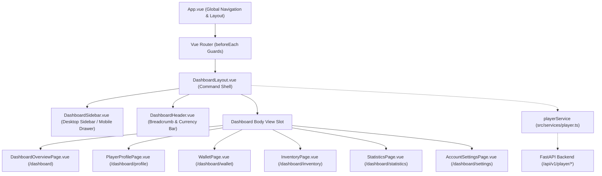

# Phase P04 — Player Dashboard Architecture

**Document:** `01_dashboard_architecture.md`  
**Phase:** P04 (Player Dashboard Implementation)  
**Project:** ROS Sothat (Private Rules of Survival Legacy Server Platform)  
**Scope:** Architectural Design, Layout Hierarchy & Routing Model  
**Security Level:** Read-Only Analysis & Isolated Development  

---

## 1. Architectural Overview

The ROS Sothat Player Dashboard provides authenticated operators with a unified, dark tactical command center to inspect personal account telemetry, character progression, diamond currency reserves, inventory items, combat statistics, and security configurations.

The architecture expands the initial single-page landing from Phase P03 into a modular, multi-view dashboard layout built on top of Vue 3, Vue Router 4, and Pinia.

---

## 2. Route Hierarchy & Navigation

The dashboard routes are registered in [src/router/index.ts](file:///D:/ROS-Legacy-Analysis/ros-website/src/router/index.ts). Every dashboard route enforces `meta: { requiresAuth: true }`, intercepting unauthenticated visitors and redirecting them to `/login?redirect=...`.

| Route Path | Component View | Purpose & Data Scope |
| :--- | :--- | :--- |
| `/dashboard` | `DashboardOverviewPage` | Tactical overview, welcome banner, 3 key metric cards, account telemetry |
| `/dashboard/profile` | `PlayerProfilePage` | Full character dossier, level, EXP bar, equipped skins & clothing loadout |
| `/dashboard/wallet` | `WalletPage` | Authoritative diamond balance, gold balance, append-only transaction ledger |
| `/dashboard/inventory`| `InventoryPage` | Category-filtered tactical armory grid, item stacks, item descriptions |
| `/dashboard/statistics`| `StatisticsPage` | Genuine match statistics (matches, wins, kills, damage), calculated ratios |
| `/dashboard/settings` | `AccountSettingsPage` | Operator credentials, session token posture, logout session termination |

---

## 3. Component Hierarchy & Reusable Design Elements

### 3.1 `DashboardLayout.vue`
The root shell wrapper for all dashboard views:
- **Responsive Navigation:** Manages desktop side-by-side layout and mobile slide-out navigation drawer (< 900px breakpoint).
- **Background Dimmer:** Renders an interactive backdrop when the mobile drawer is open to prevent accidental background clicks.
- **Data Provisioning:** Centrally queries `playerService.getMyCharacter()` upon mount and provides `characterProfile` and `loadingCharacter` to all child components via Vue's `provide`/`inject` API.

### 3.2 `DashboardSidebar.vue`
- Displays user identity badge (`authStore.user.username` and `role`).
- Renders tactical menu items with active route highlighting (`border-color` and gold text).
- Includes the primary session termination action (`Logout Session`).

### 3.3 `DashboardHeader.vue`
- Renders the current section title and contextual subtitle.
- Features real-time currency quick-access pills:
  - 💎 **Diamonds Pill:** Displays live authoritative diamond balance with quick navigation to `/dashboard/wallet`.
  - 🪙 **Gold Pill:** Displays character gold reserve.

### 3.4 `EmptyState.vue` & `LoadingState.vue`
- Reusable UI state components ensuring consistent visual feedback across all pages during network latency, uninitialized profiles, or empty transaction/inventory states.

---

## 4. Visual Design Language & Tactical Styling

The dashboard maintains the tactical military dark palette established in Phase P03:
- **Main Background (`--bg-primary`):** `#080B10`
- **Secondary Background (`--bg-secondary`):** `#101720`
- **Card Background (`--bg-card`):** `#151E29`
- **Border Trim (`--border-color`):** `#263442`
- **Gold Accent (`--accent-gold`):** `#D7A84B`
- **Red Accent (`--accent-red`):** `#B94B3C`
- **Primary Text (`--text-primary`):** `#F3F6FA`
- **Secondary Text (`--text-secondary`):** `#9AA7B5`
- **Monospace Font (`--font-mono`):** `Courier New`, Courier, monospace for numerical balances, GIDs, and timestamps.
