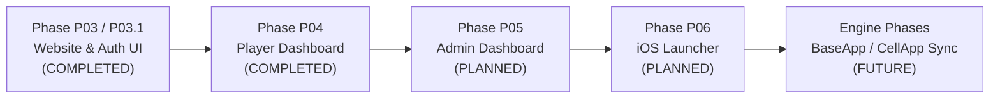

# Phase P04 — Known Limitations & Future Roadmap

**Document:** `10_known_limitations.md`  
**Phase:** P04 (Player Dashboard Implementation)  
**Project:** ROS Sothat (Private Rules of Survival Legacy Server Platform)  
**Scope:** Scope Boundaries, Architectural Constraints & Downstream Handoffs  
**Security Level:** Read-Only Analysis & Isolated Development  

---

## 1. Scope Boundary Enforcement

Phase P04 strictly authorizes the **Player Dashboard Implementation**:
- Personal player profile and character deployment.
- Authoritative diamond wallet and transaction ledger inspection.
- Tactical inventory viewing and category filtering.
- Player statistics status presentation.
- Account settings and session management.

In strict accordance with project rules, the following remain unauthorized in this phase:
- **Admin Dashboard (Phase P05):** No administrative moderation views, diamond granting consoles, item catalog editors, or ban panels were built in this phase.
- **Economy Mutations:** Players cannot self-grant diamonds, purchase items, deduct currency, or transfer balances.
- **Inventory Mutations:** Players cannot spawn, delete, or trade items through the website.
- **Client Modifications:** The original iOS IPA and Mach-O binary remain completely unmodified.

---

## 2. Technical Limitations & Environment Constraints

### 2.1 Game Client Engine Synchronization
> [!IMPORTANT]
> **Database Authority vs. Original Game Client Synchronization:**  
> The diamonds and items displayed on the website originate from the authoritative PostgreSQL/SQLite database models of `ros-private-server`.  
> However, having diamonds recorded in the backend database does **not** imply that the original legacy iOS game client (`RoS-Legacy-iOS.ipa`) will automatically reflect that balance on launch. Real-time synchronization requires BaseApp/CellApp native Mercury entity property broadcasts (BigWorld engine protocol), which is designated for downstream engine phases.

### 2.2 Multiplayer Match Statistics
- **Match Server Status:** Multiplayer room coordination, physics simulation, and combat match resolution (CellApp) are in active engineering.
- **Initial Telemetry:** As a result, all player match statistics initialize at genuine baseline zeroes (`total_matches: 0`, `total_wins: 0`, `total_kills: 0`). The dashboard honestly discloses this status and makes zero attempts to fabricate imaginary match records or artificial win rates.

### 2.3 Client Session Security Posture
- **`sessionStorage` Limitation:** Authentication tokens are stored in Pinia reactive memory and mirrored to `sessionStorage`. While this ensures tokens are purged immediately upon closing the browser tab, `sessionStorage` is accessible to client-side JavaScript and does not provide HttpOnly cookie protection.
- **XSS Mitigations:** The application eliminates `v-html` and raw HTML rendering across all components, relies on Vue's automated text escaping, and avoids external script CDN dependencies.

### 2.4 Local Network Isolation
- All services and tests operate strictly on loopback (`127.0.0.1:8000` and `127.0.0.1:5173`). No public ports, cloud servers (e.g. Render/Vercel), or external mail relays were configured or contacted.

---

## 3. Downstream Roadmap Handoff

1. **Phase P05 — Admin Dashboard:**
   - Dedicated administrative command views guarded by `isAdmin` claims.
   - Administrative diamond grants/deductions with required audit reasons and idempotency keys.
   - Catalog item creation and inventory airdrops to player characters.
   - Account moderation (suspensions, ban reasons, role updates).
2. **Phase P06 — iOS Companion Launcher:**
   - Ad Hoc distribution handoff, device UDID enrollment, and one-click game launch (`rosmobile://`).
3. **Future Engine Phases:**
   - Mercury transport entity property synchronization to bridge backend database balances directly into the original game client memory.
