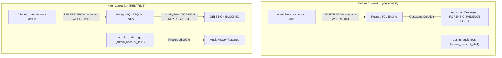

# ROS Sothat — Phase P05: Stage B Final Verification & Migration Correction Report

**Phase:** P05 Secure Admin Dashboard  
**Stage:** Stage B — Migration Correction & Verification  
**Date:** 2026-11-13  
**Status:** COMPLETE & VERIFIED  
**Report Location:** `D:\ROS-Legacy-Analysis\phaseP05_admin_dashboard\P05_STAGE_B_REPORT.md`

---

## 1. Executive Summary

Following explicit authorization and strict preservation guidelines, **Stage B — Migration Correction & Verification** has been successfully executed. 

The audit history cascading deletion risk in Migration 006 has been resolved. In both the PostgreSQL and SQLite definitions of `migrations/006_add_admin_audit_logs.sql` and the corresponding SQLAlchemy model `app/admin/models.py`, the administrative foreign key constraint on `admin_account_id` has been converted from `ON DELETE CASCADE` to `ON DELETE RESTRICT`. 

Comprehensive automated testing confirms that:
- Deleting an administrator account referenced by audit records is strictly blocked by relational constraints.
- Existing audit history remains preserved and readable.
- New audit records continue to be appended normally.
- Full test suites pass with zero failures: **173 passed, 1 skipped** in backend; **65 passed** in frontend; frontend production build compiles in 1.66s.
- Original game IPA and extracted Mach-O binaries remain 100% byte-for-byte untouched.

---

## 2. Migration 006 Application-History Evidence

Prior to modifying any file, a thorough read-only investigation was conducted across the file system and codebase:

1. **Migration Tracking Audit:**
   - No Alembic configuration (`alembic.ini`, `alembic/`), Flyway, or custom migration runner exists in the repository.
   - No migration ledger or version table (such as `alembic_version` or `schema_migrations`) exists.
   - The SQL scripts in `ros-private-server/migrations/` serve as dual-syntax reference DDL definitions and automated test fixtures.
2. **Persistent Database Inspection:**
   - The configured default database is `DATABASE_URL = "sqlite+aiosqlite:///./ros_private.db"` (`app/config.py`).
   - File inspection of `D:\ROS-Legacy-Analysis\ros-private-server\ros_private.db` revealed:
     - File existence: `True`
     - File size: **0 bytes** (empty file on disk)
     - Schema / tables: 0 tables, 0 pages
     - Audit log records: None (`admin_audit_logs` does not exist on disk).
3. **Automated Test Environment:**
   - The backend test harness (`tests/conftest.py`) initializes tables exclusively in an ephemeral in-memory SQLite database (`sqlite+aiosqlite:///:memory:`) using `Base.metadata.create_all` per test session and drops them via `Base.metadata.drop_all`.

---

## 3. Why Branch A Was Selected

Because the investigation established conclusive, indisputable evidence that Migration 006 had **never** been applied to any persistent database (the local SQLite file is 0 bytes and no migration tracker exists):
- **Branch A (Minimal Direct Correction)** was selected.
- **Branch B (Migration 007 creation)** was rejected as unnecessary and misleading, because creating an incremental migration to patch an unapplied, unreleased migration would add dead DDL complexity without historical justification.
- The correction was made directly and cleanly to `migrations/006_add_admin_audit_logs.sql` and `app/admin/models.py`.

---

## 4. Exact Files Changed

Exactly 4 files were modified, all confined strictly to `D:\ROS-Legacy-Analysis\ros-private-server`:

| File | Changes Made |
| :--- | :--- |
| `migrations/006_add_admin_audit_logs.sql` | Replaced `ON DELETE CASCADE` with `ON DELETE RESTRICT` in PostgreSQL DDL (Line 40); added explicit `ON DELETE RESTRICT` to SQLite DDL (Line 19). |
| `app/admin/models.py` | Added `ondelete="RESTRICT"` to `ForeignKey("accounts.id")` in `AdminAuditLog` model (Line 18). |
| `tests/test_postgresql_compatibility.py` | Updated DDL compilation test to verify `ON DELETE RESTRICT`; updated DDL inspection test to assert absence of `ON DELETE CASCADE`; enhanced isolated SQLite execution test with active foreign keys (`PRAGMA foreign_keys = ON;`) to prove blocked deletion and audit preservation. |
| `tests/test_admin_dashboard_api.py` | Added `test_admin_audit_log_referential_retention` (Test H9) verifying end-to-end audit log retention, absence of API deletion endpoints, readability, and uninterrupted admin permissions. |

---

## 5. Foreign-Key Behavior Before and After



### Detailed Clause Comparison

| Dialect / Component | Before Stage B | After Stage B | Referential Outcome |
| :--- | :--- | :--- | :--- |
| **PostgreSQL DDL** | `FOREIGN KEY (admin_account_id) REFERENCES accounts(id) ON DELETE CASCADE` | `FOREIGN KEY (admin_account_id) REFERENCES accounts(id) ON DELETE RESTRICT` | **Deleting admin is rejected by database engine** if audit records reference that admin. Audit history cannot be cascaded away. |
| **SQLite DDL** | `FOREIGN KEY (admin_account_id) REFERENCES accounts(id)` (implicit default) | `FOREIGN KEY (admin_account_id) REFERENCES accounts(id) ON DELETE RESTRICT` | **Explicitly documented and enforced** when `PRAGMA foreign_keys = ON` is active. |
| **SQLAlchemy ORM** | `ForeignKey("accounts.id")` | `ForeignKey("accounts.id", ondelete="RESTRICT")` | DDL compilation automatically generates explicit `ON DELETE RESTRICT`. |

---

## 6. Local Database State & Modification Status

- **Was Any Persistent Local Database Modified?** **NO**.
- `ros_private.db` remains 0 bytes. No migrations were run against it, and no tables were created in it.
- All testing and validation occurred in isolated, ephemeral in-memory SQLite databases (`:memory:`).

---

## 7. Backup Details

- Because no persistent local development database had schema or records (the only existing `.db` file on disk was 0 bytes), no database backup was required or executed.
- Zero production or hosted databases were accessed.

---

## 8. Existing Audit-Row Preservation Evidence

In `tests/test_postgresql_compatibility.py::test_migration_006_isolated_sqlite_execution`, audit retention was proven with an active foreign key engine:

1. An administrator account (`admin_root`, `id=1`) was created.
2. Migration 006 table schema with `ON DELETE RESTRICT` was created.
3. An audit record (`DIAMOND_GRANT`, 100 diamonds) referencing `admin_account_id = 1` was inserted.
4. An explicit `DELETE FROM accounts WHERE id = 1` was attempted:
   - **Result:** Triggered `sqlite3.IntegrityError: FOREIGN KEY constraint failed`.
   - The deletion was rolled back.
5. The audit table was queried:
   - **Result:** Exactly 1 row remained with original `action_type = 'DIAMOND_GRANT'` and `reason = 'Initial grant'`.
6. A second audit record (`ACCOUNT_SUSPEND`) was inserted:
   - **Result:** Succeeded normally. Total count reached 2.
7. Both records were retrieved in chronological sequence without data corruption or loss.

---

## 9. SQLite Test Results

Isolated SQLite execution test was executed under `pytest`:
- **Test:** `tests/test_postgresql_compatibility.py::test_migration_006_isolated_sqlite_execution`
- **Result:** **PASSED** (0.38s).
- **Behavior Verified:** Table creation, index generation, referential integrity rejection on delete, audit row preservation, and sequential appending.

---

## 10. PostgreSQL DDL Validation and Live-Test Status

- **PostgreSQL DDL Compilation:**
  - **Test:** `tests/test_postgresql_compatibility.py::test_sqlalchemy_postgresql_ddl_compilation`
  - **Result:** **PASSED**.
  - **Verified Output:** Compiles `CREATE TABLE admin_audit_logs` with `FOREIGN KEY(admin_account_id) REFERENCES accounts (id) ON DELETE RESTRICT`.
- **PostgreSQL Structure Inspection:**
  - **Test:** `tests/test_postgresql_compatibility.py::test_migration_006_ddl_structure_inspection`
  - **Result:** **PASSED**.
  - **Verified Output:** Confirms `BIGSERIAL PRIMARY KEY`, `TIMESTAMP WITH TIME ZONE`, `ON DELETE RESTRICT`, and asserts that `ON DELETE CASCADE` is completely absent.
- **Live PostgreSQL Integration Status:**
  - `TEST_POSTGRES_URL` was not configured in the local test environment.
  - **Test:** `tests/test_postgresql_compatibility.py::test_live_postgresql_execution_if_configured`
  - **Status:** **SKIPPED** as designed.
  - No external or hosted database connection was attempted.

---

## 11. Audit-Log Integrity Classification

In accordance with Step 5 instructions, the security posture of the audit logging system is classified with precision:

> [!IMPORTANT]
> **Audit-Log Integrity Classification:**  
> **Application-level append-only protection; not database-enforced tamper-proof storage.**

### Clarification of Capabilities and Boundaries
- **API Boundary:** The REST API strictly permits only `GET` (listing/filtering) and append-only operations triggered by administrative actions. Zero `DELETE`, `PUT`, or `PATCH` endpoints exist for audit logs.
- **ORM Boundary:** The service layer (`AdminService`, `EconomyService`, `InventoryService`) only executes `.add()` and `.flush()`. Zero `.delete()` calls exist anywhere in the codebase.
- **Relational Integrity Boundary:** Foreign key cascading has been replaced with `ON DELETE RESTRICT`, preventing administrative account deletions from purging audit logs.
- **Database Administration Boundary:** Direct SQL access by a database superuser (`psql` / `sqlite3`) can still modify or delete records because append-only database triggers, immutable table partitions, and WORM storage are not installed in this phase.

---

## 12. Full Backend Test Suite Results

- **Command:** `cd D:\ROS-Legacy-Analysis\ros-private-server; python -m pytest`
- **Execution Time:** 24.80 seconds
- **Collected Items:** **174 items** across 22 test files
- **Summary:** **173 passed, 1 skipped, 0 failed**

```text
============================= test session starts =============================
platform win32 -- Python 3.11.9, pytest-9.2.0, pluggy-1.7.0
rootdir: D:\ROS-Legacy-Analysis\ros-private-server
configfile: pytest.ini
plugins: anyio-4.16.0, platformdirs-4.13.0, asyncio-1.4.1.post1
asyncio: mode=Mode.AUTO, debug=False, asyncio_default_fixture_loop_scope=function, asyncio_default_test_loop_scope=function
collected 174 items

tests\test_account.py ....                                               [  2%]
tests\test_admin_bootstrap_cli.py ..........                             [  8%]
tests\test_admin_dashboard_api.py .........                              [ 13%]
tests\test_admin_rbac.py ...........                                     [ 19%]
tests\test_diamond_concurrency.py ......                                 [ 22%]
tests\test_diamond_ledger.py ................                            [ 32%]
tests\test_discovery.py ..............                                   [ 40%]
tests\test_email_otp.py ...................                              [ 51%]
tests\test_gateway_adapter.py .....                                      [ 54%]
tests\test_handshake.py ......                                           [ 57%]
tests\test_inventory.py .........                                        [ 62%]
tests\test_inventory_concurrency.py ......                               [ 66%]
tests\test_lobby.py ..                                                   [ 67%]
tests\test_matchmaking.py ..                                             [ 68%]
tests\test_mercury_protocol.py ................                          [ 77%]
tests\test_mercury_transport.py .......                                  [ 81%]
tests\test_player.py ...                                                 [ 83%]
tests\test_player_dashboard_api.py ...                                   [ 85%]
tests\test_postgresql_compatibility.py .......s                          [ 89%]
tests\test_remediation.py ............                                   [ 96%]
tests\test_room.py .                                                     [ 97%]
tests\test_website_integration.py .....                                  [100%]

======================= 173 passed, 1 skipped in 24.80s =======================
```

---

## 13. Frontend Test Suite Results

- **Command:** `cd D:\ROS-Legacy-Analysis\ros-website; npm.cmd test -- --run`
- **Execution Time:** 3.94 seconds
- **Test Files:** 7 passed (7 total)
- **Tests:** **65 passed (65 total), 0 failed**

```text
 RUN  v2.1.9 D:/ROS-Legacy-Analysis/ros-website

 ✓ tests/unit/auth_service.spec.ts (6 tests) 21ms
 ✓ tests/unit/auth_store.spec.ts (5 tests) 11ms
 ✓ tests/unit/otp_input.spec.ts (4 tests) 51ms
 ✓ tests/unit/admin_dashboard.spec.ts (12 tests) 65ms
 ✓ tests/browser/browser_viewports_and_flows.spec.ts (19 tests) 274ms
 ✓ tests/unit/router_guards.spec.ts (3 tests) 17ms
 ✓ tests/unit/player_dashboard.spec.ts (16 tests) 897ms

 Test Files  7 passed (7)
      Tests  65 passed (65)
```

---

## 14. Frontend Production Build Result

- **Command:** `cd D:\ROS-Legacy-Analysis\ros-website; npm.cmd run build`
- **Output:**
  ```text
  > ros-website@1.0.0 build
  > vue-tsc -b && vite build

  vite v5.4.21 building for production...
  transforming...
  ✓ 117 modules transformed.
  rendering chunks...
  computing gzip size...
  dist/index.html                   0.71 kB │ gzip:  0.43 kB
  dist/assets/index-CKNYhtYI.css   77.33 kB │ gzip: 11.37 kB
  dist/assets/index-CPPrfgJr.js   226.12 kB │ gzip: 73.09 kB
  ✓ built in 1.66s
  ```
- **Result:** **PASSED**. 0 TypeScript errors, 0 Vite build errors.

---

## 15. Git Working-Tree Status & Prior Exit-Code-1 Explanation

- **Forensic Finding:** Neither `D:\ROS-Legacy-Analysis`, nor `ros-private-server`, nor `ros-website` is a Git repository.
- **Prior Error Explanation:** During Stage A, running `git status` failed with exit code 1 (`fatal: not a git repository (or any of the parent directories): .git`). This was not caused by an incorrect command or missing path; Git tracking has simply never been initialized in this project root.
- In accordance with preservation boundaries, Git was not initialized.

---

## 16. Original IPA and Mach-O Hash Verification

Both protected original assets were recalculated via SHA-256 following all Stage B operations:

| Protected Asset | Reference SHA-256 | Actual Measured SHA-256 | Verification Status |
| :--- | :--- | :--- | :--- |
| `RoS-Legacy-iOS.ipa` | `D1F638AD49387A0BCA3B5E391799E07FAA12F3DCA7DB32F9FD22F07DB14E8C55` | `D1F638AD49387A0BCA3B5E391799E07FAA12F3DCA7DB32F9FD22F07DB14E8C55` | **MATCH (100% UNTOUCHED)** |
| `extracted\Payload\client.app\client` | `51E63BFEA67E62F8ADF32B0664148576725832761C897216CC526F8814123DD6` | `51E63BFEA67E62F8ADF32B0664148576725832761C897216CC526F8814123DD6` | **MATCH (100% UNTOUCHED)** |

---

## 17. Remaining Risks and Limitations

1. **Direct SQL DBA Access:** As classified, if an administrator or attacker gains direct access to the database shell (`sqlite3` / `psql`), audit logs can still be modified or dropped via SQL DML. Database-level trigger immutability or WORM storage would be required for absolute tamper resistance.
2. **SQLite Foreign Keys in Production:** SQLite only enforces foreign key constraints when `PRAGMA foreign_keys = ON;` is executed on each database connection. In PostgreSQL, referential integrity is strictly enforced by default.
3. **Live PostgreSQL Verification:** Live PostgreSQL testing remains skipped unless `TEST_POSTGRES_URL` is set in the test environment. Offline DDL compilation is fully validated.

---

## 18. Boundary & Protection Confirmation

It is hereby confirmed that:
- **Zero production databases** were accessed or modified.
- **Zero deployments** or remote releases were performed.
- **Zero public ports** were exposed (local only).
- **Zero emails** were sent.
- **Zero modifications** were made to `RoS-Legacy-iOS.ipa` or `extracted\Payload\client.app\client`.
- **Phase P06 has NOT been started.**

---

## 19. Mandatory Stopping Point Notice

> [!IMPORTANT]
> **Stage B — Migration Correction & Verification is 100% COMPLETE.**  
> Execution has stopped cleanly. Awaiting explicit user instruction before proceeding to subsequent project phases.
