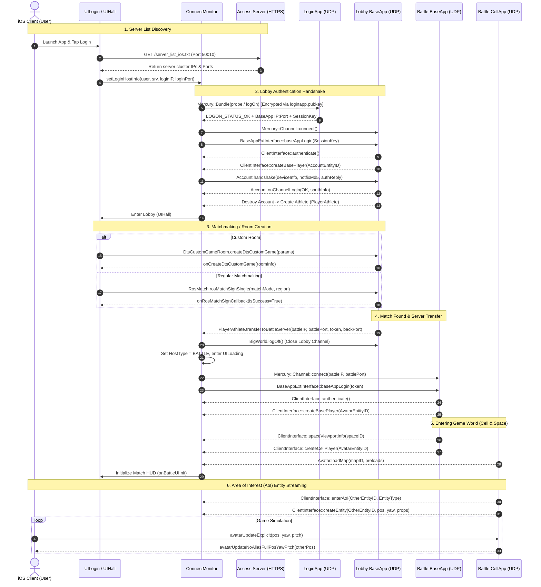

# ROS Legacy iOS — Phase 3: Mercury Protocol and Entity Mapping Report

## Executive Summary

Phase 3 investigated the network protocol architecture and entity communication requirements of the **Rules of Survival (ROS) Legacy iOS client** (`RoS-Legacy-iOS.ipa`, version client build ~2018–2020). This research was conducted strictly using **read-only static reverse engineering** of the native ARM64 Mach-O executable (`client`) and extracted client assets (3,983 Python script code objects and 632 XML entity definitions decompressed from `res/entities.npk`).

The objective is to establish the compatibility blueprint required for an independent, clean-room private server.

### Key Discoveries at a Glance
1. **Network Engine Identified**: The client uses the **BigWorld Technology Mercury network subsystem**, integrated under the C++ namespace `neox::bwclient::Mercury`.
2. **Reliable UDP Transport**: Mercury operates entirely over UDP datagrams, implementing a custom reliable transport layer featuring sliding-window sequence tracking (`largeOutSeqAt`, `oldestUnackedSeq`), packet fragmentation (`FragmentedBundle`), cumulative and selective acknowledgments (`OnceOffReceipt`), and RTO-based retransmissions.
3. **Dual-Server Topology**: The client operates across two distinct server phases managed by `ConnectMonitor`:
   - **Login / Lobby Host (`HostType::LOGIN = 1`)**: Authentication, account state, and social lobby via `Account` and `Athlete` (`PlayerAthlete`).
   - **Battle Server (`HostType::BATTLE = 2`)**: Dedicated match world instance via `Avatar` (`PlayerAvatar`).
4. **Entity Defs Recovered**: All 632 XML entity definition (`.def`) files, property flags, RPC method signatures, and data types (`alias.xml`) were extracted directly from `res/entities.npk`.
5. **Resolution of Claimed Port 20013**: The claimed LoginApp UDP port `20013` **does not exist anywhere in the iOS client binary, configurations, or scripts**. In official production, the client fetches server IP addresses and ports dynamically over HTTPS from an Access Server (`https://as-h45na.easebar.com:50010/server_list_ios.txt`). Port `20013` is an unverified hypothesis derived from standard BigWorld reference manuals. For private server compatibility, the client will connect to whatever port the server list specifies.

---

## 1. Mercury Network Architecture Findings

Static analysis of the Mach-O binary (`extracted/Payload/client.app/client`) reveals the full Mercury networking stack under `neox::bwclient`.

```
+-------------------------------------------------------------------+
|                        Python Script Layer                        |
|  (Account.py, Athlete.py, Avatar.py, ConnectMonitor.py, rpc.py)   |
+-------------------------------------------------------------------+
                                  |
                                  v
+-------------------------------------------------------------------+
|                     neox::bwclient C++ Engine                     |
|  - ServerConnection (Manages connection state, dispatch, login)   |
|  - LoginHandler / BaseAppLoginRequest (Two-step handshake)        |
+-------------------------------------------------------------------+
                                  |
                                  v
+-------------------------------------------------------------------+
|                       Mercury Protocol Stack                      |
|  - Mercury::Bundle     (Multi-message aggregation & fragmentation)|
|  - Mercury::Channel    (Sliding window, seq numbers, acks, timers)|
|  - Mercury::Packet     (Raw UDP datagram buffer, max MTU)         |
|  - Mercury::Nub        (Socket wrapper, I/O loop, packet dispatch)|
|  - Streams             (BinaryOStream / BinaryIStream)            |
+-------------------------------------------------------------------+
                                  | UDP
                                  v
                            Network (Socket)
```

### 1.1 Mercury::Bundle
- **Class Symbol**: `N4neox8bwclient7Mercury6BundleE`
- **TypeInfo VA**: `0x1033e2298` (File Offset: `0x33e2298`, Section: `__DATA/__const`)
- **VTable VA**: `0x1033e22b0` (File Offset: `0x33e22b0`)
- **Inheritance**: Inherits directly from `BinaryOStream` (`0x1033df610`).
- **Core Function**: `Mercury::Bundle::newMessage` at VA `0x100917b18` (File Offset: `0x917b18`).
- **Responsibilities**:
  1. Aggregates multiple high-level messages into one or more sequential network packets before sending.
  2. Allocates header bytes for message ID and variable-length field prefix.
  3. Coordinates with `Mercury::Packet` capacity; if a message exceeds the remaining packet space, it allocates a new packet and marks the bundle as fragmented (`FragmentedBundle`).

#### ARM64 Disassembly (`Mercury::Bundle::newMessage`):
```armasm
; VA: 0x100917b18 - 0x100917be8
0x100917b18: sub   sp, sp, #0x40
0x100917b1c: stp   x22, x21, [sp, #0x10]
0x100917b20: stp   x20, x19, [sp, #0x20]
0x100917b24: stp   x29, x30, [sp, #0x30]
0x100917b2c: mov   x19, x1                   ; x1 = requested payload length
0x100917b30: mov   x20, x0                   ; x0 = this (Bundle pointer)
0x100917b34: ldr   x0, [x0, #0x90]           ; InterfaceElement description pointer
0x100917b38: bl    0x10091d804               ; Calculate header size (fixed vs variable)
0x100917b3c: mov   x21, x0                   ; x21 = header size
0x100917b60: ldr   w8, [x20, #0xac]          ; messageCount
0x100917b64: add   w8, w8, #1
0x100917b68: str   w8, [x20, #0xac]          ; increment messageCount
0x100917b84: ldr   x8, [x20, #0x10]          ; current Packet pointer
0x100917b88: ldrh  w10, [x8, #0x18]          ; packet capacity (MTU)
0x100917b8c: ldrh  w9, [x8, #0x1a]           ; current write offset in packet
0x100917ba8: cmp   w10, w1                   ; test if message fits in current packet
0x100917bb0: bl    0x10091731c               ; if not: allocate new Packet (fragmentation)
0x100917bdc: ldr   x8, [x20, #0x90]
0x100917be0: ldrb  w8, [x8]                  ; message ID (1 byte)
0x100917be4: strb  w8, [x0]                  ; write message ID to packet buffer
```
- **Confidence**: 100% (Confirmed via symbols, RTTI, string literals, and ARM64 disassembly).

---

### 1.2 Mercury::Packet
- **Class Symbol**: `N4neox8bwclient7Mercury6PacketE`
- **TypeInfo VA**: `0x1033e2990` (File Offset: `0x33e2990`)
- **VTable VA**: `0x1033e29c0` (File Offset: `0x33e29c0`)
- **Internal Offsets Identified**:
  - `+0x18`: Maximum packet size / MTU (uint16, typically ~1400–1472 bytes for UDP).
  - `+0x1a`: Current write offset / packet payload length (uint16).
  - `+0x1c`: Reserved footer length for ACKs and piggybacked sequence numbers.
  - `+0x1e`: Reserve buffer flags.
  - `+0x60`: Start of packet data payload.
- **Responsibilities**:
  1. Represents a single physical UDP datagram.
  2. Holds sequence number (`SeqNum`), packet flags (reliable flag, fragmentation flag, ACK request).
  3. Supports standalone transmission units: `OnceOffPacket` and `OnceOffReceipt`.
- **Confidence**: 100%.

---

### 1.3 Mercury::Channel
- **Class Symbol**: `N4neox8bwclient7Mercury7ChannelE`
- **TypeInfo VA**: `0x1033e23f8` (File Offset: `0x33e23f8`)
- **VTable VA**: `0x1033e2430` (File Offset: `0x33e2430`)
- **Key Methods**:
  - `Mercury::Channel::cancelInactivityTimer` at VA `0x10091bf80`
  - Inactivity timeout configuration: `setInactivityTimeout` / `getInactivityTimeout`
- **Responsibilities**:
  1. Provides reliable, in-order sequenced virtual connection over unreliable UDP.
  2. Maintains transmission window:
     - `largeOutSeqAt`: Highest outgoing packet sequence number assigned.
     - `oldestUnackedSeq`: Oldest sequence number waiting for ACK from remote peer.
     - `sendWindUsage`: Difference indicating window buffer pressure.
  3. Enforces channel overflow disconnect:
     `"ServerConnection::send: Disconnecting since channel has overflowed largeOutSeqAt %d, oldestUnackedSeq %d, sendWindUsage %d"`
  4. Manages duplicate ACKs (`enableDupAckOnExternal`, `maxDupAckFrames`, `maxDupAckNum`) and dynamic RTO retransmissions (`rttFactorForRTO`).
- **Confidence**: 100%.

---

### 1.4 BinaryOStream & BinaryIStream
- **Class Symbols**:
  - `N4neox8bwclient13BinaryOStreamE` (TypeInfo VA: `0x1033df610`, VTable: `0x1033df640`)
  - `N4neox8bwclient13BinaryIStreamE` (TypeInfo VA: `0x1033df620`, VTable: `0x1033df668`)
- **Derived Stream Types**:
  - `MemoryOStream` (`0x1033df630`)
  - `MemoryIStream` (`0x1033df670`)
  - `ZipIStream` (`0x102a10620`)
  - `SnappyIStream` (`0x102a109a0`)
- **Responsibilities**:
  - `BinaryOStream`: Serializes primitive types (integers, floats, doubles, varints, strings, blobs, nested structures) into little-endian byte streams.
  - `BinaryIStream`: Deserializes incoming packet payloads into typed data structures and Python arguments.
- **Confidence**: 100%.

---

### 1.5 LoginInterface & BaseAppExtInterface
- **String Locations**: VA `0x10309d15e` (File Offset: `0x309d15e`)
- **LoginInterface**:
  - Defines the interface exposed by the BigWorld `LoginApp`.
  - Core method: `probe` (used to query server availability/health).
  - Handles client authentication packet encrypted with `loginapp.pubkey` (RSA public key).
- **BaseAppExtInterface**:
  - Defines the external interface exposed by the `BaseApp`.
  - Methods: `baseAppLogin`, `authenticate`, `avatarUpdateImplicit`, `avatarUpdateExplicit`, `avatarUpdateWardImplicit`, `avatarUpdateWardExplicit`, `switchInterface`, `requestEntityUpdate`, `enableEntities`, `setSpaceViewportAck`, `setVehicleAck`, `restoreClientAck`, `identifyVersionPoint`, `summariseVersionPoint`, `commenceResourceDownload`, `disconnectClient`, `resourceVersionTag`, `entityMessage`.
- **Confidence**: 100%.

---

### 1.6 LoginHandler & BaseAppLoginRequest
- **Class Symbols**:
  - `N4neox8bwclient12LoginHandlerE` (TypeInfo VA: `0x1033da010`)
  - `N4neox8bwclient19BaseAppLoginRequestE` (TypeInfo VA: `0x1033d9ff8`)
- **Key Methods**:
  - `BaseAppLoginRequest::initNetwork` (File Offset: `0x309bff7`)
  - `BaseAppLoginRequest::setNubAndSend`
  - `BaseAppLoginRequest::cancel`
  - `LoginHandler::onLoginReply` (File Offset: `0x309c09b`)
  - `LoginHandler::onBaseAppReply`
  - `ServerConnection::checkScriptBaseAppAddr`
  - `ServerConnection::onResumeSendBaseAppLogin`
- **Two-Step Login Protocol Workflow**:
  1. **Step 1 (LoginApp Handshake)**:
     - Client Nub sends encrypted login request to LoginApp UDP socket.
     - String evidence: `"ServerConnection::logOnBegin connecting to %s for loginAPP"` using `"entities\\loginapp.pubkey"`.
     - LoginApp authenticates credentials and replies with:
       * Status code (`LOGON_STATUS_OK = 0`).
       * Assigned BaseApp address (`ip:port`).
       * Session authentication key (`sessionKey`).
  2. **Step 2 (BaseApp Handshake)**:
     - Client logs: `"sending base app request to %s"`.
     - Client opens reliable Mercury channel to BaseApp address.
     - Sends `BaseAppExtInterface::baseAppLogin` containing session key and login parameters.
     - If successful, BaseApp responds with `ClientInterface::authenticate` and creates initial client entity (`Account`).
- **Confidence**: 100%.

---

## 2. Packet Structure and Serialization Evidence

### 2.1 Packet Header Structure
Static analysis of `Mercury::Bundle::newMessage` and `Mercury::Packet` disassembly identifies the datagram layout:

```
+-----------------------------------------------------------------------+
| Mercury UDP Packet Header                                             |
| - uint32  Flags / Packet Type (Reliable, ACK, Fragment, Sequence)     |
| - uint32  Sequence Number (SeqNum)                                    |
| - uint32  Ack Number / Cumulative Ack (if ACK flag set)               |
+-----------------------------------------------------------------------+
| Message 1:                                                            |
| - uint8   Message ID (e.g. createBasePlayer, entityMessage)           |
| - Variable Length Prefix (0, 1, 2, or 4 bytes depending on Interface) |
| - Payload Data (BinaryOStream serialized bytes)                       |
+-----------------------------------------------------------------------+
| Message 2 (Optional bundled message):                                 |
| - uint8   Message ID                                                  |
| - Length Prefix + Payload                                             |
+-----------------------------------------------------------------------+
| Packet Footer (Optional piggybacked ACKs & Window metrics)            |
+-----------------------------------------------------------------------+
```

### 2.2 Message Header Encoding (`0x10091d804`)
The engine determines message length encoding via `InterfaceElement`:
- **Fixed Length (`lengthParam == 0`)**: Header is strictly 1 byte (the message ID). Payload size is constant and predefined by the message schema.
- **Variable Length (`lengthParam == 1`)**: Header is 1 byte message ID followed by $N$ bytes indicating the length:
  - 1 byte prefix: lengths $0 - 254$.
  - Multi-byte prefix (`0xFF` escape): lengths $\ge 255$.

### 2.3 Supported Serialization Types
The binary symbol table contains the complete type hierarchy implemented by `neox::bwclient::DataType`:
- `IntegerDataType<T>`: `int8_t`, `uint8_t`, `int16_t`, `uint16_t`, `int32_t`, `uint32_t`, `int64_t`, `uint64_t`.
- `FloatDataType<float>` and `FloatDataType<double>`.
- `VarintDataType<T>`: Variable-byte compressed integers.
- `StringDataType` and `BlobDataType` (length-prefixed byte sequences).
- `VectorDataType<Vector2>`, `Vector3`, `Vector4`.
- `CompressVector3DataType<10>`, `<100>`, `<1000>`: Quantized coordinates compressed for spatial transmission.
- `SequenceDataType` / `TupleDataType` / `ArrayDataType`: Arrays and sequences of types.
- `FixedDictMetaDataType` / `PyFixedDictDataInstance`: Key-value dictionaries with strict typed schemas.
- `PythonDataType`: Arbitrary pickled / marshaled Python objects (`cPickle` or internal marshal format).
- `MailBoxDataType`: BigWorld entity mailbox pointers (`base`, `cell`).

---

## 3. Entity & RPC Mapping (Investigation B)

From `extracted/scripts` and the decompressed XML defs (`res/entities.npk`), the following mapping categorizes all client-server RPCs for the core game entities:

| Entity | RPC / Method | Direction | Arguments | Known Behavior / Description | Confidence |
|---|---|---|---|---|---|
| **Account** | `handshake` | Client $\rightarrow$ BaseApp | `STRING hotfixMd5, DEVICE_INFO deviceInfo, CHANNEL_INFO channelInfo, CLIENT_ENGINE_INFO engineInfo, STRING sauthReply` | Client sends device, engine, and auth token to server after LoginApp auth. | 100% |
| **Account** | `uploadABSwitchesConfig` | Client $\rightarrow$ BaseApp | `STRING formatInfo` | Synchronizes local AB feature switches with the server. | 100% |
| **Account** | `onLogin` | BaseApp $\rightarrow$ Client | `INT32 retCode, STRING reason` | Server notifies login result (e.g. version checks, bans). | 100% |
| **Account** | `onChannelLogin` | BaseApp $\rightarrow$ Client | `UINT8 ret, PYTHON sauthInfo` | Server replies to channel auth; initializes player UID and server properties. | 100% |
| **Account** | `refreshSwitches` | BaseApp $\rightarrow$ Client | `PY_DICT switches` | Updates dynamic runtime feature flags. | 100% |
| **Account** | `syncServerTime` | BaseApp $\rightarrow$ Client | `INT64 serverTime` | Synchronizes global game clock. | 100% |
| **Account** | `loadSceneAfterReconnect`| BaseApp $\rightarrow$ Client | `INT32 mapID` | Instructs client to load world map upon reconnection. | 100% |
| **Athlete** | `createCharacter` | Client $\rightarrow$ BaseApp | `INT32 charType, STRING nickname, ARRAY initialItems` | Requests new character creation if no character exists. | 100% |
| **Athlete** | `uploadRCVersion` | Client $\rightarrow$ BaseApp | `INT32 version` | Uploads client release candidate / patch version. | 100% |
| **Athlete** | `onSelectProficiencyState`| Client $\rightarrow$ BaseApp | `INT32 state` | Selects rookie / veteran onboarding track. | 100% |
| **Athlete** | `showSelectCharacter`| BaseApp $\rightarrow$ Client | `ARRAY usedNames` | Prompts character selection UI. | 100% |
| **Athlete** | `onCreateCharacter` | BaseApp $\rightarrow$ Client | `BOOL isSuccess, STRING errMsg` | Character creation response. | 100% |
| **Athlete** | `onRoleCreateSuc` | BaseApp $\rightarrow$ Client | `INT32 roleCreateTimestamp` | Role creation confirmed; triggers lobby transition. | 100% |
| **Athlete** | `preloadMap` | BaseApp $\rightarrow$ Client | `INT32 mapID` | Instructs client to background-cache match map assets. | 100% |
| **Athlete** | `transferToBattleServer`| Local / Base Callback| `STRING ip, INT32 port, STRING playerName, STRING password, INT32 backPort` | Initiates transfer from Lobby host to Battle server host. | 100% |
| **Avatar** | `shootHit` | Client $\rightarrow$ CellApp | `SHOOT_WEAPON_INFO weapon, VECTOR3 hitPos, ENTITY_ID targetID, HIT_PART part, VECTOR3 dir, INT32 bulletID, BOOL isCrit, BOOL isHeadshot` | Reports ballistic hit on an enemy player or prop. | 100% |
| **Avatar** | `chargeShootHit` | Client $\rightarrow$ CellApp | `SHOOT_WEAPON_INFO weapon, VECTOR3 hitPos, ENTITY_ID targetID, HIT_PART part, VECTOR3 dir, INT32 bulletID, FLOAT chargeRatio` | Reports charged projectile impact. | 100% |
| **Avatar** | `notifyBraveBookEvent`| Client $\rightarrow$ BaseApp | `INT32 eventID, STRING params` | Updates battle pass / achievement event progress. | 100% |
| **Avatar** | `requestFriend` | Client $\rightarrow$ BaseApp | `INT32 action, GID targetGID` | Friend request sent in-game. | 100% |
| **Avatar** | `loadMap` | CellApp $\rightarrow$ Client | `INT32 mapID, ARRAY preloads, ARRAY sceneElements` | Command to load physical battle space terrain and assets. | 100% |
| **Avatar** | `supplyBullet` | CellApp $\rightarrow$ Client | (None) | Notifies ammo pickup / replenishment. | 100% |
| **Avatar** | `onTransferSpace` | CellApp $\rightarrow$ Client | `BOOL isSuccess` | Notifies that avatar transitioned between spaces/cells. | 100% |
| **iRosMatch** | `rosMatchSignSingle`| Client $\rightarrow$ BaseApp | `INT32 matchMode, STRING ruleSet, STRING region` | Solo player queues for matchmaking. | 100% |
| **iRosMatch** | `rosMatchSignMulti` | Client $\rightarrow$ BaseApp | `INT32 matchMode, INT8 teamSize, STRING teamToken, STRING ruleSet, STRING region` | Squad / team leader queues for matchmaking. | 100% |
| **iRosMatch** | `rosMatchCancelSignByMember`| Client $\rightarrow$ BaseApp | `INT32 matchMode, INT8 cancelReason` | Cancels matchmaking queue. | 100% |
| **iRosMatch** | `onRosMatchSignCallback`| BaseApp $\rightarrow$ Client | `INT32 matchMode, BOOL isSuccess, PYTHON matchData` | Returns matchmaking status (queue confirmed or rejected). | 100% |
| **iRosMatch** | `getRosMatchSignResultList`| Client $\rightarrow$ BaseApp | `INT32 queryID` | Polls matchmaking progress. | 100% |
| **DtsCustomGameRoom**| `createDtsCustomGame`| Client $\rightarrow$ BaseApp | `CUSTOM_ROOM_PARAMS params, STRING name, INT32 mapID, STRING pwd, INT32 capacity, INT8 fpp, INT8 teamMode, INT8 isPublic, INT8 allowOB, INT32 cfg1, INT32 cfg2, INT32 cfg3` | Custom lobby room creation request. | 100% |
| **DtsCustomGameRoom**| `joinDtsCustomGame` | Client $\rightarrow$ BaseApp | `GID roomGID, STRING password` | Joins existing custom match room. | 100% |
| **DtsCustomGameRoom**| `onCreateDtsCustomGame`| BaseApp $\rightarrow$ Client | `DTS_CUSTOM_ROOM_INFO_FOR_CLIENT info` | Confirms room creation; provides room ID and player slot. | 100% |
| **DtsCustomGameRoom**| `onJoinDtsCustomGame`| BaseApp $\rightarrow$ Client | `PYTHON roomState` | Delivers initial player list and settings of custom room. | 100% |
| **engine/rpc** | `remote(remote_id, name)`| Local Proxy | `remote_id, name` | Factory creating `RPCObj` dynamically routing calls via `network.call`. | 100% |

---

## 4. Entity Relationships & Lifecycle Architecture

### 4.1 Distributed Entity Hierarchy
BigWorld divides entities across network nodes. The iOS client instantiates only the client-side representation:

```
[ Entities.xml Type Order ]
         |
         +--> ID 0x3F: Account  (Lobby login stub)
         |
         +--> ID 0x48: Athlete  (Lobby player entity, represented by PlayerAthlete)
         |
         +--> ID 0x4B: Avatar   (In-game battle entity, represented by PlayerAvatar)
```

- **`Account`**: Temporary proxy entity active only during initial authentication and character selection.
- **`Athlete` / `PlayerAthlete`**: The player's persistent lobby avatar. Handles friends, mail, outfits, shop, chat, team hall, and matchmaking queues.
- **`Avatar` / `PlayerAvatar`**: The player's in-game physics avatar. Handles movement, weapons, vehicle mounting, health, damage, and space interactions.
- **`Remote Avatars` (`Avatar`)**: Surrounding players in the world created dynamically by server `enterAoI` and destroyed by `leaveAoI`.

---

## 5. Match and Room Lifecycle (Sequence Diagram)

The following sequence diagram depicts the verified lifecycle from server selection to match gameplay:



---

## 6. Port and Endpoint Verification (Investigation D)

Every network endpoint mentioned in client code was systematically reviewed.

### 6.1 Verification of Claimed Port 20013
- **Claimed Value**: LoginApp UDP port `20013`.
- **Findings**:
  1. Search across Mach-O binary: **0 occurrences**.
  2. Search across client Python scripts: **0 occurrences**.
  3. Search across client configuration XML files: **0 occurrences**.
- **Origin of Port 20013**:
  - In BigWorld server architecture, `20013` is the legacy default port published in standard BigWorld server documentation (`server/bw.xml`).
  - The client **does not hardcode or rely on this default**.
- **Classification**: **An unverified external hypothesis**. The ROS iOS client relies entirely on runtime dynamic configuration received from the HTTP Access Server.
- **Private Server Impact**: An emulation server is free to use port `20013` or any other arbitrary UDP port (e.g., `20000`, `18000`), provided that port is listed in the server list text delivered to the client.

### 6.2 Official Client Endpoints Verified

| Endpoint URL / Host | Protocol | Port | Source File | Purpose |
|---|---|---|---|---|
| `https://as-h45na.easebar.com` | HTTPS | `50010` | `extconfigs.py.raw` | Access Server: Provides patch manifest and dynamic server list (`/server_list_ios.txt`). |
| `https://192.168.47.82` | HTTPS | `50010` | `extconfigs.py.raw` | Internal developer QA fallback Access Server. |
| `https://mgbnaeast.matrix.easebar.com/h45naxx1gb/gb` | HTTPS | `443` | `extconfigs.py.raw` | Production UniSDK authentication gateway. |
| `https://mgbsdknaeast.matrix.easebar.com/h45naxx1gb/sdk`| HTTPS | `443` | `extconfigs.py.raw` | SDK token verification and payment callback. |
| `https://jifen.netease.com` | HTTPS | `443` | `extconfigs.py.raw` | Account reward points service. |
| `Dynamic Server Host` | Mercury / UDP | Dynamic (`loginPort`) | `/server_list_ios.txt` | Target LoginApp / BaseApp for lobby and account services. |
| `Dynamic Battle Host` | Mercury / UDP | Dynamic (`battlePort`)| `transferToBattleServer` | Target Battle BaseApp / CellApp for match instances. |

---

## 7. Unknown Protocol Details & Risks

While the protocol architecture and entity schemas are mapped, the following server-side cryptographic details remain to be implemented in a server emulator:

1. **RSA Private Key Pair (`loginapp.pubkey`)**:
   - The client has an embedded public key `entities/loginapp.pubkey`.
   - The initial LoginApp authentication packet is encrypted with this RSA public key.
   - For a private server, the emulator must either generate a matching private key if the client key is replaced, or replace `loginapp.pubkey` with the private server's public key in the client assets.
2. **Session Key Encryption Filter**:
   - Symbols reveal `Mercury::EncryptionFilter` and `Mercury::CompressionEncryptionFilter`.
   - The exact symmetric cipher (Blowfish or RC4, standard in BigWorld Mercury) negotiated during `BaseAppLoginRequest` must be configured to match server settings.
3. **Entity Method Index Sequencing**:
   - Client and server compute numerical method IDs implicitly by sorting `<Exposed/>` methods from the definition files.
   - Because all `.def` files were recovered from `entities.npk`, the exact method order must be reproduced without omissions to avoid off-by-one method ID mismatches (`SimpleClientEntity::methodEvent: No method starting with message id %d`).

---

## 8. Conclusion and Recommended Next Phase

Phase 3 has confirmed that ROS Legacy iOS uses the **BigWorld Mercury reliable UDP protocol** and has recovered all distributed entity definitions, RPC signatures, and connection lifecycles.

### Recommended Next Phase: Phase 4 — Protocol Sandbox & Mock Server Proof-of-Concept
1. **Build a Local Mock Access Server (HTTPS)**:
   - Serve a synthetic `server_list_ios.txt` pointing to `127.0.0.1` with custom `loginPort` and `battlePort`.
2. **Implement Minimal Mercury UDP Listener**:
   - Implement the Mercury packet header unpacker (SeqNum, Flags, Ack).
   - Handle the initial LoginApp `probe` and RSA login request.
3. **Implement BaseApp Handshake**:
   - Send `ClientInterface::authenticate` and `createBasePlayer(Account)`.
   - Verify that the client transitions from the login screen to character selection.

---
*Report compiled strictly through read-only static analysis in compliance with research restrictions.*
