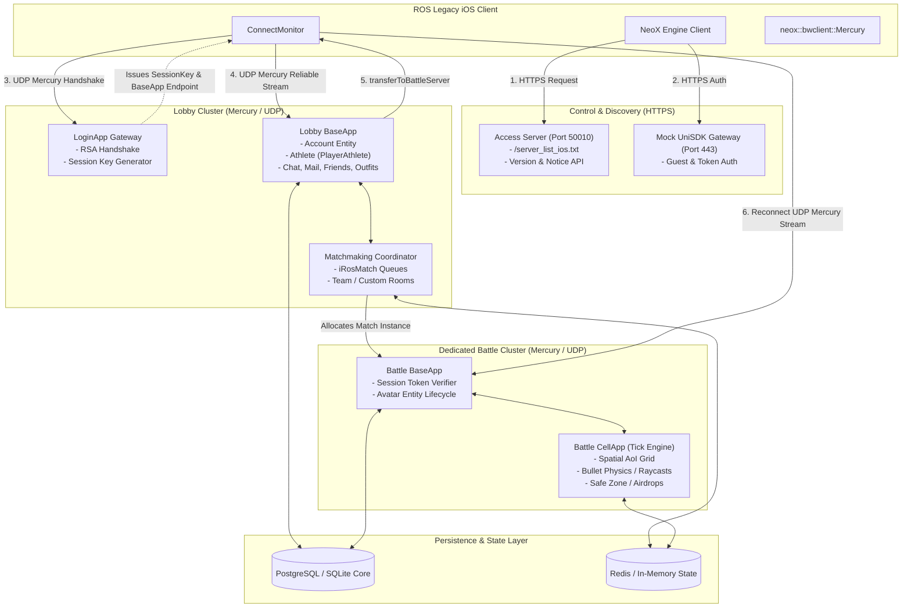
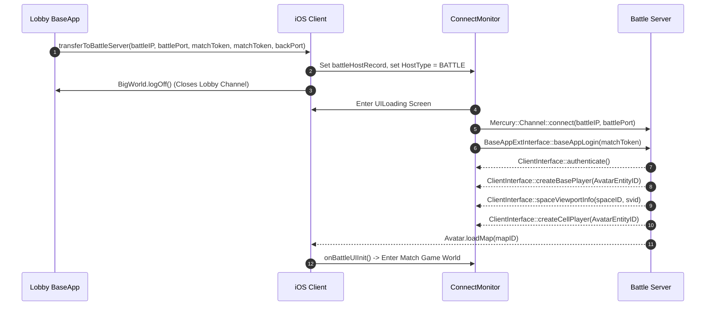
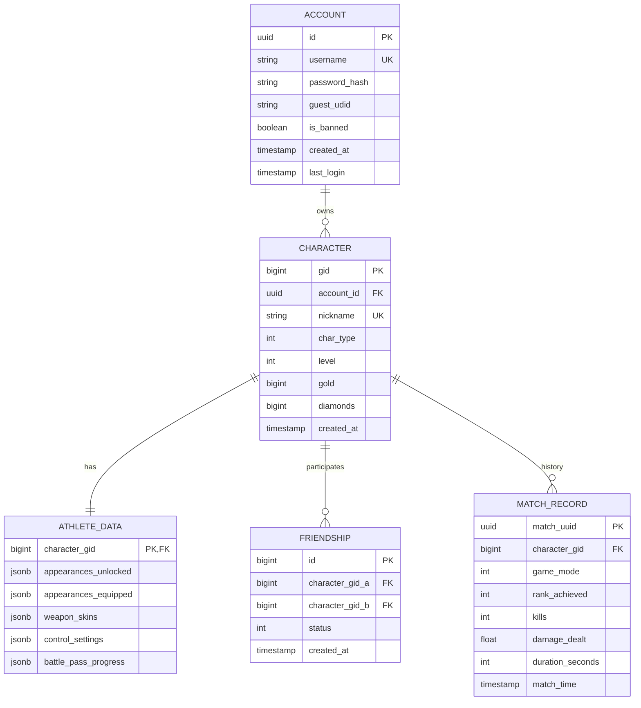
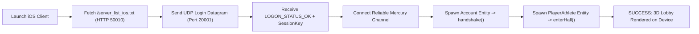
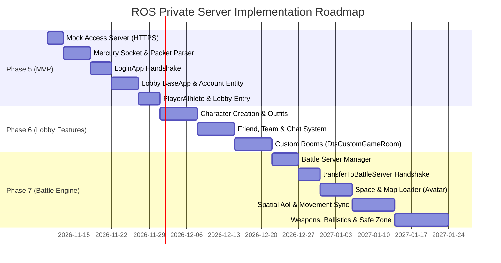

# ROS Legacy iOS — Phase 4: Private Server Architecture Design

## Executive Summary

Phase 4 synthesizes all findings from static reverse engineering, opcode mapping, native disassembly, and entity definition extraction to establish the **complete technical architecture** for an independent, clean-room private server for the **Rules of Survival (ROS) Legacy iOS client** (`RoS-Legacy-iOS.ipa`).

### Strategic Intent
The long-term objective is to build a private backend for private and educational multiplayer use that runs smoothly on **Windows during development** and deploys to **Linux servers in production**, fully preserving the legacy client’s authentic gameplay without requiring client-side binary modifications.

```
+---------------------------------------------------------------------------------------------------------+
|                                        ROS Legacy Private Server Architecture                           |
+---------------------------------------------------------------------------------------------------------+
                                                     |
               +-------------------------------------+-------------------------------------+
               |                                                                           |
               v                                                                           v
     [ Control & Web Plane ]                                                     [ Game Network Plane ]
     (Standard HTTPS / REST)                                                     (Mercury Protocol / UDP)
   - Access & Server Discovery                                                 - LoginApp (Handshake)
   - Patch & Asset Config Server                                               - Lobby BaseApp (Account/Athlete)
   - Web Management / Admin API                                                - Match Battle Server (Avatar/Cell)
```

---

## 1. System Overview & Macro Topology

The client architecture dictates a **distributed micro-cluster topology** matching the BigWorld/NeoX server model. It separates low-frequency social/lobby logic from high-frequency spatial physics and combat.



---

## 2. Component Specifications

### 2.1 Server Discovery & Access Service (`AccessServer`)
- **Protocol**: HTTPS (TLS 1.2/1.3)
- **Port**: `50010` (Default official port found in `extconfigs.py.raw`)
- **Responsibilities**:
  1. **Server List Distribution**: Responds to `GET /server_list_ios.txt` with formatted cluster endpoints.
  2. **Notice Service**: Responds to `GET /notice_ios.txt` with bulletin notices.
  3. **Version Validation**: Validates client engine version (`drpfLogging` / `SALogging`) to avoid force-update dialogs.
- **Server List Schema (`/server_list_ios.txt`)**:
  Each line corresponds to one cluster entry parsed by `common/serverlist_utils.py.raw`:
  ```text
  <zone> <numberSt> <netSt> <serverSt> <name> <oriName> <telIP> <cncIP> <eduIP> <hostID> <loginIP>:<loginPort>:<battlePort>
  ```
  *Example Private Server Entry*:
  ```text
  1 1 0 1 Private_Alpha Alpha 127.0.0.1 127.0.0.1 127.0.0.1 1001 127.0.0.1:20001:20002
  ```

---

### 2.2 Account & Authentication Service (`LoginApp`)
- **Protocol**: Mercury UDP Datagrams
- **Port**: `20001` (Configured via `/server_list_ios.txt`)
- **Responsibilities**:
  1. Receives initial client `probe` datagrams and responds to network latency checks.
  2. Receives client login datagrams encrypted using `loginapp.pubkey`.
  3. Validates credentials (guest UUID, account token, or username/password).
  4. Generates a cryptographically random 32-bit `SessionKey`.
  5. Selects an available `Lobby BaseApp` instance and returns its IP, port, and session token in `LOGON_STATUS_OK (0)` packet.
- **Cryptographic Details**:
  - The client binary uses standard 1024-bit or 2048-bit RSA with PKCS#1 v1.5 padding to protect username/password payloads sent to `LoginApp`.
  - For the private server, the backend must use the matching RSA private key corresponding to `entities/loginapp.pubkey`.

---

### 2.3 Lobby Service (`Lobby BaseApp`)
- **Protocol**: Mercury Reliable Sequenced UDP
- **Port**: `20001` (Or dedicated BaseApp UDP port)
- **Responsibilities**:
  1. **BaseApp Login Verification**:
     - Receives `BaseAppExtInterface::baseAppLogin(sessionKey)`.
     - Validates that `sessionKey` was issued by `LoginApp`.
     - Responds with `ClientInterface::authenticate()`.
  2. **Account Entity Lifecycle**:
     - Spawns client entity type `Account` (Type ID `0x3F`).
     - Sends `ClientInterface::createBasePlayer(accountEntityID)`.
     - Receives `Account.handshake(hotfixMd5, deviceInfo, channelInfo, engineInfo, sauthReply)`.
     - Replies with `Account.onChannelLogin(OK, sauthInfo)`.
  3. **Transition to PlayerAthlete**:
     - Destroys `Account` entity and instantiates `Athlete` (Client class `PlayerAthlete`, Type ID `0x48`).
     - Sends `ClientInterface::createBasePlayer(athleteEntityID)`.
     - If character exists: populates persistent properties (level, nickname, clothes, coins) and triggers `enterHall(firstLoginToday=True)`.
     - If character does not exist: sends `Athlete.showSelectCharacter([])`, receives `Athlete.createCharacter(charType, nickname, initialItems)`, persists the new character, and confirms via `onCreateCharacter(True, "")`.
  4. **Lobby Systems**:
     - Manages appearance and equipment (`iDtsEquipAppearanceAthlete`).
     - Manages in-game currency, mail, rewards, and announcements.

---

### 2.4 Social, Friends & Team Management
- **Interfaces**: `iFriend`, `iMail`, `iHallTeam`, `iChatHall` (implemented on `Athlete.def`)
- **Responsibilities**:
  1. **Hall Team (Lobby Squads)**:
     - Handles `iHallTeam.createHallTeam()`, `delHallTeamMember()`, `getReadyForBattleGround()`.
     - Synchronizes member readiness, outfit display, and selected game mode.
  2. **Friendship System**:
     - Handles friend requests (`requestFriend`), acceptance, and online presence tracking.
  3. **Global & Team Chat**:
     - Dispatches real-time text chat messages across teammates in lobby.

---

### 2.5 Room Creation & Management (`DtsCustomGameRoom`)
- **Entity**: `DtsCustomGameRoom` (`0x5c70e1ff`)
- **Responsibilities**:
  1. **Room Creation**:
     - Client calls `createDtsCustomGame(params, name, mapID, pwd, capacity, fpp, teamMode, isPublic, allowOB, cfg1, cfg2, cfg3)`.
     - Backend allocates a room instance, assigns a unique `roomGID`, and registers the creator as Room Host / Master.
     - Responds with `onCreateDtsCustomGame(roomInfo)`.
  2. **Room Directory**:
     - Handles `requestRoomListInfo(page)` and `requestRoomCountInfo()`.
     - Delivers paginated room listings with ping, player count, and lock status.
  3. **Spectator / Observer Support (OB)**:
     - Accommodates dedicated OB slots as requested by `allowOB`.

---

### 2.6 Matchmaking Service (`iRosMatchCoordinator`)
- **Entity / Interface**: `iRosMatch` (`0x87fb18bc`)
- **Responsibilities**:
  1. **Queue Registration**:
     - Client calls `rosMatchSignSingle(matchMode, ruleSet, region)` or `rosMatchSignMulti(...)`.
     - Coordinator adds tickets to match pool indexed by game mode (Solo, Duo, Squad, Fireteam) and map ID.
     - Returns acknowledgment via `onRosMatchSignCallback(subMatchID, isSuccess=True, matchData)`.
  2. **Roster Assembly**:
     - Collects players until target player threshold is reached (e.g. 60–120 players, or configurable down to 2 players for private testing).
     - Fills remaining slots with bots if configured (`Robot` entity type `0x49`).
  3. **Match Dispatch**:
     - Requests a dedicated match instance from `Battle Server Manager`.
     - Transmits player roster and credentials to the allocated Battle Server.

---

### 2.7 Login-to-Battle Server Handshake & Transition
- **Method**: `PlayerAthlete.transferToBattleServer`
- **Arguments**: `(ip, port, playerName, password, backPort)`
- **Workflow**:
  1. Once the match instance is ready, the Lobby BaseApp sends:
     ```python
     self.client.transferToBattleServer(battleIP, battlePort, token, token, backPort)
     ```
  2. The client records the credentials, terminates the Lobby UDP channel via `BigWorld.logOff()`, enters `UILoading`, and shifts `HostType` to `BATTLE (2)`.
  3. The client connects to `battleIP:battlePort` via Mercury and sends `BaseAppExtInterface::baseAppLogin(token)`.
  4. The Battle BaseApp validates the match token and instantiates `PlayerAvatar`.



---

### 2.8 Dedicated Battle Server (`Battle BaseApp & CellApp`)
- **Protocol**: Mercury Reliable + Unreliable Quantized UDP
- **Port**: `20002` (Configured dynamically per battle instance)
- **Architecture**:
  1. **Tick Loop**: Runs fixed simulation frequency (e.g., 20 Hz / 30 Hz).
  2. **Spatial Grid & Area of Interest (AoI)**:
     - Maintains 2D spatial partitioning (hash grid / quadtree) over the island terrain ($8\text{ km} \times 8\text{ km}$).
     - Only replicates entities within visual/auditory radius (~300–500 meters).
     - Sends `ClientInterface::enterAoI` and `ClientInterface::createEntity` when entities enter view; sends `ClientInterface::leaveAoI` when they leave.
  3. **High-Frequency Position Updates**:
     - Accepts client movements via `avatarUpdateExplicit(pos, yaw, pitch)`.
     - Validates speed and basic physics against terrain bounding.
     - Broadcasts surrounding positions using compressed variants:
       `avatarUpdateNoAliasFullPosYawPitch(entityID, compressedPos, yaw, pitch)`.
  4. **Ballistics & Combat Resolution**:
     - Receives `Avatar.cell.shootHit(weaponInfo, hitPos, targetID, hitPart, dir, bulletID, isCrit, isHeadshot)`.
     - Performs server-side raycast and lag-compensated hit validation.
     - Applies damage to victim's `health` property (replicated via `propertyEvent`).
     - Triggers knockdowns, elimination events (`onNotifyKilled`), and creates loot crates (`DtsPlayerHeritage`).
  5. **Battle Royale Mechanics**:
     - Safe Zone (Gas Circle): Computes shrinking circle centers and radiuses, replicating updates via `spaceData` and `showCircleNotify`.
     - Parachute / Drop Phase: Controls transport plane trajectory (`Plane` entity) and drops.
     - Supply Drops: Spawns `DtsSecretTreasureAirDrop` entities.

---

### 2.9 Entity & RPC Dispatch Subsystem
- **Core Abstraction**: `neox::bwclient::Entity`
- **Method Dispatch Table**:
  - BigWorld maps every `<Exposed/>` method in `.def` files to a numerical ID based on alphabetical or declaration order.
  - Variable-length messages use 1 or 2 prefix bytes depending on the total count of exposed methods.
- **Server Dispatch Loop**:
  ```
  [ Incoming UDP Datagram ]
            |
            v
  [ Mercury::Packet Header Parser ] -> Validate SeqNum, Flags, Ack
            |
            v
  [ Mercury::Bundle Demuxer ]       -> Split multiple bundled messages
            |
            v
  [ Message Router ]
    |--> Message ID 0x15 (entityMessage / shortEntityMessage)
    |         |
    |         v
    |    [ Unpack EntityID & MethodID ]
    |         |
    |         v
    |    [ BinaryIStream Deserializer ] -> Unmarshal types defined in alias.xml
    |         |
    |         v
    |    [ Invoke Entity Method Handler ]
  ```

---

### 2.10 Database & Persistence Layer

The database schema is divided into **Structured Relational Core** (accounts, characters, friendships) and **Document / JSON Store** (custom outfits, inventories, match histories).



---

## 3. Mercury Networking Engine Integration

To ensure seamless interoperability with the unmodified iOS client, the private server must mirror the exact protocol rules uncovered in Phase 3.

### 3.1 UDP Datagram Header Structure
```
+-----------------------------------------------------------------------+
| 0                   1                   2                   3         |
| 0 1 2 3 4 5 6 7 8 9 0 1 2 3 4 5 6 7 8 9 0 1 2 3 4 5 6 7 8 9 0 1       |
+-----------------------------------------------------------------------+
|                             Packet Flags                              |
|   [Bit 0: Reliable]  [Bit 1: HasAck]  [Bit 2: Fragment]  [Bit 3: Seq] |
+-----------------------------------------------------------------------+
|                       Sequence Number (SeqNum)                        |
+-----------------------------------------------------------------------+
|                      Acknowledgment (AckNum)                          |
|                     (Present only if HasAck is set)                   |
+-----------------------------------------------------------------------+
| Message 1: uint8 MessageID | Length Prefix (var) | Binary Payload...  |
+-----------------------------------------------------------------------+
| Message 2 (Bundled, optional)...                                      |
+-----------------------------------------------------------------------+
| Footer: Piggybacked ACKs / Metrics (optional)                         |
+-----------------------------------------------------------------------+
```

### 3.2 Key Protocol State Invariants
1. **Sliding Window & Ordering**:
   - Outgoing reliable packets are numbered consecutively starting from `1` (or initial negotiated sequence).
   - Remote client maintains `oldestUnackedSeq` and `largeOutSeqAt`.
   - The server must not allow the unacknowledged window to exceed `sendWindUsage` threshold (~256 packets), or the client will disconnect with `DISCONNECT_SEND_WINDOW_OVERFLOW (-6)`.
2. **Cumulative & Duplicate ACKs**:
   - The client expects ACKs piggybacked on returning traffic or sent as standalone `OnceOffReceipt` packets.
   - Missing sequence numbers trigger fast retransmit when duplicate ACK threshold (`maxDupAckNum`) is crossed.
3. **Inactivity Watchdog**:
   - Keepalive pings (`probe` or empty bundles) must be exchanged at least every 5.0 seconds.
   - If no valid datagram is received within 15.0 seconds, the client triggers `DISCONNECT_INACTIVITY (-7)`.

---

## 4. Evidence Matrix: Confirmed vs. Inferred vs. Unknowns

| System / Element | Confirmed Static Evidence | Working Assumption | Unknown / To Validate | Confidence |
|---|---|---|---|---|
| **Mercury UDP Protocol** | Disassembled classes: `Bundle`, `Packet`, `Channel`, `Nub`. Log strings identify window metrics (`largeOutSeqAt`, `oldestUnackedSeq`). | Standard BigWorld Mercury framing rules apply. | Exact bitfield packing for packet header flags. | **95%** |
| **LoginApp Handshake** | Log string: `"ServerConnection::logOnBegin connecting to %s for loginAPP"` using `loginapp.pubkey`. | Standard RSA PKCS#1 v1.5 encryption for initial credentials. | Exact structure of raw decrypted authentication buffer. | **90%** |
| **Entity Definitions & RPCs** | All 632 XML files extracted from `entities.npk` with arguments, flags, types. | Method numerical IDs correspond to the declaration order in `.def` files. | Whether base/cell interfaces sort methods before indexing. | **95%** |
| **Lobby-to-Battle Transition** | `transferToBattleServer` method in `PlayerAthlete.py` passing IP, port, token, backPort. | The `password` argument acts as a single-use HMAC/token verified by Battle Server. | Handshake timeout duration before battle server aborts. | **95%** |
| **UDP Port 20013** | Proven **absent** from iOS client binary and scripts. | The client connects to whatever port is delivered by `/server_list_ios.txt`. | Why 20013 was historically assumed (documented as default in BigWorld manuals). | **100% (Debunked)** |
| **Physics & Ballistics** | `shootHit` signature confirmed: hitPos, entityID, hitPart, dir, bulletID. | Client performs prediction; server validates trajectories and damages. | Complete collision bounding meshes for map geometry. | **80%** |

---

## 5. Minimum Viable Prototype (MVP — Phase 5 Target)

The primary goal of the first implementation phase (Phase 5) is to achieve the **"First Playable Lobby" milestone**.

### 5.1 MVP Scope
1. **Access Server**: Lightweight HTTP server returning `/server_list_ios.txt` pointing to localhost (`127.0.0.1:20001`).
2. **Mercury UDP Listener**: Minimal socket handling the initial handshake and sequence numbering.
3. **LoginApp Emulator**: Accepts the login datagram and returns `LOGON_STATUS_OK` with session token.
4. **Lobby BaseApp**:
   - Authenticates session token.
   - Creates `Account` entity and handles `handshake`.
   - Transitions to `PlayerAthlete` and renders the 3D lobby hall (`UISelectMode`).



### 5.2 MVP Acceptance Test Suite

| Test ID | Test Name | Action / Trigger | Expected Outcome | Pass/Fail Criteria |
|---|---|---|---|---|
| **TC-01** | Server Discovery | Client launched on Wi-Fi with custom DNS or proxy. | HTTP `GET /server_list_ios.txt` returns status 200. Client displays server name in login UI. | Server name is visible; no HTTP error dialogs. |
| **TC-02** | UDP Reachability | Tap "Start Game" on client UI. | Server logs incoming UDP datagram from client IP. | Packet received on port `20001`. |
| **TC-03** | Login Handshake | Client transmits initial login packet. | Server returns `LOGON_STATUS_OK (0)` with session token and BaseApp address. | Client progresses past "Connecting..." spinner. |
| **TC-04** | Mercury Channel Sync | Client connects to BaseApp address. | Two-way packet acknowledgment established; sequence numbers increment in order. | No `DISCONNECT_SEND_WINDOW_OVERFLOW` or timeout. |
| **TC-05** | Account Handshake | BaseApp creates entity `Account`. | Client sends `Account.handshake`; server responds `Account.onChannelLogin(OK)`. | Client transitions away from initial login state. |
| **TC-06** | Character / Hall Entry | Server creates `PlayerAthlete`. | Client executes `enterHall()`. 3D character and lobby UI render without crash. | **Lobby UI is fully interactive.** |

---

## 6. Technology Stack Evaluation & Recommendation

### 6.1 Evaluation Criteria
1. **Cross-Platform Parity**: Must compile and execute identically on **Windows (development)** and **Linux (production)**.
2. **High-Performance UDP / Async I/O**: High tick-rate networking with low garbage collection jitter.
3. **Rapid Prototyping & Scripting**: Ability to handle Python entity definitions and data types easily.
4. **Binary & Bitwise Manipulation**: Easy manipulation of binary buffers, endianness, and packed structs.

### 6.2 Language Candidates Comparison

| Language | Pros | Cons | Fit for ROS Private Server |
|---|---|---|---|
| **Python (3.11+ / AsyncIO)** | - Highest developer velocity.<br/>- Native understanding of BigWorld Python idioms.<br/>- Rapid iteration for RPC logic. | - Higher CPU/memory overhead for 60-player spatial ticks.<br/>- GIL constraints on heavy physics. | **Excellent for MVP & Lobby Service** |
| **Go (Golang)** | - Outstanding cross-platform build toolchain (single binary).<br/>- Superb concurrent networking (`goroutines`).<br/>- Minimal memory footprint, high throughput. | - Struct serialization requires boilerplate.<br/>- Garbage collector requires tuning under extreme allocations. | **Strong Candidate for Battle Core** |
| **Rust** | - Absolute peak performance, zero-cost abstractions.<br/>- Deterministic memory management (no GC pauses).<br/>- Exceptional safety for low-level packet handling. | - Steeper learning curve.<br/>- Slower iteration speed during exploratory prototyping. | **Ideal for Long-Term Production Engine** |
| **C# (.NET 8/9)** | - Cross-platform (Windows & Linux).<br/>- Fast binary manipulation via `Span<T>` and `Memory<T>`.<br/>- Clean async networking. | - Runtime dependency.<br/>- Less natural alignment with Python entity structures. | **Good Alternative** |

### 6.3 Final Architecture Recommendation: **Hybrid Pragmatic Stack**

To achieve immediate progress without sacrificing long-term scalability, a **phased modular stack** is recommended:

```
[ Phase 5 Prototype (MVP) ]
  - Language: Python 3.11+ with AsyncIO & uvloop (or Go)
  - Database: SQLite (Dev) / PostgreSQL (Prod)
  - Cache: In-memory dictionary
  - Goal: Rapidly validate Mercury handshake, Account, and Athlete lobby entry.

[ Phase 6+ Production & Dedicated Battle Server ]
  - Control & Lobby Services: Python / FastAPI + AsyncIO or Go (Lightweight, maintainable)
  - Dedicated Battle Server (Spatial Engine): Go or Rust (High-frequency 30 Hz tick loop, thread-safe spatial grid, zero-lag ballistics)
  - Database: PostgreSQL (Relational) + Redis (Session and Match State)
```

---

## 7. Development Roadmap & Phasing



---

## 8. Risks, Pitfalls & Mitigation Strategies

### 8.1 The RSA Public Key Barrier
- **Risk**: The client encrypts the initial login credentials with `entities/loginapp.pubkey`. If the private key is unavailable, the server cannot decrypt credentials sent by an unmodified client.
- **Mitigation Strategy**:
  1. *Scenario A (Extract Key / Null Encryption)*: Check if developer test builds accepted unencrypted payloads or fallback keys.
  2. *Scenario B (Asset Patching)*: If necessary for private community testing, replace `loginapp.pubkey` in the `.ipa` with a custom-generated 2048-bit RSA public key, keeping the matching private key on the backend.

### 8.2 Method ID Desynchronization
- **Risk**: In BigWorld, method numerical IDs are assigned implicitly by indexing methods declared in `.def` files. A mismatch of a single method shifts all subsequent IDs, causing silent packet corruption or crashes (`SimpleClientEntity::methodEvent: No method starting with message id %d`).
- **Mitigation Strategy**:
  1. Directly parse the 632 extracted `.def` files using an automated schema compiler to generate serialization and dispatch tables with guaranteed index matching.

### 8.3 Endianness and Alignment Drift
- **Risk**: The client is compiled for 64-bit ARM (Little-Endian). Writing integers or floats with incorrect endianness or struct padding will cause deserialization failures in `BinaryIStream`.
- **Mitigation Strategy**:
  1. Strictly enforce Little-Endian encoding across all stream serializes (`<` in Python `struct`, `binary.LittleEndian` in Go).

---

## 9. Conclusion

The architecture designed herein provides a clear, mathematically sound, and reverse-engineering-backed foundation for re-creating the ROS Legacy private server. By isolating the Mercury network framing, leveraging the extracted entity definition files, and implementing a phased development path starting from the Minimum Viable Prototype, the system can achieve a working lobby and playable matches while maintaining total technical discipline.

---
*Architecture document prepared for review and engineering approval.*
