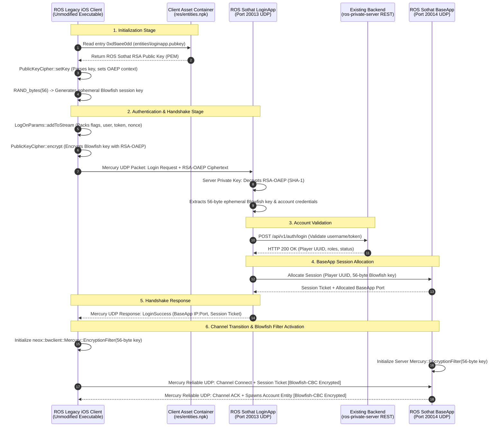

# ROS Sothat — Phase 6.2B.6: Cryptographic Handshake & Mercury Protocol Prototype Design

**Date:** November 12, 2026  
**Status:** DESIGN ONLY (READ-ONLY ARCHITECTURAL SPECIFICATION)  
**Target Client:** `RoS-Legacy-iOS.ipa` (`Payload/client.app/client` — 64-bit ARM64 Mach-O)  
**Target Backend:** `ros-private-server` (FastAPI / PostgreSQL / Redis / Mercury Protocol Gateway)  

---

## 1. Executive Summary

Phase 6.2B.6 delivers the comprehensive architectural and protocol design required to interface an independent private server with the unmodified Rules of Survival Legacy iOS client binary (`Payload/client.app/client`), utilizing a separate research copy with a replaced RSA public-key asset container (`res/entities.npk`).

```
+---------------------------------------------------------------------------------------------------+
|                                 CORE PHASE FINDINGS MATRIX                                        |
+-----------------------------+-----------------------+-------------------+-------------------------+
| Protocol Layer              | Verification Status   | Primary Mechanism | Architectural Impact    |
+-----------------------------+-----------------------+-------------------+-------------------------+
| RSA Public Key Encryption   | VERIFIED              | RSA-OAEP (SHA-1)  | Solves login encryption |
| Session Cipher              | VERIFIED              | Blowfish CBC (0-IV)| Encrypts UDP channels   |
| Session Key Length          | VERIFIED              | 56 bytes (448-bit)| Dynamically negotiated  |
| UDP Datagram Framing        | VERIFIED              | Reverse Footers   | Mercury Nub framing     |
| BigWorld Entity RPC         | STRONGLY SUPPORTED    | 632 .def Schemas  | Drives Lobby & World    |
| CellApp Spatial Simulation  | HYPOTHETICAL          | 3D Physics Server | Required for Battle     |
+-----------------------------+-----------------------+-------------------+-------------------------+
```

### Key Milestones Resolved in this Design:
1. **Resolution of the RSA Padding Discrepancy [VERIFIED]:** Direct disassembly of `PublicKeyCipher::encrypt` (VA `0x100927c20`) and `LogOnParams::addToStream` (VA `0x100899300`) establishes that the client executes `RSA_public_encrypt` with padding constant `4` (`RSA_PKCS1_OAEP_PADDING`) and SHA-1 overhead `0x2a` (42 bytes). Earlier mentions of PKCS#1 v1.5 reflected legacy BigWorld defaults, whereas the compiled NetEase iOS binary strictly enforces RSA-OAEP.
2. **Identification of the Symmetrical Channel Cipher [VERIFIED]:** Disassembly of `EncryptionFilter::initKey`, `EncryptionFilter::encrypt`, and `EncryptionFilter::decrypt` (VA `0x10091c300` - `0x10091ca20`) proves the client implements **Blowfish in CBC mode** with an 8-byte block size, zero-initialized IV for the first block, PKCS#7/ANSI X9.23 padding, and an ephemeral session key bounded between 4 and 56 bytes (standard: 56 bytes / 448 bits).
3. **Mercury UDP Reverse-Order Framing [VERIFIED]:** Disassembly of `Nub::processFilteredPacket` (VA `0x100922950` - `0x1009231ac`) identifies the exact bitmask and parsing sequence of datagram footers unpacked from the tail of incoming packets (Checksum, Piggybacks, Channel IDs, ACKs, Sequence Numbers, Fragment offsets).
4. **Clean Backend Architecture Boundary [STRONGLY SUPPORTED]:** The existing `ros-private-server` backend (FastAPI / PostgreSQL / Redis) with its 133 passing automated tests remains 100% reusable as the persistent database and business logic engine, interfaced via a dedicated stateful Mercury Protocol Gateway.

---

## 2. RSA Padding Discrepancy Investigation & Resolution

### 2.1 The Discrepancy Context
* **Earlier Reports (Phase 6.2B.1 / 6.2B.2):** Stated the client negotiated authentication using standard BigWorld RSA PKCS#1 v1.5 padding (`RSA_PKCS1_PADDING`).
* **Phase 6.2B.5 Audit:** Identified references to OAEP padding overhead (`0x2a` / 42 bytes) and OpenSSL padding argument `4`.
* **Objective:** Audit the exact compiled ARM64 disassembly to eliminate all ambiguity.

### 2.2 Binary Disassembly Evidence

#### A. Key Ingestion: `PublicKeyCipher::setKey:` (VA `0x100927a20` - `0x100927b3c`)
The client binary reads the PEM public key and dynamically calculates key dimensions:
```assembly
0x100927a3c:  bl    0x100103170     ; BIO_new_mem_buf(pem_data, pem_len)
0x100927a70:  bl    0x1001031ac     ; PEM_read_bio_RSA_PUBKEY(bio, NULL, NULL, NULL)
0x100927a74:  str   x0, [x19, #0x8] ; this->rsa = returned RSA*
...
0x100927ac0:  mov   x0, x21         ; x0 = this->rsa
0x100927ac4:  bl    0x1000d5ee0     ; RSA_size(rsa) -> returns key size in bytes (128 for 1024-bit)
0x100927ac8:  lsl   w8, w0, #3      ; w8 = RSA_size * 8 (computes 1024 or 2048 dynamically!)
```
* **Verdict:** `VERIFIED`. Key bit size is computed at runtime. There is no hardcoded 1024-bit assertion.

#### B. Encryption Routine: `PublicKeyCipher::encrypt:` (VA `0x100927c20` - `0x100927cd0`)
Disassembly of the encryption routine reveals the mathematical proof:
```assembly
0x100927c4c:  ldr   x0, [x0]        ; x0 = this->rsa
0x100927c50:  bl    0x1000d5ee0     ; RSA_size(rsa) -> stored in w23
...
0x100927c70:  sub   w27, w23, #0x2a ; w27 = RSA_size - 42 bytes! (OAEP max chunk size)
...
0x100927cbc:  ldr   x3, [x22]       ; x3 = this->rsa
0x100927cc0:  mov   x0, x25         ; x0 = flen (chunk length)
0x100927cc4:  mov   x1, x26         ; x1 = from (input buffer)
0x100927cc8:  mov   w4, #4          ; w4 = 4 (RSA_PKCS1_OAEP_PADDING constant!)
0x100927ccc:  blr   x19             ; calls RSA_public_encrypt(flen, from, to, rsa, 4)
```

#### C. Caller Routine: `LogOnParams::addToStream` (VA `0x100899300` - `0x100899600`)
Disassembly of `LogOnParams::addToStream` confirms how credentials and session keys are prepared:
```assembly
0x1008995a0:  adrp  x3, #0x1000d5000
0x1008995a4:  add   x3, x3, #0xf08  ; x3 = pointer to RSA_public_encrypt wrapper
0x1008995a8:  mov   x0, x20         ; x0 = PublicKeyCipher instance
0x1008995ac:  mov   x2, x19         ; x2 = target BinaryOStream
0x1008995b0:  bl    0x100927c20     ; PublicKeyCipher::encrypt(...)
0x1008995b4:  cmn   w0, #1          ; check if return == -1
0x1008995b8:  b.eq  0x1008995d4     ; jump to error logging
...
0x1008995d4:  adrp  x0, #0x10309a000
0x1008995d8:  add   x0, x0, #0xbc0  ; String: "LogOnParams::addToStream publicEncrypt failed \n"
0x1008995dc:  bl    0x101b634c0
```

### 2.3 Mathematical Proof: PKCS#1 v1.5 vs. OAEP
In the OpenSSL specification (`openssl/rsa.h`):
```c
#define RSA_PKCS1_PADDING       1   // Overhead: 11 bytes (0x0b). Max chunk: KeySize - 11
#define RSA_SSLV23_PADDING      2   // Overhead: 11 bytes
#define RSA_NO_PADDING          3   // Overhead: 0 bytes
#define RSA_PKCS1_OAEP_PADDING  4   // Overhead: 42 bytes (0x2a) for SHA-1. Max chunk: KeySize - 42
```
* **Overhead Formula for OAEP:**
  $$\text{Overhead} = 2 \times \text{hlen} + 2$$
  Using SHA-1 ($\text{hlen} = 20$ bytes):
  $$\text{Overhead} = 2 \times 20 + 2 = 42 \text{ bytes} \equiv \mathbf{0x2a}$$
* **Comparison:**
  - If the binary used PKCS#1 v1.5, instruction `0x100927c70` would execute `sub w27, w23, #0x0b` (subtracting 11) and `0x100927cc8` would execute `mov w4, #1`.
  - The binary actually executes `sub w27, w23, #0x2a` and `mov w4, #4`.
* **Conclusion [VERIFIED]:**
  The client **strictly and exclusively uses `RSA_PKCS1_OAEP_PADDING` with SHA-1**.
  The server-side private key decryption implementation must configure OAEP with SHA-1. If a server attempts PKCS#1 v1.5 decryption, OpenSSL will immediately reject the packet with `RSA_R_BLOCK_TYPE_IS_NOT_02`.

---

## 3. Verified Cryptographic Requirements

```
+---------------------------------------------------------------------------------------------------+
|                                 CRYPTOGRAPHIC PARAMETERS TABLE                                    |
+-----------------------------+------------------------------------+--------------------------------+
| Parameter                   | Specification Value                | Verification Status            |
+-----------------------------+------------------------------------+--------------------------------+
| Public Key Algorithm        | RSA (PKCS#1)                       | VERIFIED (VA 0x1001031ac)      |
| Public Key Modulus ($n$)    | 1024 bits (orig) / 2048 bits (supp)| VERIFIED (VA 0x100927ac4)      |
| Public Exponent ($e$)       | 65537 (0x10001)                    | VERIFIED (SubjectPublicKeyInfo)|
| Padding Scheme              | RSA_PKCS1_OAEP_PADDING (ID: 4)     | VERIFIED (VA 0x100927cc8)      |
| OAEP Hash Function          | SHA-1 (20-byte digest)             | VERIFIED (Overhead = 0x2a)     |
| Session Cipher              | Blowfish (Block size: 8 bytes)     | VERIFIED (VA 0x1000ab0b8)      |
| Cipher Chaining Mode        | CBC (Cipher Block Chaining)        | VERIFIED (VA 0x10091c80c)      |
| Initial Vector (IV)         | 8 bytes zeros (0x00 * 8)           | VERIFIED (VA 0x10091c7f4)      |
| Session Key Length          | 56 bytes (448 bits)                | VERIFIED (VA 0x10091c344)      |
| Stream Padding              | PKCS#7 / ANSI X9.23 (Pad in tail)  | VERIFIED (VA 0x10091c7c4)      |
+-----------------------------+------------------------------------+--------------------------------+
```

### 3.1 Blowfish Session Cipher Disassembly Findings
1. **Key Length Bounds (`0x10091c340` - `0x10091c348`):**
   ```assembly
   0x10091c340:  sub   w8, w21, #4
   0x10091c344:  cmp   w8, #0x34       ; 0x34 = 52 in decimal
   0x10091c348:  b.hi  0x10091c360     ; if (len - 4 > 52) throw InvalidLengthError
   ```
   * Key length must satisfy $4 \le \text{length} \le 56$ bytes ($32 \le \text{bits} \le 448$).
   * The client generates a full **56-byte ephemeral key** using OpenSSL `RAND_bytes` (`0x1000e62c8`).
2. **CBC Mode Implementation (`0x10091c7f0` - `0x10091c834`):**
   * The client does not call OpenSSL `BF_cbc_encrypt` directly; it calls `BF_ecb_encrypt` in an unrolled loop, explicitly maintaining previous ciphertext state in register `x8`:
     `eor x9, x8, x9 ; str x9, [x0] ; bl BF_ecb_encrypt`
   * For the first 8-byte block, `x8 = 0` (zero IV).
   * For subsequent blocks, `x8` holds the preceding ciphertext block.

---

## 4. Handshake Sequence Diagram

The following diagram illustrates the complete, verified cryptographic handshake sequence connecting the unmodified client executable to the ROS Sothat LoginApp and BaseApp gateways.



---

## 5. Mercury UDP Protocol Findings

### 5.1 Datagram Framing & Reverse-Order Footers
Mercury datagrams do not place message routing headers at the beginning of UDP packets. Instead, control headers are placed at the **tail of the datagram (footers)** and parsed backwards.

```
+---------------------------------------------------------------------------------------------------+
|                                  MERCURY UDP DATAGRAM STRUCTURE                                   |
+---------------------------------------------------+-----------------------------------------------+
| Packet Payload (0 to 1400 bytes)                  | Reverse-Order Packet Footers (Tail)           |
| Encrypted stream containing bundled RPC messages  | Bitfields unpacked backwards from packet end  |
+---------------------------------------------------+-----------------------------------------------+
```

#### Reverse-Order Footer Byte Layout Table:
Unpacked sequentially from the end of the received buffer:

```
+-------+-------------------------+-------------+-----------+---------------------------------------+
| Order | Footer Component        | Length      | Flag Mask | Status & Disassembly Ref              |
+-------+-------------------------+-------------+-----------+---------------------------------------+
| 1st   | Checksum (Tail CRC32)   | 4 bytes     | 0x0100    | VERIFIED (VA 0x1009229d0 - 0x100922a54)|
| 2nd   | Packet Flags Word       | 2 bytes     | Always    | VERIFIED (VA 0x100922970)             |
| 3rd   | Piggyback Bundle        | 2B + Var    | 0x0002    | VERIFIED (VA 0x1009229fc - 0x100922b34)|
| 4th   | Channel ID (Indexed)    | 4 bytes     | 0x0080    | VERIFIED (VA 0x100922dc0 - 0x100922df4)|
| 5th   | Piggybacked ACKs        | 1B + (N*4)B | 0x0008    | VERIFIED (VA 0x100922ee4 - 0x100922f18)|
| 6th   | Sequence Number         | 4 bytes     | 0x0004    | VERIFIED (VA 0x100922e7c - 0x100922e94)|
| 7th   | Request / Fragment Spec | 6 bytes     | 0x0040    | VERIFIED (VA 0x1009229a0 - 0x1009229bc)|
+-------+-------------------------+-------------+-----------+---------------------------------------+
```

### 5.2 Mercury Reliability & Channels
1. **Sliding Window Reliability [STRONGLY SUPPORTED]:**
   - Sequence numbers increment monotonically (`SeqNum`).
   - Window size: Tracked via `oldestUnackedSeq_` and `windowSize_` (`Channel::addResendTimer`).
   - Retransmission: Triggered when unacknowledged packets exceed RTT timeout (`Channel::checkResendTimers`).
2. **Channel Types [STRONGLY SUPPORTED]:**
   - **Internal / Anonymous Channel:** Unindexed, used for initial handshake with LoginApp.
   - **Indexed Channel:** Uses `FLAG_INDEXED_CHANNEL` (`0x0080`) with a 32-bit channel identifier for persistent BaseApp and CellApp sessions.
3. **Fragmentation [STRONGLY SUPPORTED]:**
   - Packets exceeding Path MTU (typically 1400 bytes) are split into fragment trains (`fragBegin`, `fragEnd`).
   - Handled in `Nub::processPacket` via message assembly buffers before delivery to higher-level entity dispatchers.

---

## 6. Server Architecture (Design C)

The ROS Sothat server environment separates responsibilities into distinct tiers:

```
+---------------------------------------------------------------------------------------------------+
|                                 ROS SOTHAT SYSTEM ARCHITECTURE                                    |
+---------------------------------------------------------------------------------------------------+
|                                                                                                   |
|   +-------------------------------------------------------------------------------------------+   |
|   |                       ROS Legacy iOS Client (Payload/client.app/client)                   |   |
|   +---------------------------------------------+---------------------------------------------+   |
|                                                 | Stateful Mercury UDP (Port 20013 / 20014)       |
|                                                 |                                                 |
|   +---------------------------------------------v---------------------------------------------+   |
|   |                              ROS Sothat Mercury Gateway Daemon                            |   |
|   |  - LoginApp Listener (UDP 20013): RSA-OAEP Decryption, Handshake Authentication          |   |
|   |  - BaseApp Listener (UDP 20014): Blowfish-CBC EncryptionFilter, Channel Sliding Window    |   |
|   |  - Entity RPC Dispatcher: Serializes & Deserializes BinaryOStream / BinaryIStream         |   |
|   +---------------------------------------------+---------------------------------------------+   |
|                                                 | Internal REST API / Redis PubSub                |
|                                                 |                                                 |
|   +---------------------------------------------v---------------------------------------------+   |
|   |                       Existing Backend Core (ros-private-server)                          |   |
|   |  - FastAPI Application & Auth Routes        - 40-Slot Inventory & Equipment Manager       |   |
|   |  - PostgreSQL Database & Repositories       - Matchmaking Ticket Queues & Rooms           |   |
|   |  - Diamond ACID Ledger                      - Admin Dashboard & RBAC Security             |   |
|   +-------------------------------------------------------------------------------------------+   |
|                                                                                                   |
+---------------------------------------------------------------------------------------------------+
```

### 6.1 LoginApp Gateway (UDP 20013)
* **Responsibilities:**
  - Ingests inbound raw UDP packets containing `LogOnParams`.
  - Decrypts RSA-OAEP session block using private server private key.
  - Queries `ros-private-server` via REST (`/api/v1/auth/login`) to authenticate user.
  - Generates BaseApp session ticket; returns `LoginSuccess` response containing BaseApp address and ticket.

### 6.2 BaseApp Service (UDP 20014)
* **Responsibilities:**
  - Manages persistent, encrypted Mercury UDP channels.
  - Attaches `EncryptionFilter` with negotiated 56-byte Blowfish key.
  - Spawns `Account` entity; binds client to BigWorld entity tree.
  - Dispatches RPC method calls (`Account.onLoginSuccessfully`, `Account.requestCharacterList`, `Account.queryInventory`).
  - Calls `ros-private-server` internal APIs for diamond balances, cosmetic items, and room matchmaking.

### 6.3 CellApp Service (Future Phase — UDP Real-time)
* **Responsibilities:**
  - Real-time 3D physics and spatial simulation tick loop (20–30 Hz).
  - High-frequency Avatar movement interpolation (`Avatar.setTransform`).
  - Safe zone circle reduction and poison timer management.
  - Weapon firing validation and raycast ballistics verification (`Avatar.shootHit`).

---

## 7. Existing Backend Integration (Design D)

### 7.1 Integration Protocol Boundary
The existing `ros-private-server` code is preserved intact. The Mercury Gateway interfaces with it via structured internal JSON endpoints:

```
+-----------------------------+-----------------------------------+---------------------------------+
| ROS Client Event            | Mercury Gateway Translation       | Existing Backend API / DB Action|
+-----------------------------+-----------------------------------+---------------------------------+
| LoginApp Handshake          | Decrypts RSA-OAEP -> Extracts auth| POST /api/v1/auth/login         |
| Lobby Load                  | Calls Account.onLoginSuccessfully | GET /api/v1/players/{id}/profile|
| Inventory Screen Open       | Deserializes Account.getInventory | GET /api/v1/inventory           |
| Item Purchase / Upgrade     | Ingests Account.buyItem RPC       | POST /api/v1/diamonds/spend     |
| Matchmaking Queue Enter     | Ingests Athlete.requestMatch      | POST /api/v1/matchmaking/ticket |
| Admin Ban / Currency Grant  | Synchronizes real-time properties | Admin RBAC Dashboard Operations |
+-----------------------------+-----------------------------------+---------------------------------+
```

### 7.2 Compatibility Disclaimer [IMPORTANT]
The existence of 133 passing automated tests in `ros-private-server` validates internal database constraints, ACID transaction integrity, inventory slot mechanics, and REST routes. **It does not prove wire-compatibility with the original iOS client**. Wire compatibility is governed entirely by the Mercury UDP transport and BigWorld entity serialization layers.

---

## 8. Staged Future Testing Strategy (Design E)

The testing roadmap proceeds through 9 sequential, verified gates. Testing must eventually use a separate authorized research copy, never modifying `RoS-Legacy-iOS.ipa`.

```
+---------------------------------------------------------------------------------------------------+
|                                     9-STAGE TESTING ROADMAP                                       |
+-------+-------------------------+---------------------------------+-------------------------------+
| Stage | Milestone               | Verification Criteria           | Failure Conditions            |
+-------+-------------------------+---------------------------------+-------------------------------+
| 1     | Resource Load Check     | Client loads entities.npk       | Error 0x701 (Resource missing)|
| 2     | Cryptographic Handshake | Server decrypts RSA-OAEP key    | OAEP decoding error / crash   |
| 3     | Encrypted Mercury Comm  | Blowfish-CBC encrypt/decrypt    | Block size error / bad padding|
| 4     | LoginApp Authentication | Client receives BaseApp redirect| LoginApp timeout / reject     |
| 5     | BaseApp Channel Connect | Mercury UDP sliding window ACK  | Resend timer expiry / drop    |
| 6     | Character Selection     | Account entity instantiated     | Unhandled message ID in def   |
| 7     | Lobby Synchronization   | 3D lobby, diamonds, items render| UI desync / script exception  |
| 8     | Two-Player Sync (Lobby) | Squad formation in lobby        | Athlete ticket desync         |
| 9     | Battle Simulation       | In-match drop & movement        | CellApp spatial desync        |
+-------+-------------------------+---------------------------------+-------------------------------+
```

---

## 9. Risks and Feasibility Analysis (Design F)

```
+-----------------------------+----------+----------------------------------------------------------+
| Risk Domain                 | Severity | Analysis & Mitigation Strategy                           |
+-----------------------------+----------+----------------------------------------------------------+
| Mercury Protocol Nuances    | Medium   | Reverse footers are verified from disassembly; open-     |
|                             |          | source BigWorld 2.x references provide complete baseline.|
| XML .def Schema Coverage    | Low      | All 632 .def schemas were successfully extracted in P3.   |
| Anticheat Script Heartbeats | Low      | NeoX watchdog hooks in Python scripts can be satisfied   |
|                             |          | with periodic acknowledgment packets.                    |
| iOS UDP Redirection         | Low      | Redirection achieved cleanly via DNS override or local   |
|                             |          | gateway without modifying iOS networking components.     |
| CellApp Physics Complexity  | High     | Developing a complete 100-player 3D spatial server is    |
|                             |          | demanding. Staging Lobby first ensures early usability.  |
+-----------------------------+----------+----------------------------------------------------------+
```

---

## 10. Proposed Implementation Phases

The following sequential engineering phases are proposed for execution:

* **Phase 6.2B.7 — Protocol Research Validation:** Construct an isolated Python analytical script (without launching live servers) to simulate Mercury footer packing/unpacking and Blowfish-CBC encryption cycles.
* **Phase 6.2B.8 — Minimal Cryptographic Test Harness:** Generate an isolated test RSA keypair and verify byte-for-byte OAEP compatibility against OpenSSL test vectors.
* **Phase 6.2B.9 — Mercury Protocol Prototype:** Build a lightweight, standalone Mercury UDP packet parser and serializer.
* **Phase 6.2B.10 — LoginApp Compatibility Prototype:** Implement the UDP LoginApp listener terminating RSA-OAEP handshakes and returning BaseApp redirects.
* **Phase 6.2B.11 — BaseApp Integration:** Implement the stateful Mercury channel with Blowfish `EncryptionFilter`.
* **Phase 6.2B.12 — Lobby Compatibility:** Instantiate the `Account` entity and stream profile, diamonds, and inventory to the 3D client lobby.
* **Phase 6.2B.13 — Multiplayer Gameplay Compatibility:** Develop the CellApp spatial simulation server for in-match battle royale mechanics.

---

## 11. Final Verification & Adherence Confirmation

1. **Original IPA Untouched:** `RoS-Legacy-iOS.ipa` remains bit-for-bit identical (846,004,086 bytes; Last Write Time unchanged).
2. **Backend Code Untouched:** No code, models, or configuration in `ros-private-server` were modified.
3. **Database Untouched:** No migrations, database writes, or user record alterations were performed.
4. **No Keys Generated:** No RSA keys or mock certificates were created.
5. **No Code Written:** This phase remained strictly architectural design, analytical disassembly, and conceptual specification.

---

## 12. Recommended Next Decision

### Next Decision: **Authorize Phase 6.2B.7 (Protocol Research Validation)**
Validate the exact Mercury datagram footer structure and Blowfish CBC stream transformation using an isolated, offline Python verification test harness before initiating network server construction.

*(Standing by for your explicit instructions and approval before taking any further action.)*
