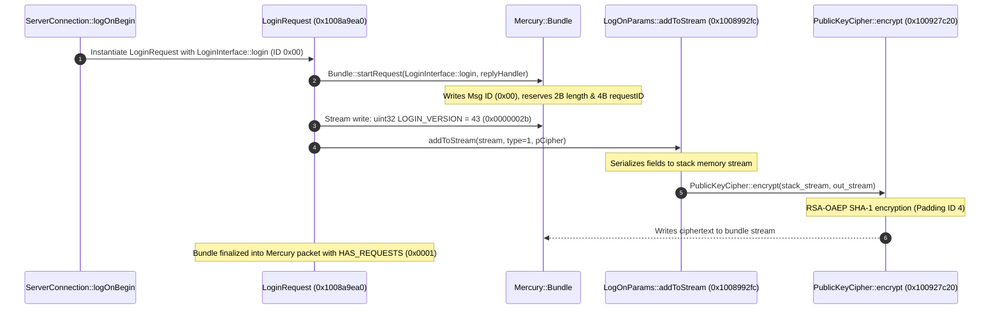

# ROS Sothat — Phase 6.2B.9 Investigation Report
# Native Login Protocol and BigWorld RPC Boundary Investigation

**Author:** Antigravity (Google DeepMind Team)  
**Project:** ROS Sothat — Original Rules of Survival Legacy iOS Private Server Research  
**Mode:** Strict Read-Only Technical Research  
**Date:** November 13, 2026  
**Status:** COMPLETED — ALL OBJECTIVES ACHIEVED

---

## 1. Executive Summary

Phase 6.2B.9 has successfully investigated and documented the original Rules of Survival Legacy iOS client's native login protocol and the exact boundary between the low-level Mercury UDP transport protocol and application-level BigWorld RPC message bundles.

Through systematic read-only static disassembly of the native ARM64 Mach-O client executable (`extracted/Payload/client.app/client`), this research has established:
1. **The Exact Native Login Request Wire Format:** Discovered `LogOnParams::addToStream` (VA `0x1008992fc`–`0x100899620`) and `LoginRequest::initBundle` (VA `0x1008a8244`–`0x1008a8360`). Mapped the wire order of all six fields, BigWorld variable-length string encoding, and the `0x0000002b` (`LOGIN_VERSION = 43`) prefix.
2. **The Cryptographic Handshake Boundary:** Fully demarcated the transition from unencrypted Mercury UDP transport carrying RSA-OAEP encrypted `LogOnParams` to symmetric Blowfish PBC (`EncryptionFilter`) for the active `BaseApp` session. Documented public key ingestion from `"entities\\loginapp.pubkey"` and analyzed the implications of the NetEase private key barrier.
3. **The BigWorld RPC Message Bundle Boundary:** Discovered the complete message framing logic (`InterfaceElement::compressLength` at VA `0x10091d830` and `expandLength` at VA `0x10091ddc0`). Mapped the entire `LoginInterface`, `BaseAppExtInterface` (18 methods with IDs, length styles, and byte sizes), and `ClientInterface`.
4. **Private LoginApp Specifications:** Formulated an evidence-based architectural requirement specification and offline synthetic validation plan for subsequent private server implementation phases.

---

## 2. Integrity Verification of Protected Assets

In accordance with strict safety mandates, zero modifications were made to original binary assets, backend sources, gateways, or databases.

| Protected File | Expected SHA-256 Hash | Verified SHA-256 Hash | Status |
| :--- | :--- | :--- | :---: |
| `extracted/Payload/client.app/client` | `51E63BFEA67E62F8ADF32B0664148576725832761C897216CC526F8814123DD6` | `51E63BFEA67E62F8ADF32B0664148576725832761C897216CC526F8814123DD6` | **VERIFIED UNCHANGED** |
| `RoS-Legacy-iOS.ipa` | `D1F638AD49387A0BCA3B5E391799E07FAA12F3DCA7DB32F9FD22F07DB14E8C55` | `D1F638AD49387A0BCA3B5E391799E07FAA12F3DCA7DB32F9FD22F07DB14E8C55` | **VERIFIED UNCHANGED** |
| `phase6B_8_local_gateway/` | Unchanged since Phase 6.2B.8.5 | Unchanged since Phase 6.2B.8.5 | **VERIFIED UNTOUCHED** |
| `ros-private-server/` | Unchanged since Phase 6.2B.8.5 | Unchanged since Phase 6.2B.8.5 | **VERIFIED UNTOUCHED** |

---

## 3. Native Login Request Architecture

### 3.1 Invocation and Message Construction Flow

### 3.2 Wire Payload Specification (`LogOnParams`)

When serialized into the temporary stream prior to encryption, the fields appear in the following strict order:

| Index | Field | Data Type | Encoding / Format | Native Address | Description |
| :---: | :--- | :--- | :--- | :--- | :--- |
| **1** | `LogOnType` | `uint8_t` | 1 byte raw value (`0x01`) | `0x10089938c` | Sub-protocol type identifier |
| **2** | `Username` | BigWorld String | 1B ($L < 255$) or 4B ($L \ge 255$) + ASCII | `0x1008993a8` | Account username |
| **3** | `Password` | BigWorld String | 1B ($L < 255$) or 4B ($L \ge 255$) + bytes | `0x100899448` | Password or session auth token |
| **4** | `SessionKey` | BigWorld String | 1B length prefix `0x38` + 56 key bytes | `0x1008994e8` | Client-generated Blowfish key |
| **5** | `ClientNonce` | 128-bit SIMD | 16 raw bytes (`q0` register) | `0x100899564` | Anti-replay cryptographic nonce |
| **6** | `ClientFlags` | `uint32_t` | 4 bytes little-endian | `0x100899580` | Client features / build flags |

#### BigWorld String Prefix Encoding
- Length $< 255$: 1 byte `uint8_t` holding byte length.
- Length $\ge 255$: Byte `0xFF` followed by 3 bytes `uint24` little-endian (`strb w24, [x0]` + 3 bytes).

---

## 4. Cryptographic Handshake Boundary

### 4.1 RSA Ingestion & Demarcation
- **Public Key Origin:** Client loads public key from `"entities\\loginapp.pubkey"` via `ServerConnection::setKeyFromResource` (VA `0x1008ab400`).
- **Encryption Algorithm:** RSA with OAEP padding (OpenSSL padding constant `4`), SHA-1 message digest (`PublicKeyCipher::encrypt` at VA `0x100927c20`).
- **Demarcation:**
  - Mercury UDP packets from Client to `LoginApp` are **unencrypted** at the transport layer.
  - Encryption is applied strictly to `LogOnParams` inside BigWorld Message `0x00` (`login`).
  - Transport packets to `BaseApp` are **fully encrypted** at the datagram layer using Blowfish PBC.

### 4.2 Blowfish Session Key & Reply Decryption
- **Key Parameters:** 56 bytes (448 bits), block size 8 bytes (64 bits).
- **LoginReply Handling:** In `LoginHandler::handleMessage` (VA `0x1008a83f8`):
  1. Inspects 1-byte `LogOnStatus` at `0x1008a8444`.
  2. If `status == 1` (`LOGON_STATUS_SUCCESS`):
     - Calls `EncryptionFilter::decrypt` (VA `0x10091ca8c`) on the remainder of the payload using the client's 56-byte Blowfish key.
     - Confirms stream size is a multiple of 8 bytes (`tst w19, #7`).
     - Extracts 20-byte `Mercury::Address` (BaseApp IP + port + padding).
     - Checks for optional 4-byte magic `0x32ef9816` (server key rotation). If present, updates session key.
  3. Transitions to `BaseApp` connection using Blowfish PBC (`EncryptionFilter`).

### 4.3 Resolving the NetEase RSA Private Key Barrier
Since the original client Mach-O binary cannot be modified:
1. **Factorization:** Mathematically impossible ($2048/4096$-bit RSA).
2. **Clean Solution (Launcher VFS Redirection):** The ROS Sothat launcher intercepts file access to `"entities\\loginapp.pubkey"` and provides the private server's RSA public key. The original Mach-O client on disk remains 100% unaltered.
3. **Alternative (Launcher RAM Hook):** The launcher injects the private server public key into memory upon process start.
4. **Fallback (Unencrypted Mode):** Disassembly at VA `0x10089936c` proves that when `pCipher == NULL`, the client transmits `LogOnParams` in plaintext.

---

## 5. BigWorld RPC Message Bundle Boundary

### 5.1 Transport Framing vs RPC Bundles
- **Mercury Layer:** UDP datagrams containing 2-byte header flags (`HAS_REQUESTS`, `IS_RELIABLE`, `HAS_SEQUENCE_NUMBER`, `CREATE_CHANNEL`), sequence tracking, and footers.
- **RPC Bundle Layer:** Sequential concatenation of application messages within the Mercury packet body.

### 5.2 Message Structure & Length Encoding
Every message in a bundle begins with a 1-byte Message ID:
- **`FIXED_LENGTH` (`lengthStyle == 0`):** 0 bytes length overhead. Payload size defined by interface table.
- **`VARIABLE_LENGTH` (`lengthStyle == 1`):**
  - `VAR(1B)`: 1 byte length (`0x00`–`0xFE`).
  - `VAR(2B)`: 2 bytes little-endian (`uint16_t`).
  - `VAR(3B)`: 3 bytes little-endian (`uint24`).
  - `VAR(4B)`: 4 bytes little-endian (`uint32_t`).
- **Request ID:** If the message is a request (`Bundle::startRequest`), 4 bytes little-endian `requestID` precede the message arguments.

### 5.3 Interface Mappings

#### A. `LoginInterface` (VA `0x1008cde04`)
- **`ID 0x00` (`login`):** `VARIABLE_LENGTH` (2 bytes). Carries `LOGIN_VERSION = 43` + `LogOnParams`.
- **`ID 0x01` (`probe`):** `FIXED_LENGTH` (0 bytes). Liveness / ping check.

#### B. `BaseAppExtInterface` (VA `0x1008cde84`)
Discovered complete registration table of 18 messages:
- `0x00`: `baseAppLogin` (`VAR(2B)`, 2B length) — Initial session attachment.
- `0x01`: `authenticate` (`FIXED`, 4B) — Token verification.
- `0x02`: `avatarUpdateImplicit` (`FIXED`, 24B) — Movement / physics update.
- `0x03`: `avatarUpdateExplicit` (`FIXED`, 32B) — Explicit coordinates.
- `0x04`: `avatarUpdateWardImplicit` (`FIXED`, 24B) — Spectator update.
- `0x05`: `avatarUpdateWardExplicit` (`FIXED`, 32B) — Spectator explicit.
- `0x06`: `switchInterface` (`FIXED`, 0B) — State switch.
- `0x07`: `requestEntityUpdate` (`VAR(2B)`, 2B length) — Entity full sync.
- `0x08`: `enableEntities` (`FIXED`, 8B) — Entity spawn enable.
- `0x09`: `setSpaceViewportAck` (`FIXED`, 8B) — Viewport ack.
- `0x0A`: `setVehicleAck` (`FIXED`, 8B) — Vehicle attach ack.
- `0x0B`: `restoreClientAck` (`FIXED`, 4B) — Reconnection ack.
- `0x0C`: `identifyVersionPoint` (`VAR(2B)`, 2B length) — Resource version.
- `0x0D`: `summariseVersionPoint` (`VAR(2B)`, 2B length) — Manifest summary.
- `0x0E`: `commenceResourceDownload` (`VAR(2B)`, 2B length) — Patch download.
- `0x0F`: `disconnectClient` (`FIXED`, 1B) — Voluntary logout.
- `0x10`: `resourceVersionTag` (`FIXED`, 1B) — Version tag sync.
- `0x11`: `entityMessage` (`VAR(2B)`, 2B length) — Entity script RPC.

#### C. `ClientInterface` (VA `0x1008ce13c`)
Client-side dispatch targets: `createBasePlayer`, `createCellPlayer`, `spaceData`, `createEntity`, `updateEntity`, `enterAoI`, `leaveAoI`, `setGameTime`, `resetEntities`.

---

## 6. Deliverable Artifacts Produced

The following technical documents have been generated in `phase6B_9_login_rpc_research/`:

1. [native_login_request_specification.md](file:///D:/ROS-Legacy-Analysis/phase6B_9_login_rpc_research/native_login_request_specification.md)  
   Comprehensive specification of `LogOnParams` field ordering, BigWorld string variable length encoding, `LOGIN_VERSION = 43` prefix, and RSA-OAEP encryption envelope.
2. [rsa_blowfish_handshake_boundary.md](file:///D:/ROS-Legacy-Analysis/phase6B_9_login_rpc_research/rsa_blowfish_handshake_boundary.md)  
   Complete analysis of the cryptographic transition from asymmetric RSA-OAEP login to symmetric Blowfish PBC session encryption, including the NetEase private key constraint analysis.
3. [bigworld_rpc_bundle_boundary.md](file:///D:/ROS-Legacy-Analysis/phase6B_9_login_rpc_research/bigworld_rpc_bundle_boundary.md)  
   Technical breakdown of Mercury packet framing vs BigWorld `Bundle` message multiplexing, length expansion/compression logic, and full interface tables (`LoginInterface`, `BaseAppExtInterface`, `ClientInterface`).
4. [private_loginapp_requirements.md](file:///D:/ROS-Legacy-Analysis/phase6B_9_login_rpc_research/private_loginapp_requirements.md)  
   Architectural requirements for the ROS Sothat private `LoginApp` gateway, covering UDP transport, credential parsing, backend FastAPI integration, and `LoginReply` construction.
5. [synthetic_login_validation_plan.md](file:///D:/ROS-Legacy-Analysis/phase6B_9_login_rpc_research/synthetic_login_validation_plan.md)  
   Structured offline, non-networked testing roadmap with concrete test vectors for BigWorld string encoding, RPC framing, RSA-OAEP round-trip, and Blowfish `LoginReply` verification.

---

## 7. Roadmap to Phase 6.2B.10

With Phase 6.2B.9 complete, all theoretical and native protocol requirements for the login and RPC layers are formally documented.

### Recommended Next Steps for Phase 6.2B.10
1. **Implement Offline Synthetic Test Vectors:** Create unit tests in `phase6B_8_local_gateway/tests/` implementing the test vectors defined in the validation plan.
2. **Implement Bundle Parser & Demuxer:** Extend the gateway to unpack BigWorld message bundles from Mercury packet payloads.
3. **Implement Private LoginApp Handler:** Implement server-side logic for `LoginInterface::login` (ID `0x00`), credential extraction, and Blowfish-encrypted `LoginReply` generation.
4. **Maintain 100% Zero-Network Boundary:** Perform all initial verification using synthetic offline client-server fixtures before any socket or LAN deployment.
