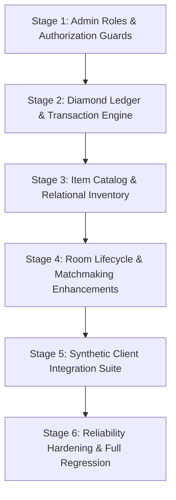

# ROS Sothat — Phase 6.2A: Independent Backend Audit & Implementation Plan

**Date**: November 11, 2026  
**Auditor & Implementation Agent**: Antigravity (Advanced Agentic Coding Assistant)  
**Target Platform**: Independent Private Server Backend (Targeting Synthetic Clients & Automated Test Harnesses)  
**Mode**: Clean-Room Development (Option A Confirmed). Original iOS IPA strictly untouched. No IPA patching or re-signing. No `loginapp.pubkey` replacement. No claims of original iOS client compatibility. Localhost/private test traffic only.

---

## 1. Executive Summary

In accordance with explicit user directive, **Option A** has been selected as the governing architecture for the ROS Sothat project:
- The original Rules of Survival (ROS) Legacy iOS IPA (`RoS-Legacy-iOS.ipa`) remains completely original, unmodified, and unpatched.
- No cryptographic assets (such as `loginapp.pubkey`) will be replaced, and no native Mach-O executable code will be altered.
- ROS Sothat does **not** claim out-of-the-box compatibility with the shipping iOS client (prevented by the client's embedded 1024-bit RSA key and Blowfish transport encryption, as established in Phase 6.1.1 and 6.1.2).
- The project proceeds as an **independent private-server backend**, fully tested and validated using synthetic clients, protocol simulators, and automated test suites.

This report conducts a thorough, read-only audit of the existing `ros-private-server` repository and delivers a concrete, production-grade implementation plan for the core gameplay and administrative subsystems required for Phase 6.2:
1. **Admin Roles & Protected Endpoints**: RBAC authorization (`admin` vs `player`), privilege guards, and moderation tools.
2. **Diamond Currency Ledger & Transaction Safeguards**: Idempotent currency operations, negative balance prevention, and an immutable audit ledger (`DiamondTransaction`).
3. **Item Catalog & Player Inventory System**: Relational separation of static item catalog definitions from dynamic player-owned inventories and equipment states.
4. **Private-Room Lifecycle & Matchmaking Enhancements**: Advanced room management, host controls, search filters, and party-aware matchmaking.
5. **Synthetic Client Integration Test Suite**: End-to-end multi-client simulation validating REST, discovery, and Mercury UDP transport layers.
6. **Reliability & Regression Safeguards**: Zero regression on the verified 72-test baseline.

---

## 2. Verified Current State Audit

A read-only audit of `C:\Users\MSI\Downloads\Telegram Desktop\ROS-Legacy-Analysis\ros-private-server` was conducted on November 11, 2026.

### 2.1 Workspace & Git Repository Status
- **Git Tracking**: Neither the workspace root nor `ros-private-server/` contains a `.git` metadata repository (standard unpacked source directory).
- **Directory Layout**:
  ```text
  ros-private-server/
  ├── app/
  │   ├── account/          (Account models, schemas, repository, service, router, rate limiter)
  │   ├── database/         (Async SQLAlchemy engine, Base, session dependency)
  │   ├── lobby/            (In-memory lobby presence, heartbeat tracking, schemas, router)
  │   ├── matchmaking/      (Ticket queue, pairing logic, schemas, router)
  │   ├── player/           (Character profile, appearances/settings JSON, schemas, router)
  │   ├── room/             (In-memory custom room lifecycle, password protection, schemas, router)
  │   ├── config.py         (Pydantic Settings: TTLs, rate limits, worker guards)
  │   ├── logging_config.py (Standardized structured logging)
  │   └── main.py           (FastAPI application entrypoint, CORS, lifespan, cleanup loop)
  ├── discovery/
  │   ├── config.py         (ServerEntry models, cluster environment settings)
  │   ├── parser.py         (Clean-room replica of client server_list parser)
  │   ├── service.py        (server_list_ios.txt generator with self-validation)
  │   └── router.py         (Root discovery endpoints: /server_list_ios.txt, notices)
  ├── gateway/
  │   ├── adapter.py        (SessionRegistry, BackendAdapter bridging UDP to REST services)
  │   ├── constants.py      (Logon status codes, session lifecycle states)
  │   └── handshake.py      (LoginApp RSA handshake specifications & LocalRSATestHarness)
  ├── mercury/
  │   ├── channel.py        (Sliding window sequencing, ACK processing, 256-packet overflow guard)
  │   ├── constants.py      (16-bit flag bitmasks, packet MTU, length formats)
  │   ├── message.py        (Bundled message multiplexer: 1-byte ID, 2-byte variable length)
  │   ├── packet.py         (MercuryPacket framing with reverse-order tail footers)
  │   └── transport.py      (AsyncIO DatagramProtocol socket listener & dispatch loop)
  ├── migrations/
  │   └── 001_add_device_id.sql (SQL documentation for device_id column)
  ├── tests/                (72 automated test cases across 11 test modules)
  ├── pytest.ini            (AsyncIO test runner configuration)
  └── requirements.txt      (fastapi, uvicorn, sqlalchemy, aiosqlite, cryptography, pytest)
  ```

### 2.2 Database Layer & Storage State
- **ORM**: SQLAlchemy 2.0 with asynchronous drivers (`sqlite+aiosqlite` for local development, `postgresql+asyncpg` supported).
- **Schema Management**: Tables are created automatically on startup via `Base.metadata.create_all` during lifespan initialization (`app/main.py`).
- **Physical Database Files**: Zero physical SQLite database files (`*.db`) exist in the tree. Automated tests run against an in-memory SQLite database (`sqlite+aiosqlite:///:memory:`) using `StaticPool` for thread isolation.
- **Migration History**: Only `001_add_device_id.sql` exists as a reference migration script. No active migration framework (e.g. Alembic) is configured.

### 2.3 Automated Test Suite Baseline
The entire test suite was executed without modifying project code:
- **Command**: `cd ros-private-server; python -m pytest -v`
- **Result**: **72 passed in 5.19 seconds (100% success)**.
- **Breakdown**:
  - `test_account.py`: 4 tests (health check, register/login, guest login, auth me).
  - `test_discovery.py`: 14 tests (11-column server list parsing, validation, endpoints).
  - `test_gateway_adapter.py`: 5 tests (session registration, lobby presence binding, cleanup).
  - `test_handshake.py`: 6 tests (RSA serialization, encryption/decryption flow, corrupted ciphertext).
  - `test_lobby.py`: 2 tests (presence lifecycle, character prerequisites).
  - `test_matchmaking.py`: 2 tests (ticket queue, player pairing).
  - `test_mercury_protocol.py`: 16 tests (packet framing, reverse footers, checksums, malformed packet rejection).
  - `test_mercury_transport.py`: 7 tests (UDP listener startup/shutdown, live datagram receipt/ACK, duplicate detection).
  - `test_player.py`: 3 tests (character creation, nickname uniqueness, settings/appearances).
  - `test_remediation.py`: 12 tests (guest persistence, worker safeguard, room/matchmaking cleanups, rate limits).
  - `test_room.py`: 1 test (room management, member join/ready/start).

---

## 3. Technical Gaps Analysis

While the core foundation is robust and fully tested, an audit against Phase 6.2 objectives identifies significant feature and architectural gaps:

```
+----------------------------------------------------------------------------------------------------+
| Feature Area             | Current State                       | Technical Gap                     |
+--------------------------+-------------------------------------+-----------------------------------+
| 1. Admin Roles & RBAC    | Account has no role/permission.     | No Admin role, no role claim in   |
|                          | All authenticated users equal.      | token, no get_current_admin guard,|
|                          |                                     | no admin moderation endpoints.    |
+--------------------------+-------------------------------------+-----------------------------------+
| 2. Diamond Currency      | Character has static integer        | No transaction history, no grant/ |
|    Management            | diamonds: BigInteger = 100.         | deduct endpoints, no negative     |
|                          |                                     | balance guard, no idempotency key.|
+--------------------------+-------------------------------------+-----------------------------------+
| 3. Item Catalog &        | JSON blob inside Character:         | No catalog definition table, no   |
|    Player Inventory      | appearances: {"unlocked_items": []} | item categories, no item grants,  |
|                          |                                     | no relational inventory table.    |
+--------------------------+-------------------------------------+-----------------------------------+
| 4. Private-Room &        | In-memory RoomService with basic    | Missing room search filters, host |
|    Matchmaking           | create/join/ready/start.            | transfer, party queues, match     |
|                          |                                     | cancellation timeout handling.    |
+--------------------------+-------------------------------------+-----------------------------------+
| 5. Synthetic Integration | Unit tests test UDP socket and REST | No synthetic bot simulating full  |
|    Testing               | in complete isolation.              | player journey: HTTP Auth -> UDP  |
|                          |                                     | Mercury -> Lobby -> Matchmaking.  |
+--------------------------+-------------------------------------+-----------------------------------+
```

---

## 4. Prioritized Implementation Roadmap

To maintain stability and ensure zero regression of existing functionality, the implementation is broken into 6 prioritized stages:



### Stage 1: Admin Roles & Authorization Infrastructure
- Extend `Account` model with a `role` field (`"player"` vs `"admin"`).
- Update token generation and verification to propagate roles.
- Create `get_current_admin` FastAPI security dependency.
- Create `/api/v1/admin/accounts` router for user management and account banning.

### Stage 2: Diamond Currency Ledger & Safeguards
- Create relational `DiamondTransaction` model (`id`, `character_gid`, `admin_account_id`, `amount`, `balance_before`, `balance_after`, `reason`, `idempotency_key`, `created_at`).
- Implement atomic grant and deduct operations with strict database transaction locking (`async with session.begin():`).
- Enforce strict invariants:
  - **Negative Balance Safeguard**: Operations resulting in `balance_after < 0` raise `400 Bad Request`.
  - **Idempotency Guard**: Duplicate `idempotency_key` returns previous transaction record without reapplying changes.
  - **Audit Immutability**: Diamond balances can only change through a recorded ledger transaction.
- Create admin endpoints (`/api/v1/admin/characters/{gid}/diamonds/*`) and player transaction history view.

### Stage 3: Item Catalog & Player Inventory System
- Create `ItemCatalog` model: static definitions of available game items (clothing, parachute skins, weapon skins, crates) with metadata (`item_id`, `name`, `category`, `rarity`, `diamond_cost`, `gold_cost`, `is_active`).
- Create `PlayerInventory` model: relational representation of ownership (`character_gid`, `item_id`, `quantity`, `is_equipped`, `acquired_at`).
- Implement equip/unequip logic validating item category slots.
- Expose public catalog browsing and player inventory management endpoints.

### Stage 4: Room Lifecycle & Matchmaking Enhancements
- Implement room search and filtering (by map, team mode, room name, open slots).
- Implement host transfer logic when room host leaves (promoting next eligible member rather than immediately terminating the room).
- Support group/team matchmaking ticket creation (queuing pairs or squads together).
- Add ticket polling / notification endpoints for match ready events.

### Stage 5: Synthetic Client Integration Test Suite
- Develop `SyntheticClient` test harness class:
  - Executes HTTP registration, login, character creation, and catalog interaction.
  - Opens UDP socket to `MercuryTransportServer`, sends sequenced reliable packets, parses reverse footers, and sends ACKs.
  - Coordinates lobby presence with UDP keepalive datagrams.
- Create end-to-end multi-client integration tests:
  - 4 synthetic clients joining a private room, toggling ready, and launching a match.
  - Concurrent synthetic matchmaking queue pairing.

### Stage 6: Reliability Hardening & Regression Verification
- Run complete test suite (baseline 72 tests + all newly created test suites).
- Verify concurrency safety, rate limiting resilience, and memory leak prevention.

---

## 5. File-Level Implementation Plan

### 5.1 Existing Files to Modify

| File Path | Planned Modifications |
|---|---|
| `app/account/models.py` | Add `role: Mapped[str] = mapped_column(String(16), default="player", nullable=False)`. |
| `app/account/schemas.py` | Add `role` to `AccountOut`, create `AccountRoleUpdate` and `AccountBanRequest`. |
| `app/account/service.py` | Include `role` in `create_token` payload. Add `get_current_admin` dependency checking `account.role == "admin"`. |
| `app/account/repository.py`| Add `set_role`, `set_banned`, and `list_accounts` repository methods. |
| `app/player/models.py` | Add SQLAlchemy relationships to `DiamondTransaction` and `PlayerInventory`. |
| `app/player/schemas.py` | Add inventory and diamond transaction response schemas. |
| `app/room/service.py` | Add host promotion upon host departure; add filtering/search support to `list_rooms`. |
| `app/room/router.py` | Add query parameters for room filtering (`map_id`, `team_mode`, `has_slots`). |
| `app/main.py` | Register new routers: `admin_router`, `catalog_router`, and `inventory_router`. |

### 5.2 New Files to Create

```text
ros-private-server/
├── app/
│   ├── admin/
│   │   ├── __init__.py         (Admin package initialization)
│   │   ├── router.py           (Protected admin endpoints: accounts, bans, diamonds)
│   │   ├── schemas.py          (Admin request/response data models)
│   │   └── service.py          (Admin business logic & system telemetry aggregation)
│   ├── economy/
│   │   ├── __init__.py         (Economy package initialization)
│   │   ├── models.py           (DiamondTransaction model with balance constraints)
│   │   ├── schemas.py          (DiamondGrantRequest, DiamondRevokeRequest, TransactionOut)
│   │   ├── service.py          (Atomic ledger transaction engine with idempotency checks)
│   │   └── router.py           (Player self-service diamond history endpoint)
│   ├── inventory/
│   │   ├── __init__.py         (Inventory package initialization)
│   │   ├── models.py           (ItemCatalog and PlayerInventory SQLAlchemy models)
│   │   ├── schemas.py          (CatalogItemOut, InventoryItemOut, EquipRequest)
│   │   ├── service.py          (Item granting, equipment validation, catalog retrieval)
│   │   └── router.py           (Public /catalog and protected /player/inventory endpoints)
├── tests/
│   ├── test_admin.py           (RBAC, unauthorized rejection, admin account moderation)
│   ├── test_economy.py         (Atomic diamond grants, revokes, negative balance prevention, idempotency)
│   ├── test_inventory.py       (Catalog definitions, item ownership, equip/unequip conflicts)
│   ├── test_room_advanced.py   (Host transfer, search filters, capacity limits)
│   └── test_synthetic_client.py(Multi-client end-to-end integration across REST and UDP Mercury)
```

---

## 6. Detailed API Endpoint Specifications

### 6.1 Admin & Moderation Endpoints (`/api/v1/admin`)

| Method | Endpoint | Auth | Description | Status Codes |
|---|---|---|---|---|
| `GET` | `/api/v1/admin/accounts` | Admin | List accounts with pagination and role filter | `200`, `401`, `403` |
| `POST`| `/api/v1/admin/accounts/{id}/role` | Admin | Promote/demote account role (`player` $\leftrightarrow$ `admin`) | `200`, `400`, `401`, `403`, `404` |
| `POST`| `/api/v1/admin/accounts/{id}/ban` | Admin | Ban/unban an account with reason string | `200`, `401`, `403`, `404` |
| `GET` | `/api/v1/admin/system/stats` | Admin | Real-time counts: accounts, lobby presences, rooms, tickets | `200`, `401`, `403` |

### 6.2 Diamond Currency Operations (`/api/v1/admin/characters/{gid}/diamonds`)

| Method | Endpoint | Auth | Description | Status Codes |
|---|---|---|---|---|
| `POST`| `/api/v1/admin/characters/{gid}/diamonds/grant` | Admin | Atomically add diamonds and record ledger transaction | `200`, `400`, `401`, `403`, `404`, `409` |
| `POST`| `/api/v1/admin/characters/{gid}/diamonds/revoke`| Admin | Atomically deduct diamonds with negative balance safeguard | `200`, `400`, `401`, `403`, `404`, `409` |
| `GET` | `/api/v1/admin/characters/{gid}/diamonds/history`| Admin | Retrieve full transaction ledger for character | `200`, `401`, `403`, `404` |
| `GET` | `/api/v1/player/diamonds/history` | Player | Player retrieves their own diamond transaction ledger | `200`, `401`, `404` |

#### Diamond Grant Payload Example (`DiamondGrantRequest`):
```json
{
  "amount": 500,
  "reason": "Phase 6.2 Alpha Tester Reward",
  "idempotency_key": "reward_20261111_alpha_001"
}
```

### 6.3 Item Catalog & Inventory (`/api/v1/catalog`, `/api/v1/player/inventory`)

| Method | Endpoint | Auth | Description | Status Codes |
|---|---|---|---|---|
| `GET` | `/api/v1/catalog/items` | None / Auth | Retrieve list of active catalog items | `200` |
| `GET` | `/api/v1/player/inventory` | Player | Retrieve items owned by authenticated player | `200`, `401`, `404` |
| `POST`| `/api/v1/player/inventory/equip` | Player | Equip owned cosmetic/skin to character slot | `200`, `400`, `401`, `404` |
| `POST`| `/api/v1/player/inventory/unequip` | Player | Unequip cosmetic item from active slot | `200`, `400`, `401`, `404` |
| `POST`| `/api/v1/admin/characters/{gid}/inventory/grant` | Admin | Admin grants catalog item to character | `200`, `400`, `401`, `403`, `404` |

---

## 7. Data Model Changes & Invariants

```
+--------------------------------------------------------------------------------------------------+
|                                    Relational Data Architecture                                  |
+--------------------------------------------------------------------------------------------------+
|                                                                                                  |
|   +--------------------------+                 +-------------------------------+                 |
|   |         Account          |                 |           Character           |                 |
|   +--------------------------+                 +-------------------------------+                 |
|   | id: Integer (PK)         | 1             1 | gid: BigInteger (PK)          |                 |
|   | username: String(64)     |---------------->| account_id: Integer (FK, UQ)  |                 |
|   | role: String(16) [NEW]   |                 | nickname: String(64)          |                 |
|   | is_banned: Boolean       |                 | diamonds: BigInteger          |                 |
|   +--------------------------+                 +-------------------------------+                 |
|                                                                | 1                               |
|                                                                |                                 |
|                                          +---------------------+---------------------+           |
|                                          | 1..*                                      | 0..*      |
|                                          v                                           v           |
|                       +----------------------------------+        +--------------------------+   |
|                       |        DiamondTransaction        |        |     PlayerInventory      |   |
|                       +----------------------------------+        +--------------------------+   |
|                       | id: BigInteger (PK)              |        | id: BigInteger (PK)      |   |
|                       | character_gid: BigInteger (FK)   |        | character_gid: (FK)      |   |
|                       | admin_account_id: Integer (FK)   |        | item_id: Integer (FK)    |   |
|                       | amount: BigInteger               |        | quantity: Integer        |   |
|                       | balance_before: BigInteger       |        | is_equipped: Boolean     |   |
|                       | balance_after: BigInteger        |        +--------------------------+   |
|                       | idempotency_key: String(64) (UQ) |                       | *             |
|                       +----------------------------------+                       |               |
|                                                                                  |               |
|                                                                                  v 1             |
|                                                                   +--------------------------+   |
|                                                                   |       ItemCatalog        |   |
|                                                                   +--------------------------+   |
|                                                                   | item_id: Integer (PK)    |   |
|                                                                   | name: String(64)         |   |
|                                                                   | category: String(32)     |   |
|                                                                   | rarity: Integer          |   |
|                                                                   | price_diamonds: Integer  |   |
|                                                                   +--------------------------+   |
+--------------------------------------------------------------------------------------------------+
```

### Critical Safeguards & Invariants

1. **Negative Balance Enforcement**:
   - `balance_after = character.diamonds + amount`
   - If `balance_after < 0`, the transaction is immediately rejected with HTTP `400 Bad Request ("Insufficient diamond balance.")`.
   - SQLite/PostgreSQL `CheckConstraint("diamonds >= 0", name="chk_character_diamonds_non_negative")` added to `Character`.
2. **Idempotency Protection**:
   - `DiamondTransaction.idempotency_key` is marked `unique=True, index=True`.
   - If an admin endpoint receives an already-processed `idempotency_key`, the service returns the existing transaction without executing duplicate debit/credit actions.
3. **Transaction Atomicity**:
   - Balance mutation and transaction logging occur inside a single atomic database transaction (`async with session.begin():`). If ledger creation fails, balance mutation is rolled back.
4. **Catalog vs Ownership Decoupling**:
   - `ItemCatalog` entries represent immutable master item metadata.
   - `PlayerInventory` tracks dynamic ownership. Equipping an item modifies `is_equipped` on the inventory row and synchronizes `Character.appearances["equipped_clothing"]` for client compatibility.

---

## 8. Synthetic Client Architecture & Test Strategy

Because no original iOS client is claimed to be compatible, quality assurance relies on synthetic clients simulating full client behavior.

### 8.1 SyntheticClient Design
```python
class SyntheticClient:
    """
    Simulates a complete player session interacting with ROS Sothat private server:
    1. HTTP REST Authentication (Guest or Account)
    2. Character Creation and Customization
    3. Server Discovery (/server_list_ios.txt)
    4. UDP Mercury Socket Transport (Sequencing, ACKs, Handshake)
    5. Room Creation, Joining, Ready Toggles, and Matchmaking Enqueue
    """
    def __init__(self, base_http_url: str, udp_host: str, udp_port: int):
        self.http_client = httpx.AsyncClient(base_url=base_http_url)
        self.udp_addr = (udp_host, udp_port)
        self.token: Optional[str] = None
        self.gid: Optional[int] = None
        self.channel: Optional[MercuryChannel] = None
        self.udp_sock: Optional[socket.socket] = None
```

### 8.2 Test Suites to Implement

| Test Suite | Purpose | Target Tests |
|---|---|---|
| `test_admin.py` | Verify RBAC: unauthenticated rejection, regular player 403, admin access, ban enforcement | 8 unit tests |
| `test_economy.py` | Verify diamond grants, deductions, negative balance guard, idempotency replay, audit logs | 10 unit tests |
| `test_inventory.py` | Verify catalog listing, inventory granting, equipping/unequipping, duplicate ownership rules | 8 unit tests |
| `test_room_advanced.py` | Verify room search filters, password verification, host departure promotion, slot limits | 6 unit tests |
| `test_synthetic_client.py` | End-to-end multi-client simulation across REST and UDP Mercury sockets | 6 integration tests |

**Total Proposed New Tests**: ~38 tests  
**Projected Total Suite**: $\approx 110$ passing automated tests.

---

## 9. Risk Analysis & Mitigations

| Risk | Severity | Potential Impact | Mitigation Strategy |
|---|---|---|---|
| **Currency Race Conditions** | High | Concurrent grant/revoke requests could result in balance inconsistency. | Enforce database-level row locking (`select(...).with_for_update()`) and atomic transaction blocks in `EconomyService`. |
| **In-Memory State Desynchronization** | Medium | Running multiple server workers breaks room/matchmaking state. | Retain strict `validate_single_worker_configuration` startup guard in `main.py`. |
| **Schema Migration Conflicts** | Low | Modifying models in SQLite could fail without migrations. | `Base.metadata.create_all` automatically provisions new tables in SQLite test environments. Document standard non-destructive SQL in `migrations/002_add_economy_and_inventory.sql`. |
| **Scope Creep / iOS Distraction** | High | Attempting to connect unmodified IPA before backend is solid. | Strictly follow Option A: synthetic clients and automated test suites only. No IPA asset modification. |

---

## 10. Proposed First Implementation Milestone: Milestone 6.2A.1

To ensure controlled, reviewable progress, the first implementation step upon approval will be:

### **Milestone 6.2A.1: Admin Roles & Diamond Transaction Ledger**
1. Update `Account` model with `role` column (`player` default, `admin` supported).
2. Create `get_current_admin` security dependency.
3. Create `DiamondTransaction` database model with non-negative check constraint.
4. Implement `EconomyService` providing atomic grant/deduct methods with idempotency keys.
5. Create admin endpoints for diamond grants, deductions, and audit ledger history.
6. Create `tests/test_admin.py` and `tests/test_economy.py`.
7. Verify all 72 existing tests + new economy/admin tests pass with 100% success.

---

## 11. Conclusion & Stop for Approval

This audit and plan provides a complete, risk-managed roadmap for building an independent private server backend under Option A.

In strict adherence to project instructions:
- **No code, database records, or migrations have been modified during this stage**.
- **The original IPA remains completely untouched**.
- **The 72 existing automated tests have been verified passing in 5.19s**.
- **All further work is paused awaiting your review and explicit approval of this plan**.
